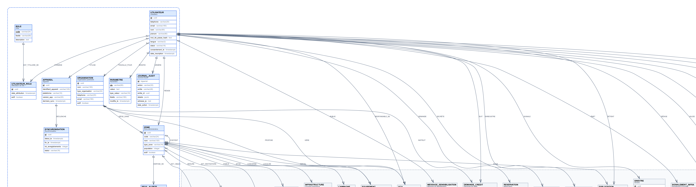
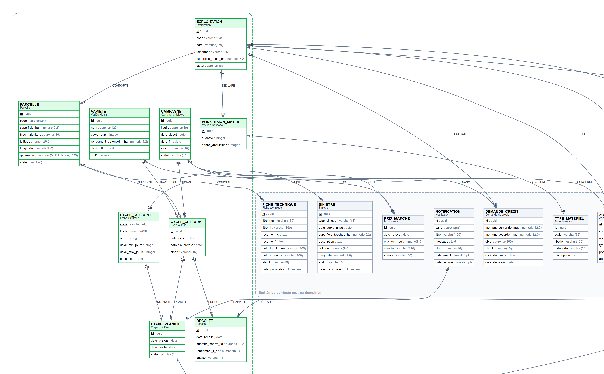
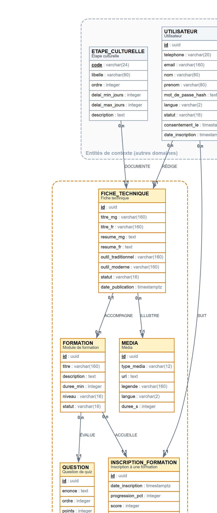
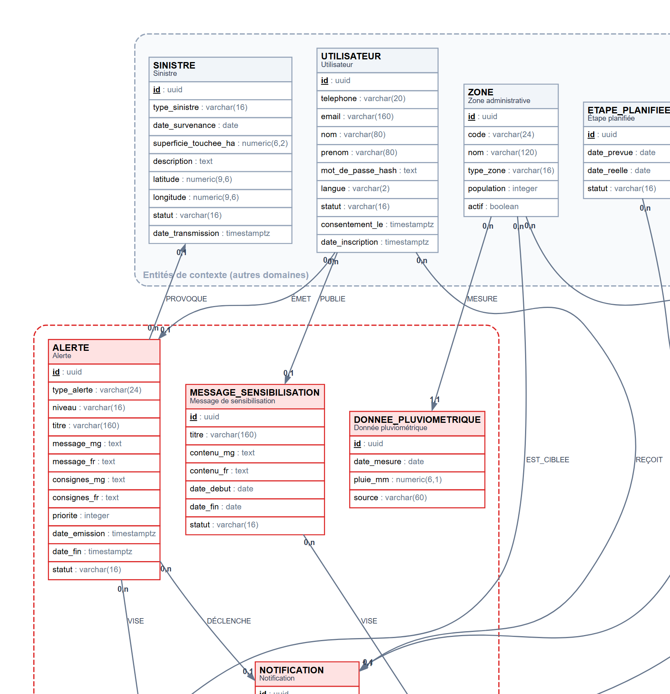
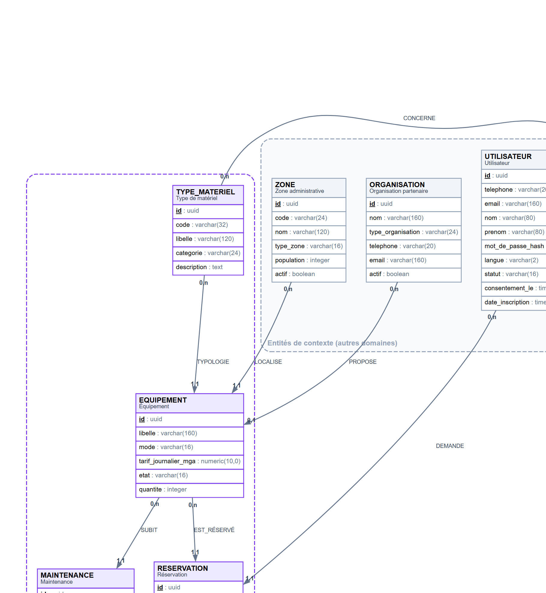
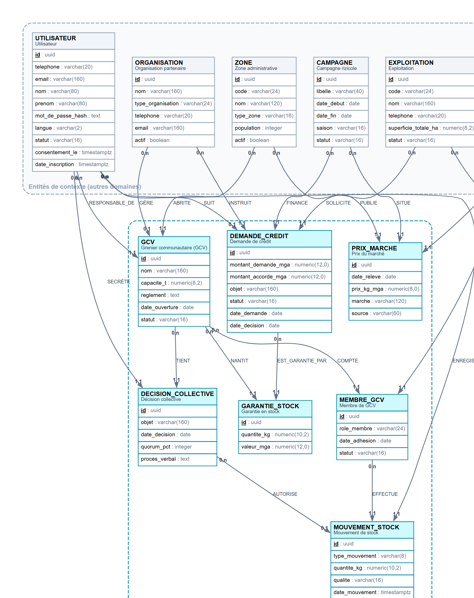
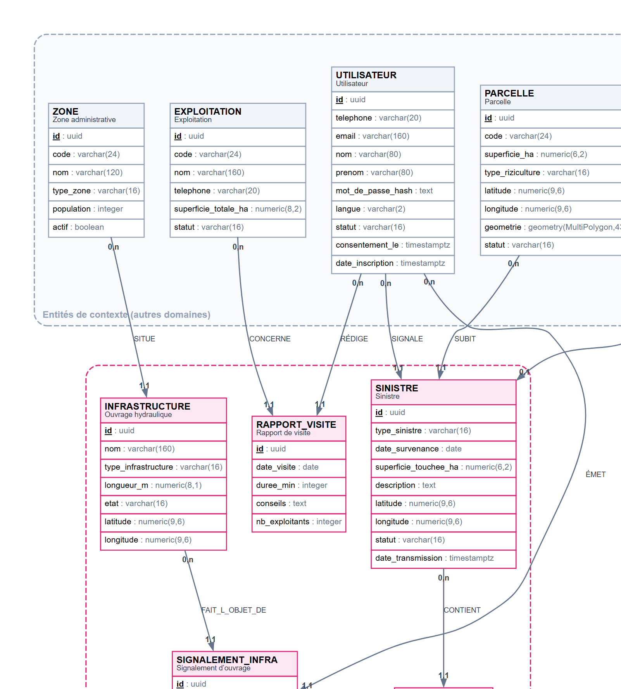

# MCD — Modèle Conceptuel de Données

**Projet :** RizConnect Madagascar · version 1.0 · 49 entités, 79 associations
**Source :** `hh.sh` — cahier des charges, modules M1 à M10 et règles de gestion RG-01 à RG-07
**Notation :** Merise (entité – association – entité), cardinalités `(min,max)`

---

## 1. Objet du document

Ce document décrit le **modèle conceptuel** de la plateforme RizConnect : les objets métier
(entités), leurs propriétés (attributs) et les liens qui les unissent (associations), sans
aucune référence à un langage ou à un SGBD. Il est indépendant de l'implémentation et sert
de contrat entre la maîtrise d'ouvrage (MAEP, BNGRC, coopératives, IMF) et l'équipe technique.

Le MCD est la première étape de la chaîne Merise du projet :

| Étape | Document | Répond à la question |
| --- | --- | --- |
| Conceptuel | **MCD** (ce document) | *Quelles données le métier manipule-t-il ?* |
| Logique | [MLD](MLD.md) | *Comment les stocker dans une base relationnelle ?* |
| Traitements | [MCT](MCT.md) | *Quels événements déclenchent quels traitements ?* |

---

## 2. Démarche de construction

Le cahier des charges ne décrit pas de base de données : il décrit des **besoins
fonctionnels** (RF-01 à RF-50) et des **règles de gestion** (RG-01 à RG-07). Le passage du
texte au modèle a suivi quatre étapes.

1. **Repérage des objets** : chaque groupe nominal récurrent du cahier des charges devient
   une entité candidate (« exploitation », « parcelle », « alerte », « dépôt », « sinistre »…).
2. **Repérage des associations** : les verbes et les dépendances fonctionnelles deviennent
   des associations (« un exploitant détient des exploitations », « une parcelle subit des
   sinistres »…).
3. **Choix des identifiants** : identifiant technique `id` systématique (UUID), plus une clé
   candidate métier quand elle existe (téléphone, code de zone, numéro de reçu).
4. **Vérification** : chaque exigence RF doit être couverte par au moins une entité ou une
   association, et chaque règle RG doit être traduisible par une contrainte du modèle.

### 2.1 Couverture des modules du cahier des charges

| Module | Exigences | Entités principalement mobilisées |
| --- | --- | --- |
| M1 — Comptes et utilisateurs | RF-01 à RF-04 | `UTILISATEUR`, `ROLE`, `UTILISATEUR_ROLE`, `ZONE`, `ORGANISATION` |
| M2 — Exploitations et parcelles | RF-05 à RF-08 | `EXPLOITATION`, `PARCELLE`, `POSSESSION_MATERIEL`, `VARIETE` |
| M3 — Calendrier cultural | RF-09 à RF-13 | `CYCLE_CULTURAL`, `ETAPE_CULTURELLE`, `ETAPE_PLANIFIEE`, `DECALAGE`, `NOTIFICATION` |
| M4 — Bibliothèque et formation | RF-14 à RF-19 | `FICHE_TECHNIQUE`, `MEDIA`, `FORMATION`, `QUESTION`, `CHOIX_REPONSE`, `INSCRIPTION_FORMATION` |
| M5 — Alertes climatiques | RF-20 à RF-25 | `ALERTE`, `CIBLAGE_ALERTE`, `NOTIFICATION`, `DONNEE_PLUVIOMETRIQUE`, `SEUIL_ALERTE` |
| M6 — Matériel agricole | RF-26 à RF-30 | `TYPE_MATERIEL`, `EQUIPEMENT`, `RESERVATION`, `MAINTENANCE` |
| M7 — Financement, GCV, stocks | RF-31 à RF-36 | `GCV`, `MEMBRE_GCV`, `MOUVEMENT_STOCK`, `RECU`, `DEMANDE_CREDIT`, `GARANTIE_STOCK`, `PRIX_MARCHE` |
| M8 — Suivi de production | RF-37 à RF-41 | `RECOLTE`, `CAMPAGNE`, `RAPPORT_VISITE` |
| M9 — Sinistres et infrastructures | RF-42 à RF-45 | `SINISTRE`, `PHOTO_SINISTRE`, `INFRASTRUCTURE`, `SIGNALEMENT_INFRA` |
| M10 — Administration, sync | RF-46 à RF-50 | `PARAMETRE`, `APPAREIL`, `SYNCHRONISATION`, `JOURNAL_AUDIT` |

### 2.2 Couverture des règles de gestion

| Règle | Énoncé du cahier des charges | Traduction dans le modèle |
| --- | --- | --- |
| **RG-01** | Un calendrier est rattaché à une parcelle, une région et un type de riziculture. | CYCLE_CULTURAL → PARCELLE → EXPLOITATION → ZONE ; PARCELLE.type_riziculture ; contrainte d’unicité (parcelle_id, campagne_id). |
| **RG-02** | Premier sarclage 8 à 10 jours après repiquage, second au moins 2 semaines plus tard. | ETAPE_CULTURELLE.delai_min_jours / delai_max_jours + génération applicative (O10). |
| **RG-03** | Repiquage proposé quand les pousses atteignent 15 à 20 cm. | Paramètre seuil_hauteur_pousses_cm (PARAMETRE) + règle de l’opération O10. |
| **RG-04** | Une alerte cyclonique est prioritaire et touche toutes les exploitations de la zone ciblée. | ALERTE.priorite + CIBLAGE_ALERTE + diffusion à toutes les exploitations des zones ciblées. |
| **RG-05** | Un décalage n’est jamais appliqué sans validation de l’exploitant ou de son agent. | DECALAGE.statut = propose → valide ; DECALAGE.valide_par_id obligatoire à la validation. |
| **RG-06** | Un retrait de stock suit la décision collective prévue par les règles du grenier. | MOUVEMENT_STOCK.type_mouvement = retrait ⇒ decision_id non nul (contrainte de vérification). |
| **RG-07** | Cloisonnement des données : exploitant, agent, MAEP/BNGRC (agrégé). | UTILISATEUR_ROLE.zone_id + vues agrégées v_tableau_bord_zone + politiques RLS. |


---

## 3. Diagramme conceptuel global


*Image : `docs/images/mcd.png` (5334 × 3575 px). La version vectorielle `docs/images/mcd.svg`
reste nette à tous les niveaux de zoom ; la source Graphviz est dans `docs/sources/mcd.dot`.*

### 3.1 Représentation Mermaid (rendue par GitHub / GitLab)

```mermaid
erDiagram
  %% ZONE — Zone administrative (D1, Découpage région → district → commune → Fokontany (RF-03). Relation réflexive pour la hiérarchie.)
  ZONE {
    uuid id PK
    varchar code UK
    varchar nom
    varchar type_zone
    integer population
    boolean actif
  }
  %% ORGANISATION — Organisation partenaire (D1, Coopérative, IMF, ONG, CFAMA, MAEP, BNGRC ou service météo (RF-02, RF-26, RF-33).)
  ORGANISATION {
    uuid id PK
    varchar nom
    varchar type_organisation
    varchar telephone
    varchar email
    boolean actif
  }
  %% UTILISATEUR — Utilisateur (D1, Compte identifié par son téléphone (RF-01), rattaché à une zone et éventuellement à une organisation.)
  UTILISATEUR {
    uuid id PK
    varchar telephone UK
    varchar email UK
    varchar nom
    varchar prenom
    text mot_de_passe_hash
    varchar langue
    varchar statut
    timestamptz consentement_le
    timestamptz date_inscription
  }
  %% ROLE — Rôle (D1, Référentiel des rôles : exploitant, agent, coopérative, IMF, MAEP, BNGRC, administrateur (RF-02).)
  ROLE {
    varchar code PK
    varchar libelle
    text description
  }
  %% UTILISATEUR_ROLE — Affectation de rôle (D1, Association-entité : un utilisateur peut cumuler des rôles, avec un périmètre géographique (RG-07).)
  UTILISATEUR_ROLE {
    uuid id PK
    timestamptz date_attribution
    boolean actif
  }
  %% APPAREIL — Appareil (D1, Terminal Android ou navigateur utilisé pour la synchronisation hors ligne (RF-46).)
  APPAREIL {
    uuid id PK
    varchar identifiant_appareil UK
    varchar plateforme
    varchar version_app
    timestamptz derniere_sync
  }
  %% PARAMETRE — Paramètre (D1, Paramétrage des régions, saisons, variétés et seuils (RF-50), modifiable par un administrateur.)
  PARAMETRE {
    varchar cle PK
    text valeur
    varchar type_valeur
    varchar libelle
    timestamptz modifie_le
  }
  %% SEUIL_ALERTE — Seuil d'alerte (D1, Seuils pluviométriques par zone utilisés pour qualifier la sécheresse (RF-25, RF-50).)
  SEUIL_ALERTE {
    uuid id PK
    varchar type_alerte
    numeric cumul_10j_mm
    numeric cumul_20j_mm
    varchar niveau
    boolean actif
  }
  %% JOURNAL_AUDIT — Journal d'audit (D1, Traçabilité des actions, des synchronisations et des accès (RF-49).)
  JOURNAL_AUDIT {
    bigserial id PK
    varchar action
    varchar entite
    uuid entite_id
    jsonb details
    inet adresse_ip
    timestamptz date_action
  }
  %% SYNCHRONISATION — Synchronisation (D1, Journal des remontées hors ligne (RF-46) : volume, durée, conflits éventuels.)
  SYNCHRONISATION {
    uuid id PK
    timestamptz debut_le
    timestamptz fin_le
    integer nb_enregistrements
    varchar statut
  }
  %% EXPLOITATION — Exploitation (D2, Unité de production d'un exploitant dans un Fokontany (RF-05).)
  EXPLOITATION {
    uuid id PK
    varchar code UK
    varchar nom
    varchar telephone
    numeric superficie_totale_ha
    varchar statut
  }
  %% PARCELLE — Parcelle (D2, Rizière localisée et géométrisée (RF-05, RF-08), support du calendrier et des sinistres.)
  PARCELLE {
    uuid id PK
    varchar code
    numeric superficie_ha
    varchar type_riziculture
    numeric latitude
    numeric longitude
    geometry geometrie
    varchar statut
  }
  %% VARIETE — Variété de riz (D2, Référentiel des variétés (RF-07, RF-50) : durée de cycle et potentiel de rendement.)
  VARIETE {
    uuid id PK
    varchar nom UK
    integer cycle_jours
    numeric rendement_potentiel_t_ha
    text description
    boolean actif
  }
  %% CAMPAGNE — Campagne rizicole (D2, Période de production (grande saison / contre-saison) servant de référentiel temporel (RF-07, RF-37).)
  CAMPAGNE {
    uuid id PK
    varchar libelle UK
    date date_debut
    date date_fin
    varchar saison
    varchar statut
  }
  %% CYCLE_CULTURAL — Cycle cultural (D2, Culture d'une variété sur une parcelle pendant une campagne : point d'entrée du calendrier (RG-01).)
  CYCLE_CULTURAL {
    uuid id PK
    date date_debut
    date date_fin_prevue
    varchar statut
  }
  %% ETAPE_CULTURELLE — Étape culturelle (D2, Référentiel des étapes : travail du sol, semis, repiquage, sarclage, moisson, battage (RF-09, RF-14).)
  ETAPE_CULTURELLE {
    varchar code PK
    varchar libelle
    integer ordre
    integer delai_min_jours
    integer delai_max_jours
    text description
  }
  %% ETAPE_PLANIFIEE — Étape planifiée (D2, Occurrence datée d'une étape pour un cycle (RF-09, RF-12), base des rappels.)
  ETAPE_PLANIFIEE {
    uuid id PK
    date date_prevue
    date date_reelle
    varchar statut
  }
  %% DECALAGE — Décalage de calendrier (D2, Proposition de report d'une étape, jamais appliquée sans validation (RF-11, RG-05).)
  DECALAGE {
    uuid id PK
    date date_proposee
    varchar motif
    varchar source
    varchar statut
    timestamptz date_validation
  }
  %% RECOLTE — Récolte (D2, Déclaration de récolte d'un cycle et rendement calculé en t/ha (RF-07, RF-37).)
  RECOLTE {
    uuid id PK
    date date_recolte
    numeric quantite_paddy_kg
    numeric rendement_t_ha
    varchar qualite
  }
  %% POSSESSION_MATERIEL — Matériel possédé (D2, Matériel déclaré par une exploitation (RF-06), utilisé pour personnaliser les conseils (RF-19, RF-39).)
  POSSESSION_MATERIEL {
    uuid id PK
    integer quantite
    integer annee_acquisition
  }
  %% FICHE_TECHNIQUE — Fiche technique (D3, Fiche pratique par étape : technique, outil traditionnel et outil moderne équivalent (RF-14, RF-16, RF-47).)
  FICHE_TECHNIQUE {
    uuid id PK
    varchar titre_mg
    varchar titre_fr
    text resume_mg
    text resume_fr
    varchar outil_traditionnel
    varchar outil_moderne
    varchar statut
    timestamptz date_publication
  }
  %% MEDIA — Média (D3, Illustration, vidéo courte ou lecture audio d'une fiche, par langue (RF-15).)
  MEDIA {
    uuid id PK
    varchar type_media
    text url
    varchar legende
    varchar langue
    integer duree_s
  }
  %% FORMATION — Module de formation (D3, Formation courte avec quiz et suivi de progression (RF-17).)
  FORMATION {
    uuid id PK
    varchar titre
    text description
    integer duree_min
    varchar niveau
    varchar statut
  }
  %% QUESTION — Question de quiz (D3, Question d'évaluation rattachée à un module de formation (RF-17).)
  QUESTION {
    uuid id PK
    text enonce
    integer ordre
    integer points
  }
  %% CHOIX_REPONSE — Choix de réponse (D3, Proposition de réponse, une seule correcte par question (RF-17).)
  CHOIX_REPONSE {
    uuid id PK
    varchar libelle
    boolean correcte
    integer ordre
  }
  %% INSCRIPTION_FORMATION — Inscription à une formation (D3, Suivi individuel : progression et score (RF-17).)
  INSCRIPTION_FORMATION {
    uuid id PK
    timestamptz date_inscription
    integer progression_pct
    integer score
    varchar statut
  }
  %% ALERTE — Alerte (D4, Alerte climatique ou sanitaire émise par le BNGRC ou la météo, prioritaire sur tout autre message (RF-20 à RF-23, RG-04).)
  ALERTE {
    uuid id PK
    varchar type_alerte
    varchar niveau
    varchar titre
    text message_mg
    text message_fr
    text consignes_mg
    text consignes_fr
    integer priorite
    timestamptz date_emission
    timestamptz date_fin
    varchar statut
  }
  %% CIBLAGE_ALERTE — Ciblage d'alerte (D4, Zones couvertes par une alerte (RF-23) ; une alerte peut viser plusieurs communes.)
  CIBLAGE_ALERTE {
    uuid id PK
  }
  %% NOTIFICATION — Notification (D4, Message envoyé à un utilisateur par push, SMS ou USSD, avec accusé de réception (RF-12, RF-21, RF-24).)
  NOTIFICATION {
    uuid id PK
    varchar canal
    varchar titre
    text message
    varchar statut
    timestamptz date_envoi
    timestamptz date_lecture
  }
  %% DONNEE_PLUVIOMETRIQUE — Donnée pluviométrique (D4, Relevé journalier par zone, base du calcul du déficit de pluie (RF-25).)
  DONNEE_PLUVIOMETRIQUE {
    uuid id PK
    date date_mesure
    numeric pluie_mm
    varchar source
  }
  %% MESSAGE_SENSIBILISATION — Message de sensibilisation (D4, Message de sensibilisation ciblé par commune ou Fokontany (RF-18).)
  MESSAGE_SENSIBILISATION {
    uuid id PK
    varchar titre
    text contenu_mg
    text contenu_fr
    date date_debut
    date date_fin
    varchar statut
  }
  %% CIBLAGE_MESSAGE — Ciblage de message (D4, Zones destinataires d'un message de sensibilisation (RF-18).)
  CIBLAGE_MESSAGE {
    uuid id PK
  }
  %% TYPE_MATERIEL — Type de matériel (D5, Référentiel des équipements : angady, charrue, herse, motoculteur, sarcleuse, faucille, batteuse (RF-06, RF-16, RF-26).)
  TYPE_MATERIEL {
    uuid id PK
    varchar code UK
    varchar libelle
    varchar categorie
    text description
  }
  %% EQUIPEMENT — Équipement (D5, Matériel réel mis à disposition par le CFAMA, une coopérative, une ONG ou un Fokontany (RF-26 à RF-29).)
  EQUIPEMENT {
    uuid id PK
    varchar libelle
    varchar mode
    numeric tarif_journalier_mga
    varchar etat
    integer quantite
  }
  %% RESERVATION — Réservation (D5, Demande de location ou de prêt sur une période, confirmée par le propriétaire (RF-27, RF-28).)
  RESERVATION {
    uuid id PK
    date date_debut
    date date_fin
    varchar statut
    timestamptz date_demande
    timestamptz date_reponse
    varchar motif_refus
  }
  %% MAINTENANCE — Maintenance (D5, Suivi de l'état et des interventions sur le matériel (RF-29).)
  MAINTENANCE {
    uuid id PK
    date date_intervention
    varchar type_maintenance
    numeric cout_mga
    text description
    varchar statut
  }
  %% GCV — Grenier communautaire (GCV) (D6, Grenier Commun Villageois : membres, dépôts, retraits et valeur du stock (RF-31).)
  GCV {
    uuid id PK
    varchar nom
    numeric capacite_t
    text reglement
    date date_ouverture
    varchar statut
  }
  %% MEMBRE_GCV — Membre de GCV (D6, Adhésion d'une exploitation à un grenier, avec rôle interne (RF-31).)
  MEMBRE_GCV {
    uuid id PK
    varchar role_membre
    date date_adhesion
    varchar statut
  }
  %% DECISION_COLLECTIVE — Décision collective (D6, Décision de l'assemblée du grenier autorisant un retrait ou une mise en garantie (RG-06).)
  DECISION_COLLECTIVE {
    uuid id PK
    varchar objet
    date date_decision
    integer quorum_pct
    text proces_verbal
  }
  %% MOUVEMENT_STOCK — Mouvement de stock (D6, Dépôt ou retrait de paddy, avec reçu numérique et décision collective éventuelle (RF-31, RF-32, RG-06).)
  MOUVEMENT_STOCK {
    uuid id PK
    varchar type_mouvement
    numeric quantite_kg
    varchar qualite
    timestamptz date_mouvement
  }
  %% RECU — Reçu numérique (D6, Reçu remis pour chaque dépôt ou retrait (RF-32), numéro unique et PDF archivable.)
  RECU {
    uuid id PK
    varchar numero UK
    timestamptz date_emission
    text url_pdf
  }
  %% DEMANDE_CREDIT — Demande de crédit (D6, Dossier de crédit de campagne déposé auprès d'une IMF, avec le stock comme garantie (RF-33).)
  DEMANDE_CREDIT {
    uuid id PK
    numeric montant_demande_mga
    numeric montant_accorde_mga
    varchar objet
    varchar statut
    date date_demande
    date date_decision
  }
  %% GARANTIE_STOCK — Garantie en stock (D6, Stock de paddy affecté en garantie d'un crédit (RF-33), valorisé au prix du marché.)
  GARANTIE_STOCK {
    uuid id PK
    numeric quantite_kg
    numeric valeur_mga
  }
  %% PRIX_MARCHE — Prix du marché (D6, Relevé de prix du riz par marché et par variété (RF-34, RF-35).)
  PRIX_MARCHE {
    uuid id PK
    date date_releve
    numeric prix_kg_mga
    varchar marche
    varchar source
  }
  %% SINISTRE — Sinistre (D7, Déclaration d'inondation, cyclone, sécheresse ou ravageurs avec photo et position (RF-42, RF-43).)
  SINISTRE {
    uuid id PK
    varchar type_sinistre
    date date_survenance
    numeric superficie_touchee_ha
    text description
    numeric latitude
    numeric longitude
    varchar statut
    timestamptz date_transmission
  }
  %% PHOTO_SINISTRE — Photo de sinistre (D7, Preuve photographique d'un sinistre (RF-42), collectée même hors ligne puis synchronisée.)
  PHOTO_SINISTRE {
    uuid id PK
    text url
    timestamptz date_prise
  }
  %% INFRASTRUCTURE — Ouvrage hydraulique (D7, Digue, barrage ou canal d'irrigation à entretenir (RF-44, RF-45).)
  INFRASTRUCTURE {
    uuid id PK
    varchar nom
    varchar type_infrastructure
    numeric longueur_m
    varchar etat
    numeric latitude
    numeric longitude
  }
  %% SIGNALEMENT_INFRA — Signalement d’ouvrage (D7, Signalement d'une infrastructure à réparer, suivi jusqu'à la réparation (RF-44).)
  SIGNALEMENT_INFRA {
    uuid id PK
    text description
    varchar gravite
    varchar statut
    timestamptz date_signalement
    timestamptz date_traitement
    text url_photo
  }
  %% RAPPORT_VISITE — Rapport de visite (D7, Compte rendu de la visite d'un agent de terrain : exploitants rencontrés, conseils donnés (RF-41).)
  RAPPORT_VISITE {
    uuid id PK
    date date_visite
    integer duree_min
    text conseils
    integer nb_exploitants
  }
  ZONE o{--o| ZONE : "A01 CONTIENT (0,n / 0,1)"
  ORGANISATION o{--o| ZONE : "A02 SIÈGE_DANS (0,n / 0,1)"
  UTILISATEUR o{--|| ZONE : "A03 RÉSIDE (0,n / 1,1)"
  UTILISATEUR o{--o| ORGANISATION : "A04 TRAVAILLE_POUR (0,n / 0,1)"
  UTILISATEUR o{--|| UTILISATEUR_ROLE : "A05 POSSÈDE (0,n / 1,1)"
  ROLE o{--|| UTILISATEUR_ROLE : "A06 EST_TITULAIRE_DE (0,n / 1,1)"
  UTILISATEUR o{--|| APPAREIL : "A07 UTILISE (0,n / 1,1)"
  UTILISATEUR o{--o| JOURNAL_AUDIT : "A08 GÉNÈRE (0,n / 0,1)"
  UTILISATEUR o{--o| PARAMETRE : "A09 MODIFIE (0,n / 0,1)"
  ZONE o{--|| SEUIL_ALERTE : "A10 DISPOSE_DE (0,n / 1,1)"
  ORGANISATION o{--o| GCV : "A11 GÈRE (0,n / 0,1)"
  UTILISATEUR o{--|| GCV : "A12 RESPONSABLE_DE (0,n / 1,1)"
  ZONE o{--|| GCV : "A13 ABRITE (0,n / 1,1)"
  UTILISATEUR o{--|| EXPLOITATION : "A14 DÉTIENT (0,n / 1,1)"
  ZONE o{--|| EXPLOITATION : "A15 SITUE (0,n / 1,1)"
  EXPLOITATION o{--|| PARCELLE : "A16 COMPORTE (0,n / 1,1)"
  ZONE o{--o| CAMPAGNE : "A17 CONCERNE (0,n / 0,1)"
  CAMPAGNE o{--|| CYCLE_CULTURAL : "A18 ORGANISE (0,n / 1,1)"
  PARCELLE o{--|| CYCLE_CULTURAL : "A19 SUPPORTE (0,n / 1,1)"
  VARIETE o{--|| CYCLE_CULTURAL : "A20 CARACTÉRISE (0,n / 1,1)"
  CYCLE_CULTURAL o{--|| ETAPE_PLANIFIEE : "A21 PLANIFIE (0,n / 1,1)"
  ETAPE_CULTURELLE o{--|| ETAPE_PLANIFIEE : "A22 INSTANCIE (0,n / 1,1)"
  ETAPE_PLANIFIEE o{--|| DECALAGE : "A23 FAIT_L_OBJET_DE (0,n / 1,1)"
  UTILISATEUR o{--o| DECALAGE : "A24 VALIDE (0,n / 0,1)"
  CYCLE_CULTURAL o|--|| RECOLTE : "A25 PRODUIT (0,1 / 1,1)"
  UTILISATEUR o{--|| RECOLTE : "A26 DÉCLARE (0,n / 1,1)"
  EXPLOITATION o{--|| POSSESSION_MATERIEL : "A27 DÉCLARE (0,n / 1,1)"
  TYPE_MATERIEL o{--|| POSSESSION_MATERIEL : "A28 CONCERNE (0,n / 1,1)"
  ETAPE_CULTURELLE o{--|| FICHE_TECHNIQUE : "A29 DOCUMENTE (0,n / 1,1)"
  FICHE_TECHNIQUE o{--|| MEDIA : "A30 ILLUSTRE (0,n / 1,1)"
  FICHE_TECHNIQUE o|--o{ FORMATION : "A31 ACCOMPAGNE (0,1 / 0,n)"
  FORMATION o{--|| QUESTION : "A32 ÉVALUE (0,n / 1,1)"
  QUESTION o{--|| CHOIX_REPONSE : "A33 PROPOSE (0,n / 1,1)"
  UTILISATEUR o{--|| INSCRIPTION_FORMATION : "A34 SUIT (0,n / 1,1)"
  FORMATION o{--|| INSCRIPTION_FORMATION : "A35 ACCUEILLE (0,n / 1,1)"
  UTILISATEUR o{--o| FICHE_TECHNIQUE : "A36 RÉDIGE (0,n / 0,1)"
  UTILISATEUR o{--o| ALERTE : "A37 ÉMET (0,n / 0,1)"
  ALERTE o{--|| CIBLAGE_ALERTE : "A38 VISE (0,n / 1,1)"
  ZONE o{--|| CIBLAGE_ALERTE : "A39 EST_CIBLEE (0,n / 1,1)"
  ALERTE o{--o| NOTIFICATION : "A40 DÉCLENCHE (0,n / 0,1)"
  UTILISATEUR o{--|| NOTIFICATION : "A41 REÇOIT (0,n / 1,1)"
  ETAPE_PLANIFIEE o{--o| NOTIFICATION : "A42 RAPPELLE (0,n / 0,1)"
  ZONE o{--|| DONNEE_PLUVIOMETRIQUE : "A43 MESURE (0,n / 1,1)"
  UTILISATEUR o{--o| MESSAGE_SENSIBILISATION : "A44 PUBLIE (0,n / 0,1)"
  MESSAGE_SENSIBILISATION o{--|| CIBLAGE_MESSAGE : "A45 VISE (0,n / 1,1)"
  ZONE o{--|| CIBLAGE_MESSAGE : "A46 EST_DESTINATAIRE (0,n / 1,1)"
  ZONE o{--|| PRIX_MARCHE : "A47 PUBLIE (0,n / 1,1)"
  VARIETE o{--|| PRIX_MARCHE : "A48 COTE (0,n / 1,1)"
  CAMPAGNE o{--|| PRIX_MARCHE : "A49 SITUE (0,n / 1,1)"
  TYPE_MATERIEL o{--|| EQUIPEMENT : "A50 TYPOLOGIE (0,n / 1,1)"
  ORGANISATION o{--o| EQUIPEMENT : "A51 PROPOSE (0,n / 0,1)"
  ZONE o{--|| EQUIPEMENT : "A52 LOCALISE (0,n / 1,1)"
  EQUIPEMENT o{--|| RESERVATION : "A53 EST_RÉSERVÉ (0,n / 1,1)"
  UTILISATEUR o{--|| RESERVATION : "A54 DEMANDE (0,n / 1,1)"
  EQUIPEMENT o{--|| MAINTENANCE : "A55 SUBIT (0,n / 1,1)"
  EXPLOITATION o{--|| MEMBRE_GCV : "A56 ADHÈRE (0,n / 1,1)"
  GCV o{--|| MEMBRE_GCV : "A57 COMPTE (0,n / 1,1)"
  MEMBRE_GCV o{--|| MOUVEMENT_STOCK : "A58 EFFECTUE (0,n / 1,1)"
  MOUVEMENT_STOCK o|--|| RECU : "A59 JUSTIFIE (0,1 / 1,1)"
  UTILISATEUR o{--|| MOUVEMENT_STOCK : "A60 ENREGISTRE (0,n / 1,1)"
  DECISION_COLLECTIVE o{--o| MOUVEMENT_STOCK : "A61 AUTORISE (0,n / 0,1)"
  GCV o{--|| DECISION_COLLECTIVE : "A62 TIENT (0,n / 1,1)"
  UTILISATEUR o{--|| DECISION_COLLECTIVE : "A63 SECRÈTE (0,n / 1,1)"
  EXPLOITATION o{--|| DEMANDE_CREDIT : "A64 SOLLICITE (0,n / 1,1)"
  ORGANISATION o{--|| DEMANDE_CREDIT : "A65 INSTRUIT (0,n / 1,1)"
  CAMPAGNE o{--|| DEMANDE_CREDIT : "A66 FINANCE (0,n / 1,1)"
  UTILISATEUR o{--o| DEMANDE_CREDIT : "A67 SUIT (0,n / 0,1)"
  DEMANDE_CREDIT o{--|| GARANTIE_STOCK : "A68 EST_GARANTIE_PAR (0,n / 1,1)"
  GCV o{--|| GARANTIE_STOCK : "A69 NANTIT (0,n / 1,1)"
  PARCELLE o{--|| SINISTRE : "A70 SUBIT (0,n / 1,1)"
  ALERTE o{--o| SINISTRE : "A71 PROVOQUE (0,n / 0,1)"
  UTILISATEUR o{--|| SINISTRE : "A72 SIGNALE (0,n / 1,1)"
  SINISTRE o{--|| PHOTO_SINISTRE : "A73 CONTIENT (0,n / 1,1)"
  ZONE o{--|| INFRASTRUCTURE : "A74 SITUE (0,n / 1,1)"
  INFRASTRUCTURE o{--|| SIGNALEMENT_INFRA : "A75 FAIT_L_OBJET_DE (0,n / 1,1)"
  UTILISATEUR o{--|| SIGNALEMENT_INFRA : "A76 ÉMET (0,n / 1,1)"
  UTILISATEUR o{--|| RAPPORT_VISITE : "A77 RÉDIGE (0,n / 1,1)"
  EXPLOITATION o{--|| RAPPORT_VISITE : "A78 CONCERNE (0,n / 1,1)"
  APPAREIL o{--|| SYNCHRONISATION : "A79 DÉCLENCHE (0,n / 1,1)"
```

> La notation patte de corbeau de Mermaid porte la même information que les cardinalités
> Merise `(min,max)` : le symbole placé près d'une entité indique combien de fois cette
> entité participe à la relation. Le libellé de chaque lien rappelle les deux cardinalités.

### 3.2 Lecture détaillée par domaine

Le diagramme global est dense (49 entités). Les sept vues suivantes
reprennent chaque domaine avec ses entités de contexte, pour une lecture à l'écran sans
zoom.

#### D1 — Comptes, référentiel et administration

Modules M1 · M10 · 10 entités. Les entités grisées relèvent d'autres domaines : elles ne figurent là que pour lire les associations.



*`docs/images/mcd-D1.png` (8178 × 2206 px) — source : `docs/sources/mcd-D1.dot`.*

#### D2 — Exploitations, parcelles et calendrier cultural

Modules M2 · M3 · M8 · 10 entités. Les entités grisées relèvent d'autres domaines : elles ne figurent là que pour lire les associations.



*`docs/images/mcd-D2.png` (4088 × 2532 px) — source : `docs/sources/mcd-D2.dot`.*

#### D3 — Bibliothèque technique et formation

Modules M4 · 6 entités. Les entités grisées relèvent d'autres domaines : elles ne figurent là que pour lire les associations.



*`docs/images/mcd-D3.png` (1022 × 2406 px) — source : `docs/sources/mcd-D3.dot`.*

#### D4 — Alertes, météo et sensibilisation

Modules M5 · M10 · 6 entités. Les entités grisées relèvent d'autres domaines : elles ne figurent là que pour lire les associations.



*`docs/images/mcd-D4.png` (1752 × 1812 px) — source : `docs/sources/mcd-D4.dot`.*

#### D5 — Matériel agricole

Modules M6 · 4 entités. Les entités grisées relèvent d'autres domaines : elles ne figurent là que pour lire les associations.



*`docs/images/mcd-D5.png` (1820 × 1974 px) — source : `docs/sources/mcd-D5.dot`.*

#### D6 — GCV, stocks, crédit et prix

Modules M7 · 8 entités. Les entités grisées relèvent d'autres domaines : elles ne figurent là que pour lire les associations.



*`docs/images/mcd-D6.png` (1824 × 2300 px) — source : `docs/sources/mcd-D6.dot`.*

#### D7 — Suivi de production, sinistres et infrastructures

Modules M8 · M9 · 5 entités. Les entités grisées relèvent d'autres domaines : elles ne figurent là que pour lire les associations.



*`docs/images/mcd-D7.png` (1602 × 1778 px) — source : `docs/sources/mcd-D7.dot`.*


---

## 4. Entités par domaine

Le modèle est découpé en 49 entités réparties en sept domaines, qui suivent
les modules du cahier des charges.

| Domaine | Contenu | Modules du cahier des charges | Entités |
| --- | --- | :--: | --: |
| **D1** | Comptes, référentiel et administration | M1 · M10 | 10 |
| **D2** | Exploitations, parcelles et calendrier cultural | M2 · M3 · M8 | 10 |
| **D3** | Bibliothèque technique et formation | M4 | 6 |
| **D4** | Alertes, météo et sensibilisation | M5 · M10 | 6 |
| **D5** | Matériel agricole | M6 | 4 |
| **D6** | GCV, stocks, crédit et prix | M7 | 8 |
| **D7** | Suivi de production, sinistres et infrastructures | M8 · M9 | 5 |


### D1 — Comptes, référentiel et administration (M1 · M10)

| Code | Entité | Rôle dans le système |
| --- | --- | --- |
| **ZONE** | Zone administrative | Découpage région → district → commune → Fokontany (RF-03). Relation réflexive pour la hiérarchie. |
| **ORGANISATION** | Organisation partenaire | Coopérative, IMF, ONG, CFAMA, MAEP, BNGRC ou service météo (RF-02, RF-26, RF-33). |
| **UTILISATEUR** | Utilisateur | Compte identifié par son téléphone (RF-01), rattaché à une zone et éventuellement à une organisation. |
| **ROLE** | Rôle | Référentiel des rôles : exploitant, agent, coopérative, IMF, MAEP, BNGRC, administrateur (RF-02). |
| **UTILISATEUR_ROLE** | Affectation de rôle | Association-entité : un utilisateur peut cumuler des rôles, avec un périmètre géographique (RG-07). |
| **APPAREIL** | Appareil | Terminal Android ou navigateur utilisé pour la synchronisation hors ligne (RF-46). |
| **PARAMETRE** | Paramètre | Paramétrage des régions, saisons, variétés et seuils (RF-50), modifiable par un administrateur. |
| **SEUIL_ALERTE** | Seuil d'alerte | Seuils pluviométriques par zone utilisés pour qualifier la sécheresse (RF-25, RF-50). |
| **JOURNAL_AUDIT** | Journal d'audit | Traçabilité des actions, des synchronisations et des accès (RF-49). |
| **SYNCHRONISATION** | Synchronisation | Journal des remontées hors ligne (RF-46) : volume, durée, conflits éventuels. |

### D2 — Exploitations, parcelles et calendrier cultural (M2 · M3 · M8)

| Code | Entité | Rôle dans le système |
| --- | --- | --- |
| **EXPLOITATION** | Exploitation | Unité de production d'un exploitant dans un Fokontany (RF-05). |
| **PARCELLE** | Parcelle | Rizière localisée et géométrisée (RF-05, RF-08), support du calendrier et des sinistres. |
| **VARIETE** | Variété de riz | Référentiel des variétés (RF-07, RF-50) : durée de cycle et potentiel de rendement. |
| **CAMPAGNE** | Campagne rizicole | Période de production (grande saison / contre-saison) servant de référentiel temporel (RF-07, RF-37). |
| **CYCLE_CULTURAL** | Cycle cultural | Culture d'une variété sur une parcelle pendant une campagne : point d'entrée du calendrier (RG-01). |
| **ETAPE_CULTURELLE** | Étape culturelle | Référentiel des étapes : travail du sol, semis, repiquage, sarclage, moisson, battage (RF-09, RF-14). |
| **ETAPE_PLANIFIEE** | Étape planifiée | Occurrence datée d'une étape pour un cycle (RF-09, RF-12), base des rappels. |
| **DECALAGE** | Décalage de calendrier | Proposition de report d'une étape, jamais appliquée sans validation (RF-11, RG-05). |
| **RECOLTE** | Récolte | Déclaration de récolte d'un cycle et rendement calculé en t/ha (RF-07, RF-37). |
| **POSSESSION_MATERIEL** | Matériel possédé | Matériel déclaré par une exploitation (RF-06), utilisé pour personnaliser les conseils (RF-19, RF-39). |

### D3 — Bibliothèque technique et formation (M4)

| Code | Entité | Rôle dans le système |
| --- | --- | --- |
| **FICHE_TECHNIQUE** | Fiche technique | Fiche pratique par étape : technique, outil traditionnel et outil moderne équivalent (RF-14, RF-16, RF-47). |
| **MEDIA** | Média | Illustration, vidéo courte ou lecture audio d'une fiche, par langue (RF-15). |
| **FORMATION** | Module de formation | Formation courte avec quiz et suivi de progression (RF-17). |
| **QUESTION** | Question de quiz | Question d'évaluation rattachée à un module de formation (RF-17). |
| **CHOIX_REPONSE** | Choix de réponse | Proposition de réponse, une seule correcte par question (RF-17). |
| **INSCRIPTION_FORMATION** | Inscription à une formation | Suivi individuel : progression et score (RF-17). |

### D4 — Alertes, météo et sensibilisation (M5 · M10)

| Code | Entité | Rôle dans le système |
| --- | --- | --- |
| **ALERTE** | Alerte | Alerte climatique ou sanitaire émise par le BNGRC ou la météo, prioritaire sur tout autre message (RF-20 à RF-23, RG-04). |
| **CIBLAGE_ALERTE** | Ciblage d'alerte | Zones couvertes par une alerte (RF-23) ; une alerte peut viser plusieurs communes. |
| **NOTIFICATION** | Notification | Message envoyé à un utilisateur par push, SMS ou USSD, avec accusé de réception (RF-12, RF-21, RF-24). |
| **DONNEE_PLUVIOMETRIQUE** | Donnée pluviométrique | Relevé journalier par zone, base du calcul du déficit de pluie (RF-25). |
| **MESSAGE_SENSIBILISATION** | Message de sensibilisation | Message de sensibilisation ciblé par commune ou Fokontany (RF-18). |
| **CIBLAGE_MESSAGE** | Ciblage de message | Zones destinataires d'un message de sensibilisation (RF-18). |

### D5 — Matériel agricole (M6)

| Code | Entité | Rôle dans le système |
| --- | --- | --- |
| **TYPE_MATERIEL** | Type de matériel | Référentiel des équipements : angady, charrue, herse, motoculteur, sarcleuse, faucille, batteuse (RF-06, RF-16, RF-26). |
| **EQUIPEMENT** | Équipement | Matériel réel mis à disposition par le CFAMA, une coopérative, une ONG ou un Fokontany (RF-26 à RF-29). |
| **RESERVATION** | Réservation | Demande de location ou de prêt sur une période, confirmée par le propriétaire (RF-27, RF-28). |
| **MAINTENANCE** | Maintenance | Suivi de l'état et des interventions sur le matériel (RF-29). |

### D6 — GCV, stocks, crédit et prix (M7)

| Code | Entité | Rôle dans le système |
| --- | --- | --- |
| **GCV** | Grenier communautaire (GCV) | Grenier Commun Villageois : membres, dépôts, retraits et valeur du stock (RF-31). |
| **MEMBRE_GCV** | Membre de GCV | Adhésion d'une exploitation à un grenier, avec rôle interne (RF-31). |
| **DECISION_COLLECTIVE** | Décision collective | Décision de l'assemblée du grenier autorisant un retrait ou une mise en garantie (RG-06). |
| **MOUVEMENT_STOCK** | Mouvement de stock | Dépôt ou retrait de paddy, avec reçu numérique et décision collective éventuelle (RF-31, RF-32, RG-06). |
| **RECU** | Reçu numérique | Reçu remis pour chaque dépôt ou retrait (RF-32), numéro unique et PDF archivable. |
| **DEMANDE_CREDIT** | Demande de crédit | Dossier de crédit de campagne déposé auprès d'une IMF, avec le stock comme garantie (RF-33). |
| **GARANTIE_STOCK** | Garantie en stock | Stock de paddy affecté en garantie d'un crédit (RF-33), valorisé au prix du marché. |
| **PRIX_MARCHE** | Prix du marché | Relevé de prix du riz par marché et par variété (RF-34, RF-35). |

### D7 — Suivi de production, sinistres et infrastructures (M8 · M9)

| Code | Entité | Rôle dans le système |
| --- | --- | --- |
| **SINISTRE** | Sinistre | Déclaration d'inondation, cyclone, sécheresse ou ravageurs avec photo et position (RF-42, RF-43). |
| **PHOTO_SINISTRE** | Photo de sinistre | Preuve photographique d'un sinistre (RF-42), collectée même hors ligne puis synchronisée. |
| **INFRASTRUCTURE** | Ouvrage hydraulique | Digue, barrage ou canal d'irrigation à entretenir (RF-44, RF-45). |
| **SIGNALEMENT_INFRA** | Signalement d’ouvrage | Signalement d'une infrastructure à réparer, suivi jusqu'à la réparation (RF-44). |
| **RAPPORT_VISITE** | Rapport de visite | Compte rendu de la visite d'un agent de terrain : exploitants rencontrés, conseils donnés (RF-41). |


---

## 5. Associations et cardinalités

Chaque association est nommée par un verbe à l'infinitif ou un substantif d'action, et
porte une justification tirée du cahier des charges.

### D1 — Comptes, référentiel et administration

| Id | Entité A | Card. | Entité B | Card. | Association | Justification |
| --- | --- | :--: | --- | :--: | --- | --- |
| A01 | ZONE | 0,n | ZONE | 0,1 | **CONTIENT** | Hiérarchie administrative réflexive |
| A02 | ORGANISATION | 0,n | ZONE | 0,1 | **SIÈGE_DANS** | Rattachement géographique |
| A03 | UTILISATEUR | 0,n | ZONE | 1,1 | **RÉSIDE** | RF-03 |
| A04 | UTILISATEUR | 0,n | ORGANISATION | 0,1 | **TRAVAILLE_POUR** | Agents, IMF, MAEP, BNGRC |
| A05 | UTILISATEUR | 0,n | UTILISATEUR_ROLE | 1,1 | **POSSÈDE** | RF-02 |
| A06 | ROLE | 0,n | UTILISATEUR_ROLE | 1,1 | **EST_TITULAIRE_DE** | RF-02 |
| A07 | UTILISATEUR | 0,n | APPAREIL | 1,1 | **UTILISE** | RF-46 |
| A08 | UTILISATEUR | 0,n | JOURNAL_AUDIT | 0,1 | **GÉNÈRE** | RF-49 |
| A09 | UTILISATEUR | 0,n | PARAMETRE | 0,1 | **MODIFIE** | RF-50 |
| A10 | ZONE | 0,n | SEUIL_ALERTE | 1,1 | **DISPOSE_DE** | RF-25 |
| A11 | ORGANISATION | 0,n | GCV | 0,1 | **GÈRE** | Coopérative de tutelle |
| A12 | UTILISATEUR | 0,n | GCV | 1,1 | **RESPONSABLE_DE** | RF-31 |
| A13 | ZONE | 0,n | GCV | 1,1 | **ABRITE** | RF-31 |
| A14 | UTILISATEUR | 0,n | EXPLOITATION | 1,1 | **DÉTIENT** | RF-05 |
| A15 | ZONE | 0,n | EXPLOITATION | 1,1 | **SITUE** | Fokontany de l’exploitation |
| A17 | ZONE | 0,n | CAMPAGNE | 0,1 | **CONCERNE** | Campagne régionale |
| A24 | UTILISATEUR | 0,n | DECALAGE | 0,1 | **VALIDE** | RG-05 |
| A26 | UTILISATEUR | 0,n | RECOLTE | 1,1 | **DÉCLARE** | RF-37 |
| A34 | UTILISATEUR | 0,n | INSCRIPTION_FORMATION | 1,1 | **SUIT** | RF-17 |
| A36 | UTILISATEUR | 0,n | FICHE_TECHNIQUE | 0,1 | **RÉDIGE** | RF-47 |
| A37 | UTILISATEUR | 0,n | ALERTE | 0,1 | **ÉMET** | RF-23 |
| A39 | ZONE | 0,n | CIBLAGE_ALERTE | 1,1 | **EST_CIBLEE** | RF-23 |
| A41 | UTILISATEUR | 0,n | NOTIFICATION | 1,1 | **REÇOIT** | RF-21 |
| A43 | ZONE | 0,n | DONNEE_PLUVIOMETRIQUE | 1,1 | **MESURE** | RF-25 |
| A44 | UTILISATEUR | 0,n | MESSAGE_SENSIBILISATION | 0,1 | **PUBLIE** | RF-18 |
| A46 | ZONE | 0,n | CIBLAGE_MESSAGE | 1,1 | **EST_DESTINATAIRE** | RF-18 |
| A47 | ZONE | 0,n | PRIX_MARCHE | 1,1 | **PUBLIE** | RF-34 |
| A51 | ORGANISATION | 0,n | EQUIPEMENT | 0,1 | **PROPOSE** | RF-26 |
| A52 | ZONE | 0,n | EQUIPEMENT | 1,1 | **LOCALISE** | RF-26 |
| A54 | UTILISATEUR | 0,n | RESERVATION | 1,1 | **DEMANDE** | RF-27 |
| A60 | UTILISATEUR | 0,n | MOUVEMENT_STOCK | 1,1 | **ENREGISTRE** | RF-32 |
| A63 | UTILISATEUR | 0,n | DECISION_COLLECTIVE | 1,1 | **SECRÈTE** | RF-31 |
| A65 | ORGANISATION | 0,n | DEMANDE_CREDIT | 1,1 | **INSTRUIT** | RF-33 |
| A67 | UTILISATEUR | 0,n | DEMANDE_CREDIT | 0,1 | **SUIT** | RF-33 |
| A72 | UTILISATEUR | 0,n | SINISTRE | 1,1 | **SIGNALE** | RF-42 |
| A74 | ZONE | 0,n | INFRASTRUCTURE | 1,1 | **SITUE** | RF-44 |
| A76 | UTILISATEUR | 0,n | SIGNALEMENT_INFRA | 1,1 | **ÉMET** | RF-44 |
| A77 | UTILISATEUR | 0,n | RAPPORT_VISITE | 1,1 | **RÉDIGE** | RF-41 |
| A79 | APPAREIL | 0,n | SYNCHRONISATION | 1,1 | **DÉCLENCHE** | RF-46 |

### D2 — Exploitations, parcelles et calendrier cultural

| Id | Entité A | Card. | Entité B | Card. | Association | Justification |
| --- | --- | :--: | --- | :--: | --- | --- |
| A14 | UTILISATEUR | 0,n | EXPLOITATION | 1,1 | **DÉTIENT** | RF-05 |
| A15 | ZONE | 0,n | EXPLOITATION | 1,1 | **SITUE** | Fokontany de l’exploitation |
| A16 | EXPLOITATION | 0,n | PARCELLE | 1,1 | **COMPORTE** | RF-05 |
| A17 | ZONE | 0,n | CAMPAGNE | 0,1 | **CONCERNE** | Campagne régionale |
| A18 | CAMPAGNE | 0,n | CYCLE_CULTURAL | 1,1 | **ORGANISE** | RF-07 |
| A19 | PARCELLE | 0,n | CYCLE_CULTURAL | 1,1 | **SUPPORTE** | RG-01 |
| A20 | VARIETE | 0,n | CYCLE_CULTURAL | 1,1 | **CARACTÉRISE** | RF-07 |
| A21 | CYCLE_CULTURAL | 0,n | ETAPE_PLANIFIEE | 1,1 | **PLANIFIE** | RF-09 |
| A22 | ETAPE_CULTURELLE | 0,n | ETAPE_PLANIFIEE | 1,1 | **INSTANCIE** | Référentiel des étapes |
| A23 | ETAPE_PLANIFIEE | 0,n | DECALAGE | 1,1 | **FAIT_L_OBJET_DE** | RF-11 |
| A24 | UTILISATEUR | 0,n | DECALAGE | 0,1 | **VALIDE** | RG-05 |
| A25 | CYCLE_CULTURAL | 0,1 | RECOLTE | 1,1 | **PRODUIT** | RF-37 |
| A26 | UTILISATEUR | 0,n | RECOLTE | 1,1 | **DÉCLARE** | RF-37 |
| A27 | EXPLOITATION | 0,n | POSSESSION_MATERIEL | 1,1 | **DÉCLARE** | RF-06 |
| A28 | TYPE_MATERIEL | 0,n | POSSESSION_MATERIEL | 1,1 | **CONCERNE** | RF-06 |
| A29 | ETAPE_CULTURELLE | 0,n | FICHE_TECHNIQUE | 1,1 | **DOCUMENTE** | RF-14 |
| A42 | ETAPE_PLANIFIEE | 0,n | NOTIFICATION | 0,1 | **RAPPELLE** | RF-12 |
| A48 | VARIETE | 0,n | PRIX_MARCHE | 1,1 | **COTE** | RF-34 |
| A49 | CAMPAGNE | 0,n | PRIX_MARCHE | 1,1 | **SITUE** | RF-34 |
| A56 | EXPLOITATION | 0,n | MEMBRE_GCV | 1,1 | **ADHÈRE** | RF-31 |
| A64 | EXPLOITATION | 0,n | DEMANDE_CREDIT | 1,1 | **SOLLICITE** | RF-33 |
| A66 | CAMPAGNE | 0,n | DEMANDE_CREDIT | 1,1 | **FINANCE** | RF-33 |
| A70 | PARCELLE | 0,n | SINISTRE | 1,1 | **SUBIT** | RF-42 |
| A78 | EXPLOITATION | 0,n | RAPPORT_VISITE | 1,1 | **CONCERNE** | RF-41 |

### D3 — Bibliothèque technique et formation

| Id | Entité A | Card. | Entité B | Card. | Association | Justification |
| --- | --- | :--: | --- | :--: | --- | --- |
| A29 | ETAPE_CULTURELLE | 0,n | FICHE_TECHNIQUE | 1,1 | **DOCUMENTE** | RF-14 |
| A30 | FICHE_TECHNIQUE | 0,n | MEDIA | 1,1 | **ILLUSTRE** | RF-15 |
| A31 | FICHE_TECHNIQUE | 0,1 | FORMATION | 0,n | **ACCOMPAGNE** | RF-17 |
| A32 | FORMATION | 0,n | QUESTION | 1,1 | **ÉVALUE** | RF-17 |
| A33 | QUESTION | 0,n | CHOIX_REPONSE | 1,1 | **PROPOSE** | RF-17 |
| A34 | UTILISATEUR | 0,n | INSCRIPTION_FORMATION | 1,1 | **SUIT** | RF-17 |
| A35 | FORMATION | 0,n | INSCRIPTION_FORMATION | 1,1 | **ACCUEILLE** | RF-17 |
| A36 | UTILISATEUR | 0,n | FICHE_TECHNIQUE | 0,1 | **RÉDIGE** | RF-47 |

### D4 — Alertes, météo et sensibilisation

| Id | Entité A | Card. | Entité B | Card. | Association | Justification |
| --- | --- | :--: | --- | :--: | --- | --- |
| A37 | UTILISATEUR | 0,n | ALERTE | 0,1 | **ÉMET** | RF-23 |
| A38 | ALERTE | 0,n | CIBLAGE_ALERTE | 1,1 | **VISE** | RF-23 |
| A39 | ZONE | 0,n | CIBLAGE_ALERTE | 1,1 | **EST_CIBLEE** | RF-23 |
| A40 | ALERTE | 0,n | NOTIFICATION | 0,1 | **DÉCLENCHE** | RG-04 |
| A41 | UTILISATEUR | 0,n | NOTIFICATION | 1,1 | **REÇOIT** | RF-21 |
| A42 | ETAPE_PLANIFIEE | 0,n | NOTIFICATION | 0,1 | **RAPPELLE** | RF-12 |
| A43 | ZONE | 0,n | DONNEE_PLUVIOMETRIQUE | 1,1 | **MESURE** | RF-25 |
| A44 | UTILISATEUR | 0,n | MESSAGE_SENSIBILISATION | 0,1 | **PUBLIE** | RF-18 |
| A45 | MESSAGE_SENSIBILISATION | 0,n | CIBLAGE_MESSAGE | 1,1 | **VISE** | RF-18 |
| A46 | ZONE | 0,n | CIBLAGE_MESSAGE | 1,1 | **EST_DESTINATAIRE** | RF-18 |
| A71 | ALERTE | 0,n | SINISTRE | 0,1 | **PROVOQUE** | RF-42 |

### D5 — Matériel agricole

| Id | Entité A | Card. | Entité B | Card. | Association | Justification |
| --- | --- | :--: | --- | :--: | --- | --- |
| A28 | TYPE_MATERIEL | 0,n | POSSESSION_MATERIEL | 1,1 | **CONCERNE** | RF-06 |
| A50 | TYPE_MATERIEL | 0,n | EQUIPEMENT | 1,1 | **TYPOLOGIE** | RF-26 |
| A51 | ORGANISATION | 0,n | EQUIPEMENT | 0,1 | **PROPOSE** | RF-26 |
| A52 | ZONE | 0,n | EQUIPEMENT | 1,1 | **LOCALISE** | RF-26 |
| A53 | EQUIPEMENT | 0,n | RESERVATION | 1,1 | **EST_RÉSERVÉ** | RF-27 |
| A54 | UTILISATEUR | 0,n | RESERVATION | 1,1 | **DEMANDE** | RF-27 |
| A55 | EQUIPEMENT | 0,n | MAINTENANCE | 1,1 | **SUBIT** | RF-29 |

### D6 — GCV, stocks, crédit et prix

| Id | Entité A | Card. | Entité B | Card. | Association | Justification |
| --- | --- | :--: | --- | :--: | --- | --- |
| A11 | ORGANISATION | 0,n | GCV | 0,1 | **GÈRE** | Coopérative de tutelle |
| A12 | UTILISATEUR | 0,n | GCV | 1,1 | **RESPONSABLE_DE** | RF-31 |
| A13 | ZONE | 0,n | GCV | 1,1 | **ABRITE** | RF-31 |
| A47 | ZONE | 0,n | PRIX_MARCHE | 1,1 | **PUBLIE** | RF-34 |
| A48 | VARIETE | 0,n | PRIX_MARCHE | 1,1 | **COTE** | RF-34 |
| A49 | CAMPAGNE | 0,n | PRIX_MARCHE | 1,1 | **SITUE** | RF-34 |
| A56 | EXPLOITATION | 0,n | MEMBRE_GCV | 1,1 | **ADHÈRE** | RF-31 |
| A57 | GCV | 0,n | MEMBRE_GCV | 1,1 | **COMPTE** | RF-31 |
| A58 | MEMBRE_GCV | 0,n | MOUVEMENT_STOCK | 1,1 | **EFFECTUE** | RF-32 |
| A59 | MOUVEMENT_STOCK | 0,1 | RECU | 1,1 | **JUSTIFIE** | RF-32 |
| A60 | UTILISATEUR | 0,n | MOUVEMENT_STOCK | 1,1 | **ENREGISTRE** | RF-32 |
| A61 | DECISION_COLLECTIVE | 0,n | MOUVEMENT_STOCK | 0,1 | **AUTORISE** | RG-06 |
| A62 | GCV | 0,n | DECISION_COLLECTIVE | 1,1 | **TIENT** | RG-06 |
| A63 | UTILISATEUR | 0,n | DECISION_COLLECTIVE | 1,1 | **SECRÈTE** | RF-31 |
| A64 | EXPLOITATION | 0,n | DEMANDE_CREDIT | 1,1 | **SOLLICITE** | RF-33 |
| A65 | ORGANISATION | 0,n | DEMANDE_CREDIT | 1,1 | **INSTRUIT** | RF-33 |
| A66 | CAMPAGNE | 0,n | DEMANDE_CREDIT | 1,1 | **FINANCE** | RF-33 |
| A67 | UTILISATEUR | 0,n | DEMANDE_CREDIT | 0,1 | **SUIT** | RF-33 |
| A68 | DEMANDE_CREDIT | 0,n | GARANTIE_STOCK | 1,1 | **EST_GARANTIE_PAR** | RF-33 |
| A69 | GCV | 0,n | GARANTIE_STOCK | 1,1 | **NANTIT** | RF-33 |

### D7 — Suivi de production, sinistres et infrastructures

| Id | Entité A | Card. | Entité B | Card. | Association | Justification |
| --- | --- | :--: | --- | :--: | --- | --- |
| A70 | PARCELLE | 0,n | SINISTRE | 1,1 | **SUBIT** | RF-42 |
| A71 | ALERTE | 0,n | SINISTRE | 0,1 | **PROVOQUE** | RF-42 |
| A72 | UTILISATEUR | 0,n | SINISTRE | 1,1 | **SIGNALE** | RF-42 |
| A73 | SINISTRE | 0,n | PHOTO_SINISTRE | 1,1 | **CONTIENT** | RF-42 |
| A74 | ZONE | 0,n | INFRASTRUCTURE | 1,1 | **SITUE** | RF-44 |
| A75 | INFRASTRUCTURE | 0,n | SIGNALEMENT_INFRA | 1,1 | **FAIT_L_OBJET_DE** | RF-44 |
| A76 | UTILISATEUR | 0,n | SIGNALEMENT_INFRA | 1,1 | **ÉMET** | RF-44 |
| A77 | UTILISATEUR | 0,n | RAPPORT_VISITE | 1,1 | **RÉDIGE** | RF-41 |
| A78 | EXPLOITATION | 0,n | RAPPORT_VISITE | 1,1 | **CONCERNE** | RF-41 |


### 5.1 Lecture des cardinalités

| Cardinalité | Signification | Exemple concret |
| --- | --- | --- |
| `1,1` | Participation obligatoire et unique | Une exploitation est située dans **exactement un** Fokontany (`A15`) |
| `0,1` | Participation facultative et unique | Un utilisateur peut ne pas être rattaché à une organisation (`A04`) |
| `0,n` | Participation facultative et multiple | Un exploitant peut détenir **plusieurs** exploitations (`A14`) |
| `1,n` | Participation obligatoire et multiple | Une alerte vise **au moins une** zone (`A38`) |

Une cardinalité `1,n` n'apparaît jamais du côté porteur d'une clé étrangère : elle décrit
l'ensemble des occurrences en face. Le sens de lecture est toujours
« *une occurrence de A participe à `cardA` occurrences de B* ».

---

## 6. Dictionnaire des données

Les identifiants techniques sont des UUID (sauf le journal d'audit, séquentiel pour la
performance) ; les horodatages sont en `timestamptz` (UTC) ; les montants sont en ariary
(`numeric`) et les poids en kilogrammes. Les énumérations sont explicitées pour préparer
les contraintes `CHECK` du MLD.

#### ZONE — Zone administrative

Découpage région → district → commune → Fokontany (RF-03). Relation réflexive pour la hiérarchie.

| Attribut | Type | Clé | Description | Valeurs |
| --- | --- | :--: | --- | --- |
| `id` | `uuid` | PK | Identifiant technique |  |
| `code` | `varchar(24)` | UK | Code officiel (ex. MG-ANA-01) |  |
| `nom` | `varchar(120)` | — | Nom de la zone |  |
| `type_zone` | `varchar(16)` | — | Niveau hiérarchique | `region`, `district`, `commune`, `fokontany` |
| `population` | `integer` | — | Population estimée |  |
| `actif` | `boolean` | — | Zone ouverte au pilote |  |

#### ORGANISATION — Organisation partenaire

Coopérative, IMF, ONG, CFAMA, MAEP, BNGRC ou service météo (RF-02, RF-26, RF-33).

| Attribut | Type | Clé | Description | Valeurs |
| --- | --- | :--: | --- | --- |
| `id` | `uuid` | PK | Identifiant technique |  |
| `nom` | `varchar(160)` | — | Raison sociale |  |
| `type_organisation` | `varchar(24)` | — | Nature de l'organisation | `cooperative`, `imf`, `ong`, `cfama`, `maep`, `bngrc`, `service_meteo` |
| `telephone` | `varchar(20)` | — | Contact |  |
| `email` | `varchar(160)` | — | Contact électronique |  |
| `actif` | `boolean` | — | Organisation active |  |

#### UTILISATEUR — Utilisateur

Compte identifié par son téléphone (RF-01), rattaché à une zone et éventuellement à une organisation.

| Attribut | Type | Clé | Description | Valeurs |
| --- | --- | :--: | --- | --- |
| `id` | `uuid` | PK | Identifiant technique |  |
| `telephone` | `varchar(20)` | UK | Numéro unique, identifiant de connexion |  |
| `email` | `varchar(160)` | UK | Optionnel, agents et institutions |  |
| `nom` | `varchar(80)` | — | Nom |  |
| `prenom` | `varchar(80)` | — | Prénom |  |
| `mot_de_passe_hash` | `text` | — | Hash Argon2 ; nul si authentification par code SMS |  |
| `langue` | `varchar(2)` | — | Langue de l’interface | `mg`, `fr` |
| `statut` | `varchar(16)` | — | État du compte | `invite`, `actif`, `suspendu`, `archive` |
| `consentement_le` | `timestamptz` | — | Consentement données personnelles |  |
| `date_inscription` | `timestamptz` | — | Date de création du compte |  |

#### ROLE — Rôle

Référentiel des rôles : exploitant, agent, coopérative, IMF, MAEP, BNGRC, administrateur (RF-02).

| Attribut | Type | Clé | Description | Valeurs |
| --- | --- | :--: | --- | --- |
| `code` | `varchar(24)` | PK | Code du rôle |  |
| `libelle` | `varchar(80)` | — | Libellé affiché |  |
| `description` | `text` | — | Droits associés |  |

#### UTILISATEUR_ROLE — Affectation de rôle

Association-entité : un utilisateur peut cumuler des rôles, avec un périmètre géographique (RG-07).

| Attribut | Type | Clé | Description | Valeurs |
| --- | --- | :--: | --- | --- |
| `id` | `uuid` | PK | Identifiant technique |  |
| `date_attribution` | `timestamptz` | — | Date d'effet |  |
| `actif` | `boolean` | — | Rôle en cours |  |

#### APPAREIL — Appareil

Terminal Android ou navigateur utilisé pour la synchronisation hors ligne (RF-46).

| Attribut | Type | Clé | Description | Valeurs |
| --- | --- | :--: | --- | --- |
| `id` | `uuid` | PK | Identifiant technique |  |
| `identifiant_appareil` | `varchar(120)` | UK | Identifiant matériel/logiciel |  |
| `plateforme` | `varchar(16)` | — | Système | `android`, `web`, `ussd` |
| `version_app` | `varchar(20)` | — | Version du client |  |
| `derniere_sync` | `timestamptz` | — | Dernière synchronisation réussie |  |

#### PARAMETRE — Paramètre

Paramétrage des régions, saisons, variétés et seuils (RF-50), modifiable par un administrateur.

| Attribut | Type | Clé | Description | Valeurs |
| --- | --- | :--: | --- | --- |
| `cle` | `varchar(60)` | PK | Clé du paramètre |  |
| `valeur` | `text` | — | Valeur sérialisée |  |
| `type_valeur` | `varchar(16)` | — | Type de la valeur | `entier`, `decimal`, `booleen`, `texte`, `json` |
| `libelle` | `varchar(160)` | — | Description fonctionnelle |  |
| `modifie_le` | `timestamptz` | — | Dernière modification |  |

#### SEUIL_ALERTE — Seuil d'alerte

Seuils pluviométriques par zone utilisés pour qualifier la sécheresse (RF-25, RF-50).

| Attribut | Type | Clé | Description | Valeurs |
| --- | --- | :--: | --- | --- |
| `id` | `uuid` | PK | Identifiant technique |  |
| `type_alerte` | `varchar(24)` | — | Phénomène surveillé | `secheresse`, `fortes_pluies`, `cyclone` |
| `cumul_10j_mm` | `numeric(6,1)` | — | Cumul de pluie minimal sur 10 jours |  |
| `cumul_20j_mm` | `numeric(6,1)` | — | Cumul de pluie minimal sur 20 jours |  |
| `niveau` | `varchar(16)` | — | Niveau déclenché | `info`, `vigilance`, `alerte`, `urgence` |
| `actif` | `boolean` | — | Seuil actif |  |

#### JOURNAL_AUDIT — Journal d'audit

Traçabilité des actions, des synchronisations et des accès (RF-49).

| Attribut | Type | Clé | Description | Valeurs |
| --- | --- | :--: | --- | --- |
| `id` | `bigserial` | PK | Identifiant séquentiel |  |
| `action` | `varchar(32)` | — | Type d’action (creation, modification, suppression, connexion…) |  |
| `entite` | `varchar(48)` | — | Table concernée |  |
| `entite_id` | `uuid` | — | Enregistrement concerné |  |
| `details` | `jsonb` | — | Avant/après, contexte |  |
| `adresse_ip` | `inet` | — | Origine de la requête |  |
| `date_action` | `timestamptz` | — | Horodatage |  |

#### SYNCHRONISATION — Synchronisation

Journal des remontées hors ligne (RF-46) : volume, durée, conflits éventuels.

| Attribut | Type | Clé | Description | Valeurs |
| --- | --- | :--: | --- | --- |
| `id` | `uuid` | PK | Identifiant technique |  |
| `debut_le` | `timestamptz` | — | Début de la synchronisation |  |
| `fin_le` | `timestamptz` | — | Fin de la synchronisation |  |
| `nb_enregistrements` | `integer` | — | Nombre d’enregistrements échangés |  |
| `statut` | `varchar(16)` | — | Résultat | `reussie`, `partielle`, `echec` |

#### EXPLOITATION — Exploitation

Unité de production d'un exploitant dans un Fokontany (RF-05).

| Attribut | Type | Clé | Description | Valeurs |
| --- | --- | :--: | --- | --- |
| `id` | `uuid` | PK | Identifiant technique |  |
| `code` | `varchar(24)` | UK | Code lisible (ex. EXP-2026-0142) |  |
| `nom` | `varchar(160)` | — | Nom de l’exploitation |  |
| `telephone` | `varchar(20)` | — | Téléphone de contact |  |
| `superficie_totale_ha` | `numeric(8,2)` | — | Somme des parcelles (dénormalisée pour le pilotage) |  |
| `statut` | `varchar(16)` | — | État | `active`, `suspendue`, `archivee` |

#### PARCELLE — Parcelle

Rizière localisée et géométrisée (RF-05, RF-08), support du calendrier et des sinistres.

| Attribut | Type | Clé | Description | Valeurs |
| --- | --- | :--: | --- | --- |
| `id` | `uuid` | PK | Identifiant technique |  |
| `code` | `varchar(24)` | — | Code interne à l’exploitation |  |
| `superficie_ha` | `numeric(6,2)` | — | Superficie en hectares |  |
| `type_riziculture` | `varchar(16)` | — | Mode de culture | `irriguee`, `pluviale`, `brulis` |
| `latitude` | `numeric(9,6)` | — | Latitude du centroïde |  |
| `longitude` | `numeric(9,6)` | — | Longitude du centroïde |  |
| `geometrie` | `geometry(MultiPolygon,4326)` | — | Contour saisi sur la carte (PostGIS) |  |
| `statut` | `varchar(16)` | — | État | `active`, `jachere`, `abandonnee` |

#### VARIETE — Variété de riz

Référentiel des variétés (RF-07, RF-50) : durée de cycle et potentiel de rendement.

| Attribut | Type | Clé | Description | Valeurs |
| --- | --- | :--: | --- | --- |
| `id` | `uuid` | PK | Identifiant technique |  |
| `nom` | `varchar(120)` | UK | Nom de la variété |  |
| `cycle_jours` | `integer` | — | Durée moyenne du cycle |  |
| `rendement_potentiel_t_ha` | `numeric(4,2)` | — | Potentiel de rendement |  |
| `description` | `text` | — | Caractéristiques |  |
| `actif` | `boolean` | — | Variété proposée |  |

#### CAMPAGNE — Campagne rizicole

Période de production (grande saison / contre-saison) servant de référentiel temporel (RF-07, RF-37).

| Attribut | Type | Clé | Description | Valeurs |
| --- | --- | :--: | --- | --- |
| `id` | `uuid` | PK | Identifiant technique |  |
| `libelle` | `varchar(40)` | UK | Libellé (ex. 2026-2027) |  |
| `date_debut` | `date` | — | Début de campagne |  |
| `date_fin` | `date` | — | Fin de campagne |  |
| `saison` | `varchar(16)` | — | Saison | `grande_saison`, `contre_saison` |
| `statut` | `varchar(16)` | — | État | `preparee`, `en_cours`, `cloturee` |

#### CYCLE_CULTURAL — Cycle cultural

Culture d'une variété sur une parcelle pendant une campagne : point d'entrée du calendrier (RG-01).

| Attribut | Type | Clé | Description | Valeurs |
| --- | --- | :--: | --- | --- |
| `id` | `uuid` | PK | Identifiant technique |  |
| `date_debut` | `date` | — | Date de démarrage (travail du sol) |  |
| `date_fin_prevue` | `date` | — | Fin prévue (battage) |  |
| `statut` | `varchar(16)` | — | Avancement | `planifie`, `en_cours`, `termine`, `abandonne` |

#### ETAPE_CULTURELLE — Étape culturelle

Référentiel des étapes : travail du sol, semis, repiquage, sarclage, moisson, battage (RF-09, RF-14).

| Attribut | Type | Clé | Description | Valeurs |
| --- | --- | :--: | --- | --- |
| `code` | `varchar(24)` | PK | Code de l’étape |  |
| `libelle` | `varchar(80)` | — | Libellé bilingue de référence |  |
| `ordre` | `integer` | — | Ordre chronologique |  |
| `delai_min_jours` | `integer` | — | Délai minimal depuis l’étape précédente |  |
| `delai_max_jours` | `integer` | — | Délai maximal depuis l’étape précédente |  |
| `description` | `text` | — | Contenu de la fiche type |  |

#### ETAPE_PLANIFIEE — Étape planifiée

Occurrence datée d'une étape pour un cycle (RF-09, RF-12), base des rappels.

| Attribut | Type | Clé | Description | Valeurs |
| --- | --- | :--: | --- | --- |
| `id` | `uuid` | PK | Identifiant technique |  |
| `date_prevue` | `date` | — | Date planifiée |  |
| `date_reelle` | `date` | — | Date de réalisation constatée |  |
| `statut` | `varchar(16)` | — | Avancement | `prevue`, `en_cours`, `realisee`, `sautee` |

#### DECALAGE — Décalage de calendrier

Proposition de report d'une étape, jamais appliquée sans validation (RF-11, RG-05).

| Attribut | Type | Clé | Description | Valeurs |
| --- | --- | :--: | --- | --- |
| `id` | `uuid` | PK | Identifiant technique |  |
| `date_proposee` | `date` | — | Nouvelle date proposée |  |
| `motif` | `varchar(160)` | — | Retard des pluies, sécheresse, alerte cyclone… |  |
| `source` | `varchar(24)` | — | Origine de la proposition | `meteo`, `alerte`, `exploitant`, `agent` |
| `statut` | `varchar(16)` | — | Décision | `propose`, `valide`, `refuse` |
| `date_validation` | `timestamptz` | — | Horodatage de la décision |  |

#### RECOLTE — Récolte

Déclaration de récolte d'un cycle et rendement calculé en t/ha (RF-07, RF-37).

| Attribut | Type | Clé | Description | Valeurs |
| --- | --- | :--: | --- | --- |
| `id` | `uuid` | PK | Identifiant technique |  |
| `date_recolte` | `date` | — | Date de moisson/battage |  |
| `quantite_paddy_kg` | `numeric(10,2)` | — | Production de paddy déclarée |  |
| `rendement_t_ha` | `numeric(5,2)` | — | Rendement calculé : quantité / superficie |  |
| `qualite` | `varchar(16)` | — | Qualité estimée | `bonne`, `moyenne`, `faible` |

#### POSSESSION_MATERIEL — Matériel possédé

Matériel déclaré par une exploitation (RF-06), utilisé pour personnaliser les conseils (RF-19, RF-39).

| Attribut | Type | Clé | Description | Valeurs |
| --- | --- | :--: | --- | --- |
| `id` | `uuid` | PK | Identifiant technique |  |
| `quantite` | `integer` | — | Nombre d’unités |  |
| `annee_acquisition` | `integer` | — | Année d’acquisition |  |

#### FICHE_TECHNIQUE — Fiche technique

Fiche pratique par étape : technique, outil traditionnel et outil moderne équivalent (RF-14, RF-16, RF-47).

| Attribut | Type | Clé | Description | Valeurs |
| --- | --- | :--: | --- | --- |
| `id` | `uuid` | PK | Identifiant technique |  |
| `titre_mg` | `varchar(160)` | — | Titre en malagasy |  |
| `titre_fr` | `varchar(160)` | — | Titre en français |  |
| `resume_mg` | `text` | — | Contenu court en malagasy |  |
| `resume_fr` | `text` | — | Contenu court en français |  |
| `outil_traditionnel` | `varchar(160)` | — | Ex. angady, faucille |  |
| `outil_moderne` | `varchar(160)` | — | Ex. motoculteur, batteuse |  |
| `statut` | `varchar(16)` | — | Cycle de publication | `brouillon`, `publie`, `archive` |
| `date_publication` | `timestamptz` | — | Date de mise en ligne |  |

#### MEDIA — Média

Illustration, vidéo courte ou lecture audio d'une fiche, par langue (RF-15).

| Attribut | Type | Clé | Description | Valeurs |
| --- | --- | :--: | --- | --- |
| `id` | `uuid` | PK | Identifiant technique |  |
| `type_media` | `varchar(12)` | — | Format | `image`, `video`, `audio` |
| `url` | `text` | — | Adresse du fichier |  |
| `legende` | `varchar(160)` | — | Légende |  |
| `langue` | `varchar(2)` | — | Langue | `mg`, `fr` |
| `duree_s` | `integer` | — | Durée pour les vidéos et audios |  |

#### FORMATION — Module de formation

Formation courte avec quiz et suivi de progression (RF-17).

| Attribut | Type | Clé | Description | Valeurs |
| --- | --- | :--: | --- | --- |
| `id` | `uuid` | PK | Identifiant technique |  |
| `titre` | `varchar(160)` | — | Titre du module |  |
| `description` | `text` | — | Objectifs pédagogiques |  |
| `duree_min` | `integer` | — | Durée estimée |  |
| `niveau` | `varchar(16)` | — | Niveau | `debutant`, `intermediaire`, `avance` |
| `statut` | `varchar(16)` | — | Publication | `brouillon`, `publie`, `archive` |

#### QUESTION — Question de quiz

Question d'évaluation rattachée à un module de formation (RF-17).

| Attribut | Type | Clé | Description | Valeurs |
| --- | --- | :--: | --- | --- |
| `id` | `uuid` | PK | Identifiant technique |  |
| `enonce` | `text` | — | Énoncé bilingue |  |
| `ordre` | `integer` | — | Ordre dans le quiz |  |
| `points` | `integer` | — | Barème |  |

#### CHOIX_REPONSE — Choix de réponse

Proposition de réponse, une seule correcte par question (RF-17).

| Attribut | Type | Clé | Description | Valeurs |
| --- | --- | :--: | --- | --- |
| `id` | `uuid` | PK | Identifiant technique |  |
| `libelle` | `varchar(240)` | — | Texte du choix |  |
| `correcte` | `boolean` | — | Bonne réponse |  |
| `ordre` | `integer` | — | Ordre d’affichage |  |

#### INSCRIPTION_FORMATION — Inscription à une formation

Suivi individuel : progression et score (RF-17).

| Attribut | Type | Clé | Description | Valeurs |
| --- | --- | :--: | --- | --- |
| `id` | `uuid` | PK | Identifiant technique |  |
| `date_inscription` | `timestamptz` | — | Date d’inscription |  |
| `progression_pct` | `integer` | — | Progression de 0 à 100 |  |
| `score` | `integer` | — | Score du quiz |  |
| `statut` | `varchar(16)` | — | État | `inscrit`, `en_cours`, `termine`, `abandonne` |

#### ALERTE — Alerte

Alerte climatique ou sanitaire émise par le BNGRC ou la météo, prioritaire sur tout autre message (RF-20 à RF-23, RG-04).

| Attribut | Type | Clé | Description | Valeurs |
| --- | --- | :--: | --- | --- |
| `id` | `uuid` | PK | Identifiant technique |  |
| `type_alerte` | `varchar(24)` | — | Phénomène | `cyclone`, `fortes_pluies`, `secheresse`, `ravageurs`, `prix` |
| `niveau` | `varchar(16)` | — | Gravité | `info`, `vigilance`, `alerte`, `urgence` |
| `titre` | `varchar(160)` | — | Titre bilingue |  |
| `message_mg` | `text` | — | Message en malagasy |  |
| `message_fr` | `text` | — | Message en français |  |
| `consignes_mg` | `text` | — | Consignes de protection (RF-22) |  |
| `consignes_fr` | `text` | — | Consignes de protection (RF-22) |  |
| `priorite` | `integer` | — | Priorité de diffusion (RG-04) |  |
| `date_emission` | `timestamptz` | — | Début de validité |  |
| `date_fin` | `timestamptz` | — | Fin de validité |  |
| `statut` | `varchar(16)` | — | État | `brouillon`, `emise`, `cloturee` |

#### CIBLAGE_ALERTE — Ciblage d'alerte

Zones couvertes par une alerte (RF-23) ; une alerte peut viser plusieurs communes.

| Attribut | Type | Clé | Description | Valeurs |
| --- | --- | :--: | --- | --- |
| `id` | `uuid` | PK | Identifiant technique |  |

#### NOTIFICATION — Notification

Message envoyé à un utilisateur par push, SMS ou USSD, avec accusé de réception (RF-12, RF-21, RF-24).

| Attribut | Type | Clé | Description | Valeurs |
| --- | --- | :--: | --- | --- |
| `id` | `uuid` | PK | Identifiant technique |  |
| `canal` | `varchar(8)` | — | Canal de diffusion | `push`, `sms`, `ussd` |
| `titre` | `varchar(160)` | — | Titre |  |
| `message` | `text` | — | Contenu envoyé |  |
| `statut` | `varchar(16)` | — | État de diffusion | `en_attente`, `envoye`, `echec`, `lu`, `accuse` |
| `date_envoi` | `timestamptz` | — | Date d’envoi |  |
| `date_lecture` | `timestamptz` | — | Date de lecture / d’accusé |  |

#### DONNEE_PLUVIOMETRIQUE — Donnée pluviométrique

Relevé journalier par zone, base du calcul du déficit de pluie (RF-25).

| Attribut | Type | Clé | Description | Valeurs |
| --- | --- | :--: | --- | --- |
| `id` | `uuid` | PK | Identifiant technique |  |
| `date_mesure` | `date` | — | Jour du relevé |  |
| `pluie_mm` | `numeric(6,1)` | — | Hauteur de pluie |  |
| `source` | `varchar(60)` | — | Station ou fournisseur |  |

#### MESSAGE_SENSIBILISATION — Message de sensibilisation

Message de sensibilisation ciblé par commune ou Fokontany (RF-18).

| Attribut | Type | Clé | Description | Valeurs |
| --- | --- | :--: | --- | --- |
| `id` | `uuid` | PK | Identifiant technique |  |
| `titre` | `varchar(160)` | — | Titre |  |
| `contenu_mg` | `text` | — | Contenu en malagasy |  |
| `contenu_fr` | `text` | — | Contenu en français |  |
| `date_debut` | `date` | — | Début de diffusion |  |
| `date_fin` | `date` | — | Fin de diffusion |  |
| `statut` | `varchar(16)` | — | État | `brouillon`, `actif`, `clos` |

#### CIBLAGE_MESSAGE — Ciblage de message

Zones destinataires d'un message de sensibilisation (RF-18).

| Attribut | Type | Clé | Description | Valeurs |
| --- | --- | :--: | --- | --- |
| `id` | `uuid` | PK | Identifiant technique |  |

#### TYPE_MATERIEL — Type de matériel

Référentiel des équipements : angady, charrue, herse, motoculteur, sarcleuse, faucille, batteuse (RF-06, RF-16, RF-26).

| Attribut | Type | Clé | Description | Valeurs |
| --- | --- | :--: | --- | --- |
| `id` | `uuid` | PK | Identifiant technique |  |
| `code` | `varchar(32)` | UK | Code du type |  |
| `libelle` | `varchar(120)` | — | Libellé |  |
| `categorie` | `varchar(24)` | — | Étape concernée | `travail_sol`, `semis`, `repiquage`, `sarclage`, `moisson`, `battage`, `transport` |
| `description` | `text` | — | Usage et coût indicatif |  |

#### EQUIPEMENT — Équipement

Matériel réel mis à disposition par le CFAMA, une coopérative, une ONG ou un Fokontany (RF-26 à RF-29).

| Attribut | Type | Clé | Description | Valeurs |
| --- | --- | :--: | --- | --- |
| `id` | `uuid` | PK | Identifiant technique |  |
| `libelle` | `varchar(160)` | — | Désignation |  |
| `mode` | `varchar(16)` | — | Modalité de mise à disposition | `location`, `pret`, `collectif` |
| `tarif_journalier_mga` | `numeric(10,0)` | — | Tarif indicatif par jour |  |
| `etat` | `varchar(16)` | — | Disponibilité | `disponible`, `reserve`, `maintenance`, `hors_service` |
| `quantite` | `integer` | — | Nombre d’unités identiques |  |

#### RESERVATION — Réservation

Demande de location ou de prêt sur une période, confirmée par le propriétaire (RF-27, RF-28).

| Attribut | Type | Clé | Description | Valeurs |
| --- | --- | :--: | --- | --- |
| `id` | `uuid` | PK | Identifiant technique |  |
| `date_debut` | `date` | — | Début de la période |  |
| `date_fin` | `date` | — | Fin de la période |  |
| `statut` | `varchar(16)` | — | État | `demandee`, `confirmee`, `refusee`, `annulee`, `terminee` |
| `date_demande` | `timestamptz` | — | Date de la demande |  |
| `date_reponse` | `timestamptz` | — | Date de la réponse |  |
| `motif_refus` | `varchar(240)` | — | Motif éventuel |  |

#### MAINTENANCE — Maintenance

Suivi de l'état et des interventions sur le matériel (RF-29).

| Attribut | Type | Clé | Description | Valeurs |
| --- | --- | :--: | --- | --- |
| `id` | `uuid` | PK | Identifiant technique |  |
| `date_intervention` | `date` | — | Date prévue ou réalisée |  |
| `type_maintenance` | `varchar(16)` | — | Nature | `preventive`, `corrective` |
| `cout_mga` | `numeric(10,0)` | — | Coût de l’intervention |  |
| `description` | `text` | — | Travaux réalisés |  |
| `statut` | `varchar(16)` | — | État | `planifiee`, `en_cours`, `terminee` |

#### GCV — Grenier communautaire (GCV)

Grenier Commun Villageois : membres, dépôts, retraits et valeur du stock (RF-31).

| Attribut | Type | Clé | Description | Valeurs |
| --- | --- | :--: | --- | --- |
| `id` | `uuid` | PK | Identifiant technique |  |
| `nom` | `varchar(160)` | — | Nom du grenier |  |
| `capacite_t` | `numeric(8,2)` | — | Capacité de stockage (tonnes) |  |
| `reglement` | `text` | — | Règles de fonctionnement et de décision collective |  |
| `date_ouverture` | `date` | — | Date d’ouverture |  |
| `statut` | `varchar(16)` | — | État | `ouvert`, `suspendu`, `ferme` |

#### MEMBRE_GCV — Membre de GCV

Adhésion d'une exploitation à un grenier, avec rôle interne (RF-31).

| Attribut | Type | Clé | Description | Valeurs |
| --- | --- | :--: | --- | --- |
| `id` | `uuid` | PK | Identifiant technique |  |
| `role_membre` | `varchar(24)` | — | Fonction dans le grenier | `membre`, `tresorier`, `president` |
| `date_adhesion` | `date` | — | Date d’adhésion |  |
| `statut` | `varchar(16)` | — | État | `actif`, `sorti` |

#### DECISION_COLLECTIVE — Décision collective

Décision de l'assemblée du grenier autorisant un retrait ou une mise en garantie (RG-06).

| Attribut | Type | Clé | Description | Valeurs |
| --- | --- | :--: | --- | --- |
| `id` | `uuid` | PK | Identifiant technique |  |
| `objet` | `varchar(160)` | — | Objet de la décision |  |
| `date_decision` | `date` | — | Date de l’assemblée |  |
| `quorum_pct` | `integer` | — | Quorum atteint |  |
| `proces_verbal` | `text` | — | Compte rendu |  |

#### MOUVEMENT_STOCK — Mouvement de stock

Dépôt ou retrait de paddy, avec reçu numérique et décision collective éventuelle (RF-31, RF-32, RG-06).

| Attribut | Type | Clé | Description | Valeurs |
| --- | --- | :--: | --- | --- |
| `id` | `uuid` | PK | Identifiant technique |  |
| `type_mouvement` | `varchar(8)` | — | Sens du mouvement | `depot`, `retrait` |
| `quantite_kg` | `numeric(10,2)` | — | Poids de paddy |  |
| `qualite` | `varchar(16)` | — | Qualité constatée | `bonne`, `moyenne`, `faible` |
| `date_mouvement` | `timestamptz` | — | Horodatage |  |

#### RECU — Reçu numérique

Reçu remis pour chaque dépôt ou retrait (RF-32), numéro unique et PDF archivable.

| Attribut | Type | Clé | Description | Valeurs |
| --- | --- | :--: | --- | --- |
| `id` | `uuid` | PK | Identifiant technique |  |
| `numero` | `varchar(24)` | UK | Numéro de reçu |  |
| `date_emission` | `timestamptz` | — | Date d’émission |  |
| `url_pdf` | `text` | — | Document généré |  |

#### DEMANDE_CREDIT — Demande de crédit

Dossier de crédit de campagne déposé auprès d'une IMF, avec le stock comme garantie (RF-33).

| Attribut | Type | Clé | Description | Valeurs |
| --- | --- | :--: | --- | --- |
| `id` | `uuid` | PK | Identifiant technique |  |
| `montant_demande_mga` | `numeric(12,0)` | — | Montant sollicité |  |
| `montant_accorde_mga` | `numeric(12,0)` | — | Montant accordé |  |
| `objet` | `varchar(160)` | — | Semences, main-d’œuvre, location… |  |
| `statut` | `varchar(16)` | — | Avancement | `soumise`, `etude`, `accordee`, `refusee`, `decaissee`, `remboursee` |
| `date_demande` | `date` | — | Date de dépôt |  |
| `date_decision` | `date` | — | Date de décision |  |

#### GARANTIE_STOCK — Garantie en stock

Stock de paddy affecté en garantie d'un crédit (RF-33), valorisé au prix du marché.

| Attribut | Type | Clé | Description | Valeurs |
| --- | --- | :--: | --- | --- |
| `id` | `uuid` | PK | Identifiant technique |  |
| `quantite_kg` | `numeric(10,2)` | — | Quantité nantie |  |
| `valeur_mga` | `numeric(12,0)` | — | Valorisation retenue |  |

#### PRIX_MARCHE — Prix du marché

Relevé de prix du riz par marché et par variété (RF-34, RF-35).

| Attribut | Type | Clé | Description | Valeurs |
| --- | --- | :--: | --- | --- |
| `id` | `uuid` | PK | Identifiant technique |  |
| `date_releve` | `date` | — | Date du relevé |  |
| `prix_kg_mga` | `numeric(8,0)` | — | Prix au kilo |  |
| `marche` | `varchar(120)` | — | Marché ou lieu de vente |  |
| `source` | `varchar(60)` | — | Source du relevé |  |

#### SINISTRE — Sinistre

Déclaration d'inondation, cyclone, sécheresse ou ravageurs avec photo et position (RF-42, RF-43).

| Attribut | Type | Clé | Description | Valeurs |
| --- | --- | :--: | --- | --- |
| `id` | `uuid` | PK | Identifiant technique |  |
| `type_sinistre` | `varchar(16)` | — | Nature | `inondation`, `cyclone`, `secheresse`, `ravageurs` |
| `date_survenance` | `date` | — | Date du phénomène |  |
| `superficie_touchee_ha` | `numeric(6,2)` | — | Superficie impactée |  |
| `description` | `text` | — | Description des dégâts |  |
| `latitude` | `numeric(9,6)` | — | Position GPS |  |
| `longitude` | `numeric(9,6)` | — | Position GPS |  |
| `statut` | `varchar(16)` | — | Traitement | `signale`, `transmis`, `en_traitement`, `cloture` |
| `date_transmission` | `timestamptz` | — | Transmission au BNGRC |  |

#### PHOTO_SINISTRE — Photo de sinistre

Preuve photographique d'un sinistre (RF-42), collectée même hors ligne puis synchronisée.

| Attribut | Type | Clé | Description | Valeurs |
| --- | --- | :--: | --- | --- |
| `id` | `uuid` | PK | Identifiant technique |  |
| `url` | `text` | — | Fichier stocké |  |
| `date_prise` | `timestamptz` | — | Date de prise de vue |  |

#### INFRASTRUCTURE — Ouvrage hydraulique

Digue, barrage ou canal d'irrigation à entretenir (RF-44, RF-45).

| Attribut | Type | Clé | Description | Valeurs |
| --- | --- | :--: | --- | --- |
| `id` | `uuid` | PK | Identifiant technique |  |
| `nom` | `varchar(160)` | — | Nom de l’ouvrage |  |
| `type_infrastructure` | `varchar(16)` | — | Type | `digue`, `barrage`, `canal` |
| `longueur_m` | `numeric(8,1)` | — | Linéaire |  |
| `etat` | `varchar(16)` | — | État constaté | `bon`, `degrade`, `hors_service` |
| `latitude` | `numeric(9,6)` | — | Position GPS |  |
| `longitude` | `numeric(9,6)` | — | Position GPS |  |

#### SIGNALEMENT_INFRA — Signalement d’ouvrage

Signalement d'une infrastructure à réparer, suivi jusqu'à la réparation (RF-44).

| Attribut | Type | Clé | Description | Valeurs |
| --- | --- | :--: | --- | --- |
| `id` | `uuid` | PK | Identifiant technique |  |
| `description` | `text` | — | Désordre constaté |  |
| `gravite` | `varchar(16)` | — | Gravité | `faible`, `moyenne`, `forte` |
| `statut` | `varchar(16)` | — | Traitement | `nouveau`, `transmis`, `en_reparation`, `repare` |
| `date_signalement` | `timestamptz` | — | Date du signalement |  |
| `date_traitement` | `timestamptz` | — | Date de clôture |  |
| `url_photo` | `text` | — | Photo jointe |  |

#### RAPPORT_VISITE — Rapport de visite

Compte rendu de la visite d'un agent de terrain : exploitants rencontrés, conseils donnés (RF-41).

| Attribut | Type | Clé | Description | Valeurs |
| --- | --- | :--: | --- | --- |
| `id` | `uuid` | PK | Identifiant technique |  |
| `date_visite` | `date` | — | Date de la visite |  |
| `duree_min` | `integer` | — | Durée |  |
| `conseils` | `text` | — | Conseils et observations |  |
| `nb_exploitants` | `integer` | — | Nombre d’exploitants rencontrés |  |


---

## 7. Choix de modélisation et justifications

**7.1 Hiérarchie administrative en entité réflexive.** `ZONE` porte un `type_zone`
(région, district, commune, Fokontany) et une association réflexive `CONTIENT` (`A01`).
Quatre tables auraient figé la profondeur de la hiérarchie ; l'entité réflexive permet
d'ajouter un niveau (ex. « fokontany urbain ») sans migration.

**7.2 `UTILISATEUR_ROLE` comme association-entité.** Le cahier des charges exige des
« droits d'accès distincts » (RF-02) et un cloisonnement par zone (RG-07). Une association
porteuse d'attributs (`date_attribution`, `actif`, `zone_id`) devient une entité à part
entière : elle matérialise le périmètre d'exercice d'un rôle.

**7.3 Le cycle cultural, pivot du calendrier.** `CYCLE_CULTURAL` relie une parcelle, une
campagne et une variété (`A18` à `A20`) : c'est le seul objet qui satisfait RG-01
(« un calendrier est rattaché à une parcelle, une région et un type de riziculture »).

**7.4 Les étapes sont un référentiel, pas des colonnes.** `ETAPE_CULTURELLE` est un
référentiel (7 lignes : travail du sol, semis, repiquage, sarclage 1, sarclage 2, moisson,
battage) et `ETAPE_PLANIFIEE` porte les dates par cycle. Ajouter une étape (ex. « épandage »)
ne modifie pas le schéma.

**7.5 Le décalage est un objet, pas une date.** RG-05 impose une validation : un décalage
doit conserver sa proposition, son motif, son auteur de validation et son statut
(`DECALAGE`). Écraser `ETAPE_PLANIFIEE.date_prevue` aurait rendu la règle invérifiable.

**7.6 Une notification est un envoi, pas un message.** `ALERTE` décrit le phénomène
(une alerte cyclone) ; `NOTIFICATION` décrit chaque envoi à un utilisateur, avec son canal
(push/SMS/USSD), son statut et son accusé de réception (RF-21, RF-24). Cette séparation
permet de rejouer les échecs sans dupliquer l'alerte.

**7.7 Le ciblage est une entité.** Une alerte cyclone vise « une liste de communes »
(§ 3.12) : `CIBLAGE_ALERTE` porte la liste, ce qui autorise une alerte multi-zones sans
répétition du message. Même logique pour `CIBLAGE_MESSAGE` (RF-18).

**7.8 Le stock du GCV est un flux, pas un solde.** `MOUVEMENT_STOCK` (dépôt/retrait)
conserve l'historique, le reçu associé et la décision collective qui l'autorise (RG-06).
Le solde est calculé par la vue `v_stock_gcv` : il n'est jamais saisi, donc jamais faux.

**7.9 Le matériel possédé et le matériel disponible sont deux choses.** `TYPE_MATERIEL`
est le référentiel (angady, charrue, motoculteur…), `POSSESSION_MATERIEL` déclare ce que
possède une exploitation (RF-06) et `EQUIPEMENT` décrit un matériel réel louable (RF-26).
Cette séparation est nécessaire pour comparer rendement et matériel (RF-39).

**7.10 Le sinistre est localisé sur la parcelle.** `SINISTRE` pointe la parcelle touchée
(`A70`), ce qui rend la superficie et la cartographie calculables (RF-45). Les photos sont
dans `PHOTO_SINISTRE` car un sinistre en comporte plusieurs (RF-42).

**7.11 Traçabilité et mode hors ligne natifs.** `JOURNAL_AUDIT`, `APPAREIL` et
`SYNCHRONISATION` traduisent RF-46 et RF-49 : la plateforme doit pouvoir prouver ce qui a
été synchronisé, par quel appareil et dans quel ordre.

**7.12 Pas d'entité « table de bord ».** Les tableaux de bord (RF-38, RF-39, RF-40) sont
des **vues** calculées sur les données de production, décrites dans le [MLD](MLD.md#8-vues-et-calculs-dérivés).
Aucune donnée n'est dupliquée pour l'affichage.

---

## 8. Données personnelles et confidentialité

| Principe | Mise en œuvre |
| --- | --- |
| **Minimisation** | Aucune donnée sensible au-delà du téléphone, de la zone et des parcelles ; pas de données bancaires (crédit traité par l’IMF). |
| **Consentement** | UTILISATEUR.consentement_le horodaté, obligatoire avant la première synchronisation. |
| **Localisation** | PARCELLE.geometrie et latitude/longitude non publiques : visibles du seul exploitant, de son agent et des vues agrégées. |
| **Traçabilité** | JOURNAL_AUDIT (RF-49) et SYNCHRONISATION conservés 12 mois glissants. |
| **Sécurité** | mot_de_passe_hash Argon2, TLS, sauvegarde quotidienne, RLS par zone. |


Le modèle ne stocke aucune donnée bancaire : le crédit est instruit par l'IMF, RizConnect
ne conserve que le statut et les montants demandés/accordés (RF-33).

---

## 9. Volumétrie conceptuelle

Hypothèses de travail du cahier des charges (100 000 utilisateurs inscrits, 70 % de
riziculteurs) :

| Objet | Volume estimé | Base du calcul |
| --- | --- | --- |
| `UTILISATEUR` | 100 000 | cible du § 4 du cahier des charges |
| `EXPLOITATION` / `PARCELLE` | 80 000 / 200 000 | 2,5 parcelles par exploitation |
| `CYCLE_CULTURAL` | 200 000 / campagne | un cycle par parcelle et par campagne |
| `ETAPE_PLANIFIEE` | 1 400 000 / campagne | 7 étapes par cycle |
| `NOTIFICATION` | 5 à 10 M / an | rappels d'étapes + alertes, multicanal |
| `MOUVEMENT_STOCK` | 300 000 / an | 3 mouvements par membre et par campagne |
| `ALERTE` | 200 / an | 4 à 5 cyclones + sécheresses + pluies |

Ces volumes orientent les index du MLD (clés étrangères, `zone_id`, `date_prevue`,
`date_mouvement`) et justifient la matérialisation de `v_tableau_bord_zone`.

---

## 10. Limites et points à valider

- Le rapport source ne décrit pas de logiciel : le modèle est une **interprétation** des
  recommandations (§ 1.5 du cahier des charges).
- La notion de « décision collective » du GCV est modélisée simplement (`DECISION_COLLECTIVE`) ;
  les règles de quorum réelles doivent être confirmées avec les coopératives.
- Le prix du riz est modélisé par relevé (zone, variété, campagne) : la source exacte des
  relevés (ODR, marchés physiques, enquêteurs) reste à conventionner.
- Les unités (kg, ha, ariary) sont fixées ; une conversion en « kapoaka » ou en « varira »
  relève de l'interface, pas du modèle.
