# MCT — Modèle Conceptuel de Traitements

**Projet :** RizConnect Madagascar · version 1.0
**Contenu :** 36 événements, 41 opérations, 7 synchronisations, 9 cycles de vie
**Documents liés :** [MCD](MCD.md) · [MLD](MLD.md)

---

## 1. Objet du document

Le MCD décrit les **données** ; le MCT décrit ce qui **les fait vivre**. Il répond à la
question : *quel événement, reçu par le système, déclenche quelle opération, sur quelles
entités, et avec quel résultat vérifiable ?*

Le MCT est volontairement indépendant de l'architecture : il ne dit pas si une opération
est exécutée par l'application Android, par l'API ou par une tâche planifiée. Il fixe en
revanche les **règles de synchronisation** entre opérations, qui deviendront des
transactions ou des files d'attente au moment de la conception détaillée.

---

## 2. Conventions Merise

| Symbole | Nom | Signification |
| --- | --- | --- |
| **E** | Événement | Fait observé par le système : message reçu, action d'un acteur, échéance de calendrier, retour du réseau |
| **O** | Opération | Traitement déclenché : vérification, calcul, création ou mise à jour d'entités |
| **▬** | Synchronisation | Barre qui fusionne plusieurs flux : les opérations en aval attendent que toutes les opérations en amont soient terminées |
| **R** | Résultat | État du système après traitement, exprimé en entités du MCD |
| `[…]` | Condition | Règle de déclenchement ou de branchement (ex. `[stock suffisant]`) |

Un événement peut être **externe** (saisie par un acteur, API météo), **temporel**
(tâche planifiée) ou **interne** (conséquence d'une opération précédente). Chaque
opération est atomique : elle laisse le système dans un état cohérent, même en cas
d'interruption (mode hors ligne, coupure réseau).

---

## 3. Diagramme des traitements

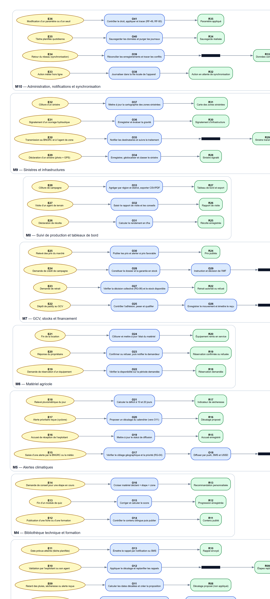

*Image : `docs/images/mct.png` (2120 × 4704 px). Source Graphviz : `docs/sources/mct.dot`.
Chaque bloc correspond à un module du cahier des charges ; les flèches vont de l'événement
vers le résultat, en passant par les opérations et les barres de synchronisation.*

### 3.1 Vues par moitié du cahier des charges

Pour une lecture confortable, le même graphe est découpé en deux planches.

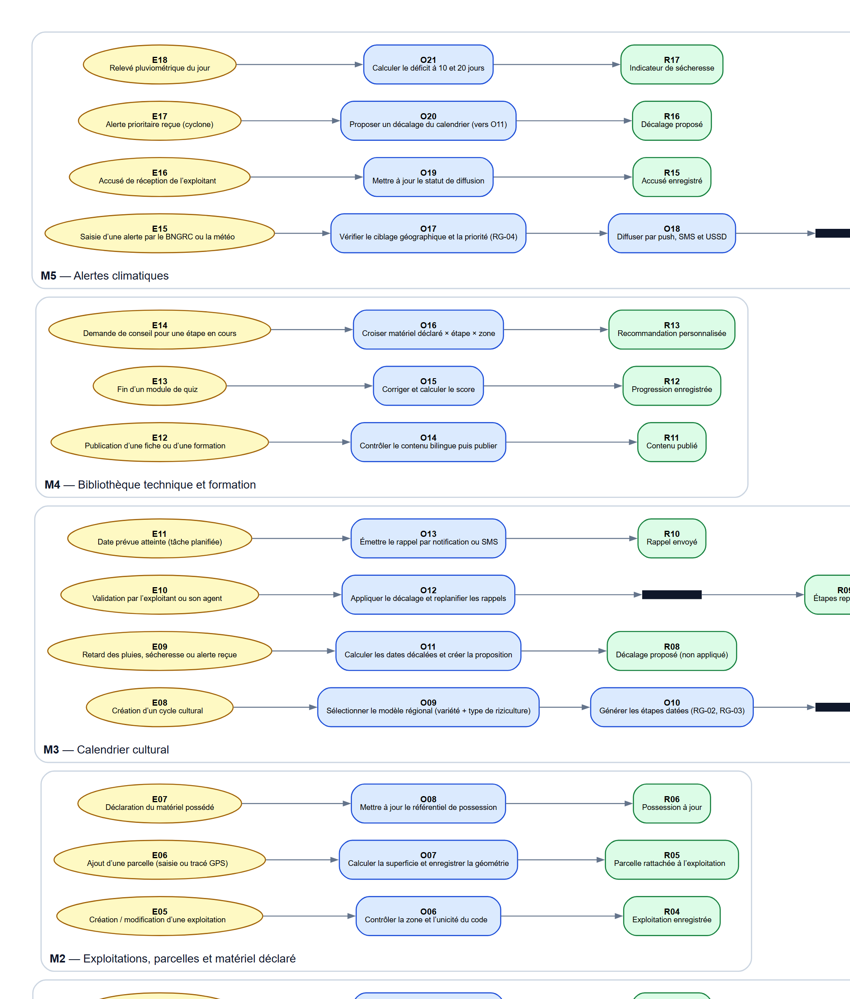

*Modules M1 à M5 — `docs/images/mct-1.png` (2094 × 2462 px).*

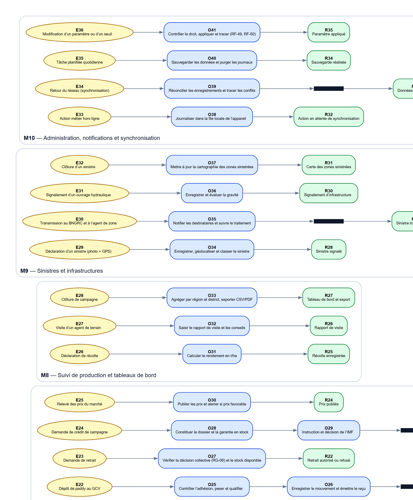

*Modules M6 à M10 — `docs/images/mct-2.png` (2032 × 2462 px).*

---

## 4. Événements

| Code | Événement | Module | Opérations déclenchées |
| --- | --- | :--: | --- |
|
 
*
*
E
0
1
*
*
 
|
 
D
e
m
a
n
d
e
 
d
'
i
n
s
c
r
i
p
t
i
o
n
 
p
a
r
 
t
é
l
é
p
h
o
n
e
 
|
 
M
1
 
|
 
O
0
1
,
 
O
0
2
 
|

|
 
*
*
E
0
2
*
*
 
|
 
V
i
s
i
t
e
 
d
e
 
l
’
a
g
e
n
t
 
(
e
x
p
l
o
i
t
a
n
t
 
s
a
n
s
 
s
m
a
r
t
p
h
o
n
e
)
 
|
 
M
1
 
|
 
O
0
3
 
|

|
 
*
*
E
0
3
*
*
 
|
 
C
o
n
n
e
x
i
o
n
 
(
t
é
l
é
p
h
o
n
e
 
o
u
 
e
-
m
a
i
l
)
 
|
 
M
1
 
|
 
O
0
4
 
|

|
 
*
*
E
0
4
*
*
 
|
 
C
o
d
e
 
S
M
S
 
e
r
r
o
n
é
 
(
3
 
t
e
n
t
a
t
i
v
e
s
)
 
|
 
M
1
 
|
 
O
0
5
 
|

|
 
*
*
E
0
5
*
*
 
|
 
C
r
é
a
t
i
o
n
 
/
 
m
o
d
i
f
i
c
a
t
i
o
n
 
d
’
u
n
e
 
e
x
p
l
o
i
t
a
t
i
o
n
 
|
 
M
2
 
|
 
O
0
6
 
|

|
 
*
*
E
0
6
*
*
 
|
 
A
j
o
u
t
 
d
’
u
n
e
 
p
a
r
c
e
l
l
e
 
(
s
a
i
s
i
e
 
o
u
 
t
r
a
c
é
 
G
P
S
)
 
|
 
M
2
 
|
 
O
0
7
 
|

|
 
*
*
E
0
7
*
*
 
|
 
D
é
c
l
a
r
a
t
i
o
n
 
d
u
 
m
a
t
é
r
i
e
l
 
p
o
s
s
é
d
é
 
|
 
M
2
 
|
 
O
0
8
 
|

|
 
*
*
E
0
8
*
*
 
|
 
C
r
é
a
t
i
o
n
 
d
’
u
n
 
c
y
c
l
e
 
c
u
l
t
u
r
a
l
 
|
 
M
3
 
|
 
O
0
9
,
 
O
1
0
 
|

|
 
*
*
E
0
9
*
*
 
|
 
R
e
t
a
r
d
 
d
e
s
 
p
l
u
i
e
s
,
 
s
é
c
h
e
r
e
s
s
e
 
o
u
 
a
l
e
r
t
e
 
r
e
ç
u
e
 
|
 
M
3
 
|
 
O
1
1
 
|

|
 
*
*
E
1
0
*
*
 
|
 
V
a
l
i
d
a
t
i
o
n
 
p
a
r
 
l
’
e
x
p
l
o
i
t
a
n
t
 
o
u
 
s
o
n
 
a
g
e
n
t
 
|
 
M
3
 
|
 
O
1
2
 
|

|
 
*
*
E
1
1
*
*
 
|
 
D
a
t
e
 
p
r
é
v
u
e
 
a
t
t
e
i
n
t
e
 
(
t
â
c
h
e
 
p
l
a
n
i
f
i
é
e
)
 
|
 
M
3
 
|
 
O
1
3
 
|

|
 
*
*
E
1
2
*
*
 
|
 
P
u
b
l
i
c
a
t
i
o
n
 
d
’
u
n
e
 
f
i
c
h
e
 
o
u
 
d
’
u
n
e
 
f
o
r
m
a
t
i
o
n
 
|
 
M
4
 
|
 
O
1
4
 
|

|
 
*
*
E
1
3
*
*
 
|
 
F
i
n
 
d
’
u
n
 
m
o
d
u
l
e
 
d
e
 
q
u
i
z
 
|
 
M
4
 
|
 
O
1
5
 
|

|
 
*
*
E
1
4
*
*
 
|
 
D
e
m
a
n
d
e
 
d
e
 
c
o
n
s
e
i
l
 
p
o
u
r
 
u
n
e
 
é
t
a
p
e
 
e
n
 
c
o
u
r
s
 
|
 
M
4
 
|
 
O
1
6
 
|

|
 
*
*
E
1
5
*
*
 
|
 
S
a
i
s
i
e
 
d
’
u
n
e
 
a
l
e
r
t
e
 
p
a
r
 
l
e
 
B
N
G
R
C
 
o
u
 
l
a
 
m
é
t
é
o
 
|
 
M
5
 
|
 
O
1
7
,
 
O
1
8
 
|

|
 
*
*
E
1
6
*
*
 
|
 
A
c
c
u
s
é
 
d
e
 
r
é
c
e
p
t
i
o
n
 
d
e
 
l
’
e
x
p
l
o
i
t
a
n
t
 
|
 
M
5
 
|
 
O
1
9
 
|

|
 
*
*
E
1
7
*
*
 
|
 
A
l
e
r
t
e
 
p
r
i
o
r
i
t
a
i
r
e
 
r
e
ç
u
e
 
(
c
y
c
l
o
n
e
)
 
|
 
M
5
 
|
 
O
2
0
 
|

|
 
*
*
E
1
8
*
*
 
|
 
R
e
l
e
v
é
 
p
l
u
v
i
o
m
é
t
r
i
q
u
e
 
d
u
 
j
o
u
r
 
|
 
M
5
 
|
 
O
2
1
 
|

|
 
*
*
E
1
9
*
*
 
|
 
D
e
m
a
n
d
e
 
d
e
 
r
é
s
e
r
v
a
t
i
o
n
 
d
’
u
n
 
é
q
u
i
p
e
m
e
n
t
 
|
 
M
6
 
|
 
O
2
2
 
|

|
 
*
*
E
2
0
*
*
 
|
 
R
é
p
o
n
s
e
 
d
u
 
p
r
o
p
r
i
é
t
a
i
r
e
 
|
 
M
6
 
|
 
O
2
3
 
|

|
 
*
*
E
2
1
*
*
 
|
 
F
i
n
 
d
e
 
l
a
 
l
o
c
a
t
i
o
n
 
|
 
M
6
 
|
 
O
2
4
 
|

|
 
*
*
E
2
2
*
*
 
|
 
D
é
p
ô
t
 
d
e
 
p
a
d
d
y
 
a
u
 
G
C
V
 
|
 
M
7
 
|
 
O
2
5
,
 
O
2
6
 
|

|
 
*
*
E
2
3
*
*
 
|
 
D
e
m
a
n
d
e
 
d
e
 
r
e
t
r
a
i
t
 
|
 
M
7
 
|
 
O
2
7
 
|

|
 
*
*
E
2
4
*
*
 
|
 
D
e
m
a
n
d
e
 
d
e
 
c
r
é
d
i
t
 
d
e
 
c
a
m
p
a
g
n
e
 
|
 
M
7
 
|
 
O
2
8
,
 
O
2
9
 
|

|
 
*
*
E
2
5
*
*
 
|
 
R
e
l
e
v
é
 
d
e
s
 
p
r
i
x
 
d
u
 
m
a
r
c
h
é
 
|
 
M
7
 
|
 
O
3
0
 
|

|
 
*
*
E
2
6
*
*
 
|
 
D
é
c
l
a
r
a
t
i
o
n
 
d
e
 
r
é
c
o
l
t
e
 
|
 
M
8
 
|
 
O
3
1
 
|

|
 
*
*
E
2
7
*
*
 
|
 
V
i
s
i
t
e
 
d
’
u
n
 
a
g
e
n
t
 
d
e
 
t
e
r
r
a
i
n
 
|
 
M
8
 
|
 
O
3
2
 
|

|
 
*
*
E
2
8
*
*
 
|
 
C
l
ô
t
u
r
e
 
d
e
 
c
a
m
p
a
g
n
e
 
|
 
M
8
 
|
 
O
3
3
 
|

|
 
*
*
E
2
9
*
*
 
|
 
D
é
c
l
a
r
a
t
i
o
n
 
d
’
u
n
 
s
i
n
i
s
t
r
e
 
(
p
h
o
t
o
 
+
 
G
P
S
)
 
|
 
M
9
 
|
 
O
3
4
 
|

|
 
*
*
E
3
0
*
*
 
|
 
T
r
a
n
s
m
i
s
s
i
o
n
 
a
u
 
B
N
G
R
C
 
e
t
 
à
 
l
’
a
g
e
n
t
 
d
e
 
z
o
n
e
 
|
 
M
9
 
|
 
O
3
5
 
|

|
 
*
*
E
3
1
*
*
 
|
 
S
i
g
n
a
l
e
m
e
n
t
 
d
’
u
n
 
o
u
v
r
a
g
e
 
h
y
d
r
a
u
l
i
q
u
e
 
|
 
M
9
 
|
 
O
3
6
 
|

|
 
*
*
E
3
2
*
*
 
|
 
C
l
ô
t
u
r
e
 
d
’
u
n
 
s
i
n
i
s
t
r
e
 
|
 
M
9
 
|
 
O
3
7
 
|

|
 
*
*
E
3
3
*
*
 
|
 
A
c
t
i
o
n
 
m
é
t
i
e
r
 
h
o
r
s
 
l
i
g
n
e
 
|
 
M
1
0
 
|
 
O
3
8
 
|

|
 
*
*
E
3
4
*
*
 
|
 
R
e
t
o
u
r
 
d
u
 
r
é
s
e
a
u
 
(
s
y
n
c
h
r
o
n
i
s
a
t
i
o
n
)
 
|
 
M
1
0
 
|
 
O
3
9
 
|

|
 
*
*
E
3
5
*
*
 
|
 
T
â
c
h
e
 
p
l
a
n
i
f
i
é
e
 
q
u
o
t
i
d
i
e
n
n
e
 
|
 
M
1
0
 
|
 
O
4
0
 
|

|
 
*
*
E
3
6
*
*
 
|
 
M
o
d
i
f
i
c
a
t
i
o
n
 
d
’
u
n
 
p
a
r
a
m
è
t
r
e
 
o
u
 
d
’
u
n
 
s
e
u
i
l
 
|
 
M
1
0
 
|
 
O
4
1
 
|

### 4.1 Nature et fréquence des événements

| Type | Événements | Fréquence attendue | Contrainte de délai |
| --- | --- | --- | --- |
| Saisie utilisateur | E01, E03, E05–E07, E14, E19, E22–E24, E26, E29, E31 | continue | réponse < 3 s (exigence de performance) |
| Saisie institutionnelle | E12, E15, E25, E30 | quotidienne / à l'événement | alerte diffusée < 15 min (RG-04) |
| Temporel | E11 (rappel d'étape), E28 (clôture de campagne), E35 (sauvegarde) | tâche planifiée quotidienne | exécution entre 00:00 et 04:00 |
| Interne / système | E04, E08, E09, E10, E16–E18, E20, E21, E27, E32–E34, E36 | selon les flux | — |

---

## 5. Opérations

| Code | Opération | Module | Entités / vues utilisées | Résultat produit |
| --- | --- | :--: | --- | --- |
|
 
*
*
O
0
1
*
*
 
|
 
V
é
r
i
f
i
e
r
 
l
e
 
n
u
m
é
r
o
,
 
l
a
 
z
o
n
e
 
e
t
 
l
’
u
n
i
c
i
t
é
 
d
u
 
c
o
m
p
t
e
 
|
 
M
1
 
|
 
U
T
I
L
I
S
A
T
E
U
R
,
 
Z
O
N
E
 
|
 
R
0
1
 
C
o
m
p
t
e
 
a
c
t
i
f
 
+
 
r
ô
l
e
 
e
x
p
l
o
i
t
a
n
t
 
a
t
t
r
i
b
u
é
 
|

|
 
*
*
O
0
2
*
*
 
|
 
E
n
v
o
y
e
r
 
e
t
 
c
o
n
t
r
ô
l
e
r
 
l
e
 
c
o
d
e
 
d
e
 
v
é
r
i
f
i
c
a
t
i
o
n
 
S
M
S
 
|
 
M
1
 
|
 
U
T
I
L
I
S
A
T
E
U
R
 
|
 
R
0
1
 
C
o
m
p
t
e
 
a
c
t
i
f
 
+
 
r
ô
l
e
 
e
x
p
l
o
i
t
a
n
t
 
a
t
t
r
i
b
u
é
 
|

|
 
*
*
O
0
3
*
*
 
|
 
C
r
é
e
r
 
l
e
 
c
o
m
p
t
e
 
a
u
 
n
o
m
 
d
e
 
l
’
e
x
p
l
o
i
t
a
n
t
 
(
R
F
-
0
4
)
 
|
 
M
1
 
|
 
U
T
I
L
I
S
A
T
E
U
R
,
 
E
X
P
L
O
I
T
A
T
I
O
N
 
|
 
R
0
1
 
C
o
m
p
t
e
 
a
c
t
i
f
 
+
 
r
ô
l
e
 
e
x
p
l
o
i
t
a
n
t
 
a
t
t
r
i
b
u
é
 
|

|
 
*
*
O
0
4
*
*
 
|
 
A
u
t
h
e
n
t
i
f
i
e
r
 
p
u
i
s
 
j
o
u
r
n
a
l
i
s
e
r
 
l
a
 
s
e
s
s
i
o
n
 
|
 
M
1
 
|
 
U
T
I
L
I
S
A
T
E
U
R
,
 
J
O
U
R
N
A
L
_
A
U
D
I
T
 
|
 
R
0
2
 
S
e
s
s
i
o
n
 
o
u
v
e
r
t
e
 
|

|
 
*
*
O
0
5
*
*
 
|
 
S
u
s
p
e
n
d
r
e
 
t
e
m
p
o
r
a
i
r
e
m
e
n
t
 
l
a
 
d
e
m
a
n
d
e
 
|
 
M
1
 
|
 
U
T
I
L
I
S
A
T
E
U
R
 
|
 
R
0
3
 
C
o
m
p
t
e
 
n
o
n
 
a
c
t
i
v
é
 
|

|
 
*
*
O
0
6
*
*
 
|
 
C
o
n
t
r
ô
l
e
r
 
l
a
 
z
o
n
e
 
e
t
 
l
’
u
n
i
c
i
t
é
 
d
u
 
c
o
d
e
 
|
 
M
2
 
|
 
E
X
P
L
O
I
T
A
T
I
O
N
,
 
Z
O
N
E
 
|
 
R
0
4
 
E
x
p
l
o
i
t
a
t
i
o
n
 
e
n
r
e
g
i
s
t
r
é
e
 
|

|
 
*
*
O
0
7
*
*
 
|
 
C
a
l
c
u
l
e
r
 
l
a
 
s
u
p
e
r
f
i
c
i
e
 
e
t
 
e
n
r
e
g
i
s
t
r
e
r
 
l
a
 
g
é
o
m
é
t
r
i
e
 
|
 
M
2
 
|
 
P
A
R
C
E
L
L
E
 
|
 
R
0
5
 
P
a
r
c
e
l
l
e
 
r
a
t
t
a
c
h
é
e
 
à
 
l
’
e
x
p
l
o
i
t
a
t
i
o
n
 
|

|
 
*
*
O
0
8
*
*
 
|
 
M
e
t
t
r
e
 
à
 
j
o
u
r
 
l
e
 
r
é
f
é
r
e
n
t
i
e
l
 
d
e
 
p
o
s
s
e
s
s
i
o
n
 
|
 
M
2
 
|
 
P
O
S
S
E
S
S
I
O
N
_
M
A
T
E
R
I
E
L
 
|
 
R
0
6
 
P
o
s
s
e
s
s
i
o
n
 
à
 
j
o
u
r
 
|

|
 
*
*
O
0
9
*
*
 
|
 
S
é
l
e
c
t
i
o
n
n
e
r
 
l
e
 
m
o
d
è
l
e
 
r
é
g
i
o
n
a
l
 
(
v
a
r
i
é
t
é
 
+
 
t
y
p
e
 
d
e
 
r
i
z
i
c
u
l
t
u
r
e
)
 
|
 
M
3
 
|
 
C
Y
C
L
E
_
C
U
L
T
U
R
A
L
,
 
V
A
R
I
E
T
E
 
|
 
R
0
7
 
C
a
l
e
n
d
r
i
e
r
 
d
e
 
l
a
 
p
a
r
c
e
l
l
e
 
|

|
 
*
*
O
1
0
*
*
 
|
 
G
é
n
é
r
e
r
 
l
e
s
 
é
t
a
p
e
s
 
d
a
t
é
e
s
 
(
R
G
-
0
2
,
 
R
G
-
0
3
)
 
|
 
M
3
 
|
 
E
T
A
P
E
_
P
L
A
N
I
F
I
E
E
 
|
 
R
0
7
 
C
a
l
e
n
d
r
i
e
r
 
d
e
 
l
a
 
p
a
r
c
e
l
l
e
 
|

|
 
*
*
O
1
1
*
*
 
|
 
C
a
l
c
u
l
e
r
 
l
e
s
 
d
a
t
e
s
 
d
é
c
a
l
é
e
s
 
e
t
 
c
r
é
e
r
 
l
a
 
p
r
o
p
o
s
i
t
i
o
n
 
|
 
M
3
 
|
 
D
E
C
A
L
A
G
E
 
|
 
R
0
8
 
D
é
c
a
l
a
g
e
 
p
r
o
p
o
s
é
 
(
n
o
n
 
a
p
p
l
i
q
u
é
)
 
|

|
 
*
*
O
1
2
*
*
 
|
 
A
p
p
l
i
q
u
e
r
 
l
e
 
d
é
c
a
l
a
g
e
 
e
t
 
r
e
p
l
a
n
i
f
i
e
r
 
l
e
s
 
r
a
p
p
e
l
s
 
|
 
M
3
 
|
 
E
T
A
P
E
_
P
L
A
N
I
F
I
E
E
,
 
D
E
C
A
L
A
G
E
 
|
 
R
0
9
 
É
t
a
p
e
s
 
r
e
p
l
a
n
i
f
i
é
e
s
 
|

|
 
*
*
O
1
3
*
*
 
|
 
É
m
e
t
t
r
e
 
l
e
 
r
a
p
p
e
l
 
p
a
r
 
n
o
t
i
f
i
c
a
t
i
o
n
 
o
u
 
S
M
S
 
|
 
M
3
 
|
 
N
O
T
I
F
I
C
A
T
I
O
N
 
|
 
R
1
0
 
R
a
p
p
e
l
 
e
n
v
o
y
é
 
|

|
 
*
*
O
1
4
*
*
 
|
 
C
o
n
t
r
ô
l
e
r
 
l
e
 
c
o
n
t
e
n
u
 
b
i
l
i
n
g
u
e
 
p
u
i
s
 
p
u
b
l
i
e
r
 
|
 
M
4
 
|
 
F
I
C
H
E
_
T
E
C
H
N
I
Q
U
E
,
 
M
E
D
I
A
 
|
 
R
1
1
 
C
o
n
t
e
n
u
 
p
u
b
l
i
é
 
|

|
 
*
*
O
1
5
*
*
 
|
 
C
o
r
r
i
g
e
r
 
e
t
 
c
a
l
c
u
l
e
r
 
l
e
 
s
c
o
r
e
 
|
 
M
4
 
|
 
Q
U
E
S
T
I
O
N
,
 
I
N
S
C
R
I
P
T
I
O
N
_
F
O
R
M
A
T
I
O
N
 
|
 
R
1
2
 
P
r
o
g
r
e
s
s
i
o
n
 
e
n
r
e
g
i
s
t
r
é
e
 
|

|
 
*
*
O
1
6
*
*
 
|
 
C
r
o
i
s
e
r
 
m
a
t
é
r
i
e
l
 
d
é
c
l
a
r
é
 
×
 
é
t
a
p
e
 
×
 
z
o
n
e
 
|
 
M
4
 
|
 
P
O
S
S
E
S
S
I
O
N
_
M
A
T
E
R
I
E
L
,
 
E
T
A
P
E
_
P
L
A
N
I
F
I
E
E
 
|
 
R
1
3
 
R
e
c
o
m
m
a
n
d
a
t
i
o
n
 
p
e
r
s
o
n
n
a
l
i
s
é
e
 
|

|
 
*
*
O
1
7
*
*
 
|
 
V
é
r
i
f
i
e
r
 
l
e
 
c
i
b
l
a
g
e
 
g
é
o
g
r
a
p
h
i
q
u
e
 
e
t
 
l
a
 
p
r
i
o
r
i
t
é
 
(
R
G
-
0
4
)
 
|
 
M
5
 
|
 
A
L
E
R
T
E
,
 
C
I
B
L
A
G
E
_
A
L
E
R
T
E
 
|
 
R
1
4
 
A
l
e
r
t
e
s
 
e
n
v
o
y
é
e
s
 
a
u
x
 
e
x
p
l
o
i
t
a
t
i
o
n
s
 
c
i
b
l
é
e
s
 
|

|
 
*
*
O
1
8
*
*
 
|
 
D
i
f
f
u
s
e
r
 
p
a
r
 
p
u
s
h
,
 
S
M
S
 
e
t
 
U
S
S
D
 
|
 
M
5
 
|
 
N
O
T
I
F
I
C
A
T
I
O
N
 
|
 
R
1
4
 
A
l
e
r
t
e
s
 
e
n
v
o
y
é
e
s
 
a
u
x
 
e
x
p
l
o
i
t
a
t
i
o
n
s
 
c
i
b
l
é
e
s
 
|

|
 
*
*
O
1
9
*
*
 
|
 
M
e
t
t
r
e
 
à
 
j
o
u
r
 
l
e
 
s
t
a
t
u
t
 
d
e
 
d
i
f
f
u
s
i
o
n
 
|
 
M
5
 
|
 
N
O
T
I
F
I
C
A
T
I
O
N
 
|
 
R
1
5
 
A
c
c
u
s
é
 
e
n
r
e
g
i
s
t
r
é
 
|

|
 
*
*
O
2
0
*
*
 
|
 
P
r
o
p
o
s
e
r
 
u
n
 
d
é
c
a
l
a
g
e
 
d
u
 
c
a
l
e
n
d
r
i
e
r
 
(
v
e
r
s
 
O
1
1
)
 
|
 
M
5
 
|
 
D
E
C
A
L
A
G
E
 
|
 
R
1
6
 
D
é
c
a
l
a
g
e
 
p
r
o
p
o
s
é
 
|

|
 
*
*
O
2
1
*
*
 
|
 
C
a
l
c
u
l
e
r
 
l
e
 
d
é
f
i
c
i
t
 
à
 
1
0
 
e
t
 
2
0
 
j
o
u
r
s
 
|
 
M
5
 
|
 
D
O
N
N
E
E
_
P
L
U
V
I
O
M
E
T
R
I
Q
U
E
 
|
 
R
1
7
 
I
n
d
i
c
a
t
e
u
r
 
d
e
 
s
é
c
h
e
r
e
s
s
e
 
|

|
 
*
*
O
2
2
*
*
 
|
 
V
é
r
i
f
i
e
r
 
l
a
 
d
i
s
p
o
n
i
b
i
l
i
t
é
 
s
u
r
 
l
a
 
p
é
r
i
o
d
e
 
d
e
m
a
n
d
é
e
 
|
 
M
6
 
|
 
E
Q
U
I
P
E
M
E
N
T
,
 
R
E
S
E
R
V
A
T
I
O
N
 
|
 
R
1
8
 
R
é
s
e
r
v
a
t
i
o
n
 
d
e
m
a
n
d
é
e
 
|

|
 
*
*
O
2
3
*
*
 
|
 
C
o
n
f
i
r
m
e
r
 
o
u
 
r
e
f
u
s
e
r
,
 
p
u
i
s
 
n
o
t
i
f
i
e
r
 
l
e
 
d
e
m
a
n
d
e
u
r
 
|
 
M
6
 
|
 
R
E
S
E
R
V
A
T
I
O
N
,
 
N
O
T
I
F
I
C
A
T
I
O
N
 
|
 
R
1
9
 
R
é
s
e
r
v
a
t
i
o
n
 
c
o
n
f
i
r
m
é
e
 
o
u
 
r
e
f
u
s
é
e
 
|

|
 
*
*
O
2
4
*
*
 
|
 
C
l
ô
t
u
r
e
r
 
e
t
 
m
e
t
t
r
e
 
à
 
j
o
u
r
 
l
’
é
t
a
t
 
d
u
 
m
a
t
é
r
i
e
l
 
|
 
M
6
 
|
 
R
E
S
E
R
V
A
T
I
O
N
,
 
E
Q
U
I
P
E
M
E
N
T
 
|
 
R
2
0
 
É
q
u
i
p
e
m
e
n
t
 
r
e
m
i
s
 
e
n
 
s
e
r
v
i
c
e
 
|

|
 
*
*
O
2
5
*
*
 
|
 
C
o
n
t
r
ô
l
e
r
 
l
’
a
d
h
é
s
i
o
n
,
 
p
e
s
e
r
 
e
t
 
q
u
a
l
i
f
i
e
r
 
|
 
M
7
 
|
 
M
E
M
B
R
E
_
G
C
V
,
 
M
O
U
V
E
M
E
N
T
_
S
T
O
C
K
 
|
 
R
2
1
 
S
t
o
c
k
 
a
u
g
m
e
n
t
é
 
+
 
r
e
ç
u
 
n
u
m
é
r
i
q
u
e
 
|

|
 
*
*
O
2
6
*
*
 
|
 
E
n
r
e
g
i
s
t
r
e
r
 
l
e
 
m
o
u
v
e
m
e
n
t
 
e
t
 
é
m
e
t
t
r
e
 
l
e
 
r
e
ç
u
 
|
 
M
7
 
|
 
M
O
U
V
E
M
E
N
T
_
S
T
O
C
K
,
 
R
E
C
U
 
|
 
R
2
1
 
S
t
o
c
k
 
a
u
g
m
e
n
t
é
 
+
 
r
e
ç
u
 
n
u
m
é
r
i
q
u
e
 
|

|
 
*
*
O
2
7
*
*
 
|
 
V
é
r
i
f
i
e
r
 
l
a
 
d
é
c
i
s
i
o
n
 
c
o
l
l
e
c
t
i
v
e
 
(
R
G
-
0
6
)
 
e
t
 
l
e
 
s
t
o
c
k
 
d
i
s
p
o
n
i
b
l
e
 
|
 
M
7
 
|
 
D
E
C
I
S
I
O
N
_
C
O
L
L
E
C
T
I
V
E
,
 
v
_
s
t
o
c
k
_
g
c
v
 
|
 
R
2
2
 
R
e
t
r
a
i
t
 
a
u
t
o
r
i
s
é
 
o
u
 
r
e
f
u
s
é
 
|

|
 
*
*
O
2
8
*
*
 
|
 
C
o
n
s
t
i
t
u
e
r
 
l
e
 
d
o
s
s
i
e
r
 
e
t
 
l
a
 
g
a
r
a
n
t
i
e
 
e
n
 
s
t
o
c
k
 
|
 
M
7
 
|
 
D
E
M
A
N
D
E
_
C
R
E
D
I
T
,
 
G
A
R
A
N
T
I
E
_
S
T
O
C
K
 
|
 
R
2
3
 
S
t
a
t
u
t
 
d
e
 
l
a
 
d
e
m
a
n
d
e
 
m
i
s
 
à
 
j
o
u
r
 
|

|
 
*
*
O
2
9
*
*
 
|
 
I
n
s
t
r
u
c
t
i
o
n
 
e
t
 
d
é
c
i
s
i
o
n
 
d
e
 
l
’
I
M
F
 
|
 
M
7
 
|
 
D
E
M
A
N
D
E
_
C
R
E
D
I
T
 
|
 
R
2
3
 
S
t
a
t
u
t
 
d
e
 
l
a
 
d
e
m
a
n
d
e
 
m
i
s
 
à
 
j
o
u
r
 
|

|
 
*
*
O
3
0
*
*
 
|
 
P
u
b
l
i
e
r
 
l
e
s
 
p
r
i
x
 
e
t
 
a
l
e
r
t
e
r
 
s
i
 
p
r
i
x
 
f
a
v
o
r
a
b
l
e
 
|
 
M
7
 
|
 
P
R
I
X
_
M
A
R
C
H
E
,
 
N
O
T
I
F
I
C
A
T
I
O
N
 
|
 
R
2
4
 
P
r
i
x
 
p
u
b
l
i
é
s
 
|

|
 
*
*
O
3
1
*
*
 
|
 
C
a
l
c
u
l
e
r
 
l
e
 
r
e
n
d
e
m
e
n
t
 
e
n
 
t
/
h
a
 
|
 
M
8
 
|
 
R
E
C
O
L
T
E
,
 
P
A
R
C
E
L
L
E
 
|
 
R
2
5
 
R
é
c
o
l
t
e
 
e
n
r
e
g
i
s
t
r
é
e
 
|

|
 
*
*
O
3
2
*
*
 
|
 
S
a
i
s
i
r
 
l
e
 
r
a
p
p
o
r
t
 
d
e
 
v
i
s
i
t
e
 
e
t
 
l
e
s
 
c
o
n
s
e
i
l
s
 
|
 
M
8
 
|
 
R
A
P
P
O
R
T
_
V
I
S
I
T
E
 
|
 
R
2
6
 
R
a
p
p
o
r
t
 
d
e
 
v
i
s
i
t
e
 
|

|
 
*
*
O
3
3
*
*
 
|
 
A
g
r
é
g
e
r
 
p
a
r
 
r
é
g
i
o
n
 
e
t
 
d
i
s
t
r
i
c
t
,
 
e
x
p
o
r
t
e
r
 
C
S
V
/
P
D
F
 
|
 
M
8
 
|
 
v
_
t
a
b
l
e
a
u
_
b
o
r
d
_
z
o
n
e
 
|
 
R
2
7
 
T
a
b
l
e
a
u
 
d
e
 
b
o
r
d
 
e
t
 
e
x
p
o
r
t
 
|

|
 
*
*
O
3
4
*
*
 
|
 
E
n
r
e
g
i
s
t
r
e
r
,
 
g
é
o
l
o
c
a
l
i
s
e
r
 
e
t
 
c
l
a
s
s
e
r
 
l
e
 
s
i
n
i
s
t
r
e
 
|
 
M
9
 
|
 
S
I
N
I
S
T
R
E
,
 
P
H
O
T
O
_
S
I
N
I
S
T
R
E
 
|
 
R
2
8
 
S
i
n
i
s
t
r
e
 
s
i
g
n
a
l
é
 
|

|
 
*
*
O
3
5
*
*
 
|
 
N
o
t
i
f
i
e
r
 
l
e
s
 
d
e
s
t
i
n
a
t
a
i
r
e
s
 
e
t
 
s
u
i
v
r
e
 
l
e
 
t
r
a
i
t
e
m
e
n
t
 
|
 
M
9
 
|
 
S
I
N
I
S
T
R
E
,
 
N
O
T
I
F
I
C
A
T
I
O
N
 
|
 
R
2
9
 
S
i
n
i
s
t
r
e
 
t
r
a
n
s
m
i
s
 
/
 
s
u
i
v
i
 
|

|
 
*
*
O
3
6
*
*
 
|
 
E
n
r
e
g
i
s
t
r
e
r
 
e
t
 
é
v
a
l
u
e
r
 
l
a
 
g
r
a
v
i
t
é
 
|
 
M
9
 
|
 
S
I
G
N
A
L
E
M
E
N
T
_
I
N
F
R
A
,
 
I
N
F
R
A
S
T
R
U
C
T
U
R
E
 
|
 
R
3
0
 
S
i
g
n
a
l
e
m
e
n
t
 
d
’
i
n
f
r
a
s
t
r
u
c
t
u
r
e
 
|

|
 
*
*
O
3
7
*
*
 
|
 
M
e
t
t
r
e
 
à
 
j
o
u
r
 
l
a
 
c
a
r
t
o
g
r
a
p
h
i
e
 
d
e
s
 
z
o
n
e
s
 
s
i
n
i
s
t
r
é
e
s
 
|
 
M
9
 
|
 
S
I
N
I
S
T
R
E
,
 
v
_
t
a
b
l
e
a
u
_
b
o
r
d
_
z
o
n
e
 
|
 
R
3
1
 
C
a
r
t
e
 
d
e
s
 
z
o
n
e
s
 
s
i
n
i
s
t
r
é
e
s
 
|

|
 
*
*
O
3
8
*
*
 
|
 
J
o
u
r
n
a
l
i
s
e
r
 
d
a
n
s
 
l
a
 
f
i
l
e
 
l
o
c
a
l
e
 
d
e
 
l
’
a
p
p
a
r
e
i
l
 
|
 
M
1
0
 
|
 
A
P
P
A
R
E
I
L
 
|
 
R
3
2
 
A
c
t
i
o
n
 
e
n
 
a
t
t
e
n
t
e
 
d
e
 
s
y
n
c
h
r
o
n
i
s
a
t
i
o
n
 
|

|
 
*
*
O
3
9
*
*
 
|
 
R
é
c
o
n
c
i
l
i
e
r
 
l
e
s
 
e
n
r
e
g
i
s
t
r
e
m
e
n
t
s
 
e
t
 
t
r
a
c
e
r
 
l
e
s
 
c
o
n
f
l
i
t
s
 
|
 
M
1
0
 
|
 
S
Y
N
C
H
R
O
N
I
S
A
T
I
O
N
,
 
J
O
U
R
N
A
L
_
A
U
D
I
T
 
|
 
R
3
3
 
D
o
n
n
é
e
s
 
c
o
n
s
o
l
i
d
é
e
s
 
|

|
 
*
*
O
4
0
*
*
 
|
 
S
a
u
v
e
g
a
r
d
e
r
 
l
e
s
 
d
o
n
n
é
e
s
 
e
t
 
p
u
r
g
e
r
 
l
e
s
 
j
o
u
r
n
a
u
x
 
|
 
M
1
0
 
|
 
J
O
U
R
N
A
L
_
A
U
D
I
T
 
|
 
R
3
4
 
S
a
u
v
e
g
a
r
d
e
 
r
é
a
l
i
s
é
e
 
|

|
 
*
*
O
4
1
*
*
 
|
 
C
o
n
t
r
ô
l
e
r
 
l
e
 
d
r
o
i
t
,
 
a
p
p
l
i
q
u
e
r
 
e
t
 
t
r
a
c
e
r
 
(
R
F
-
4
9
,
 
R
F
-
5
0
)
 
|
 
M
1
0
 
|
 
P
A
R
A
M
E
T
R
E
,
 
S
E
U
I
L
_
A
L
E
R
T
E
 
|
 
R
3
5
 
P
a
r
a
m
è
t
r
e
 
a
p
p
l
i
q
u
é
 
|

### 5.1 Règles de calcul portées par les opérations

| Opération | Formule / règle | Source |
| --- | --- | --- |
| O07 — superficie d'une parcelle | `aire(geometrie)` si tracé GPS, sinon saisie manuelle contrôlée (0,01–50 ha) | RF-08 |
| O10 — génération des étapes | `date_etape[n] = date_reelle[n-1] + delai_min_jours` ; sarclage 1 à J+8..J+10, sarclage 2 à J+14 minimum | RG-02, RG-03 |
| O11 — proposition de décalage | `nouvelle_date = date_prevue + retard_observe` où `retard_observe` provient de la pluie ou de l'alerte | RF-11 |
| O21 — déficit de pluie | `deficit_20j_pct = 100 × (1 − cumul_20j / seuil_20j)` | RF-25, vue `v_indicateur_pluie` |
| O22 — disponibilité matériel | `quantite − réservations confirmées sur la période` | RF-27, vue `v_disponibilite_materiel` |
| O27 — contrôle de retrait | `quantite_demandee ≤ stock_kg` **et** `decision_collective` présente | RG-06, vue `v_stock_gcv` |
| O31 — rendement | `rendement_t_ha = quantite_paddy_kg / 1000 / superficie_ha` | RF-37 |
| O33 — agrégats de campagne | `SUM(superficie_ha)`, `SUM(production_t)`, `AVG(rendement_t_ha)` par région et district | RF-38 |

---

## 6. Synchronisations

| Barre | Processus | Règle de synchronisation |
| --- | --- | --- |
| **S1** | Inscription (M1) | Le compte n’est activé qu’après vérification du code SMS ; la création de l’exploitation attend la validation du compte. |
| **S2** | Calendrier cultural (M3) | Les dates générées, puis les décalages validés, sont appliqués en une seule transaction : aucune étape partiellement replanifiée. |
| **S3** | Diffusion d’alerte (M5) | Toutes les notifications d’une alerte sont créées avant l’envoi effectif : une alerte est diffusée intégralement ou rejouée (RG-04). |
| **S4** | Dépôt au GCV (M7) | Le mouvement de stock et son reçu numérique sont écrits ensemble : pas de dépôt sans reçu (RF-32). |
| **S5** | Crédit de campagne (M7) | La garantie en stock est bloquée avant la décision de l’IMF ; le déblocage suit la décision. |
| **S6** | Sinistre (M9) | Le sinistre et sa transmission au BNGRC sont séparés : un sinistre peut rester en attente de réseau (mode hors ligne). |
| **S7** | Synchronisation (M10) | Les écritures hors ligne sont rejouées dans l’ordre, avec journalisation des conflits. |
| **undefined** | undefined | undefined |

Les synchronisations S1 à S7 deviennent, dans l'implémentation, des **transactions SQL**
(S1, S2, S4, S5) ou des **files de messages idempotentes** (S3, S6, S7).

---

## 7. Cycles de vie des objets à statut

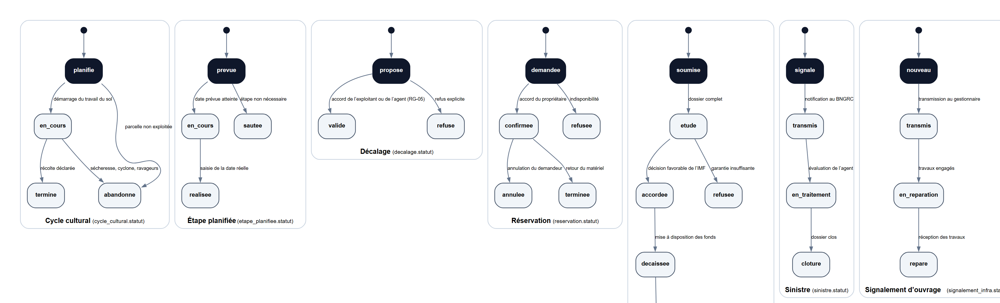

*Image : `docs/images/mct-etats.png` (3868 × 1174 px). Chaque diagramme se lit de gauche
(état initial) vers la droite ; les transitions sont étiquetées par leur déclencheur.*

## Cycle cultural

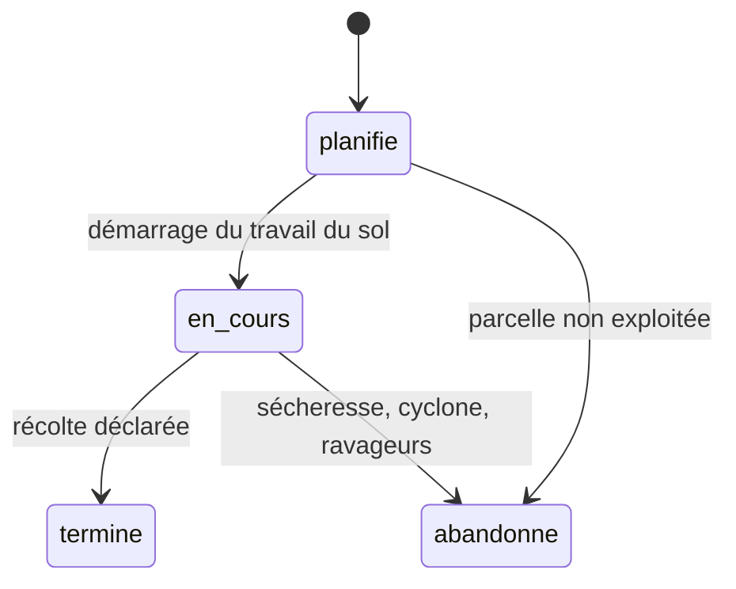

## Étape planifiée

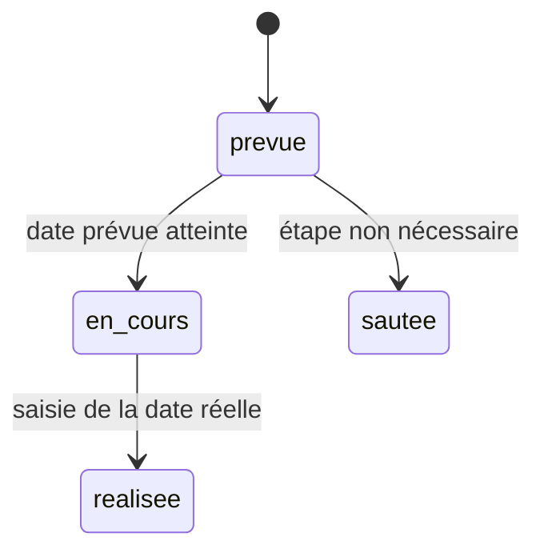

## Décalage

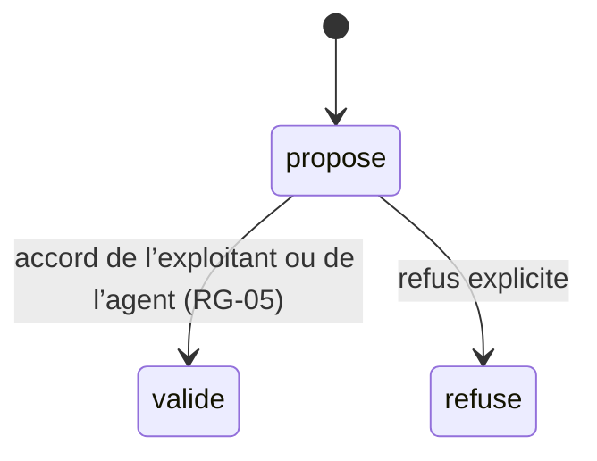

## Réservation

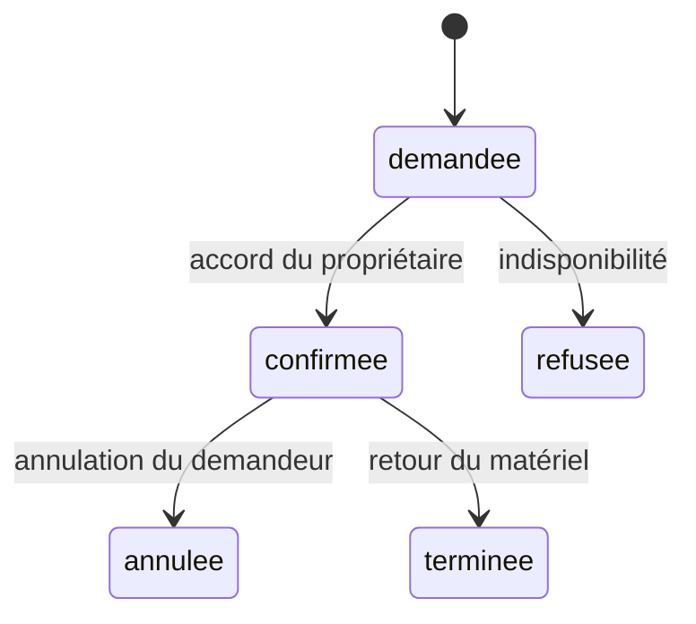

## Demande de crédit

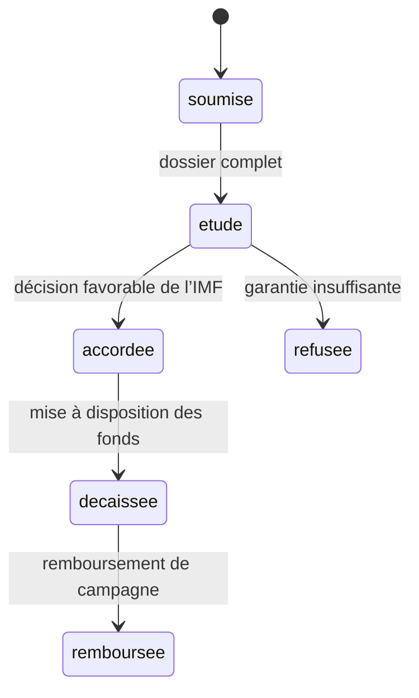

## Sinistre

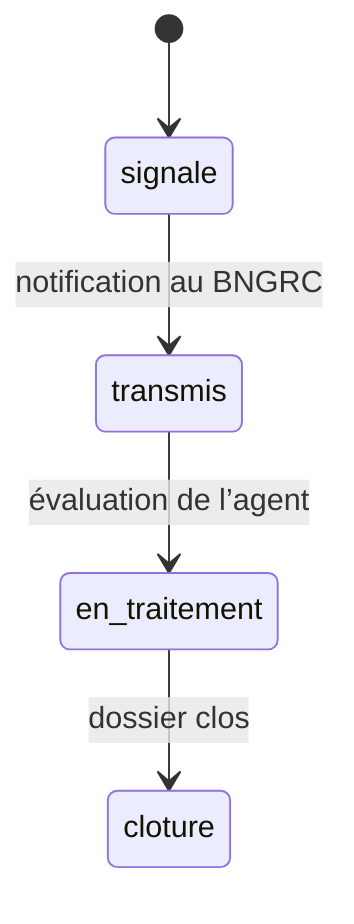

## Signalement d’ouvrage

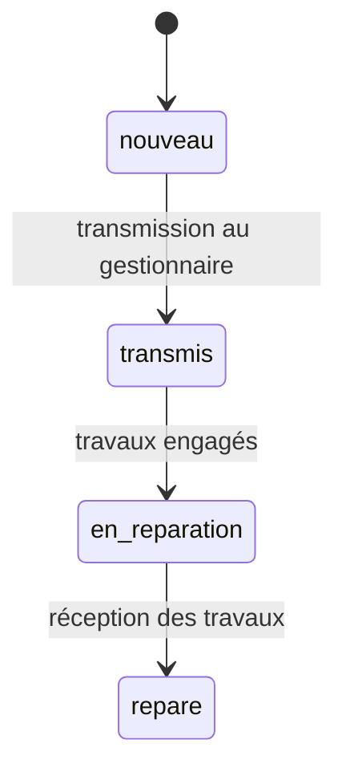

## Alerte

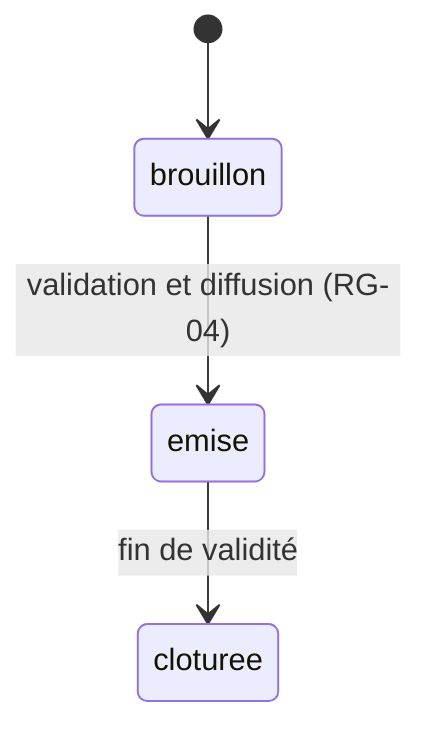

## Notification

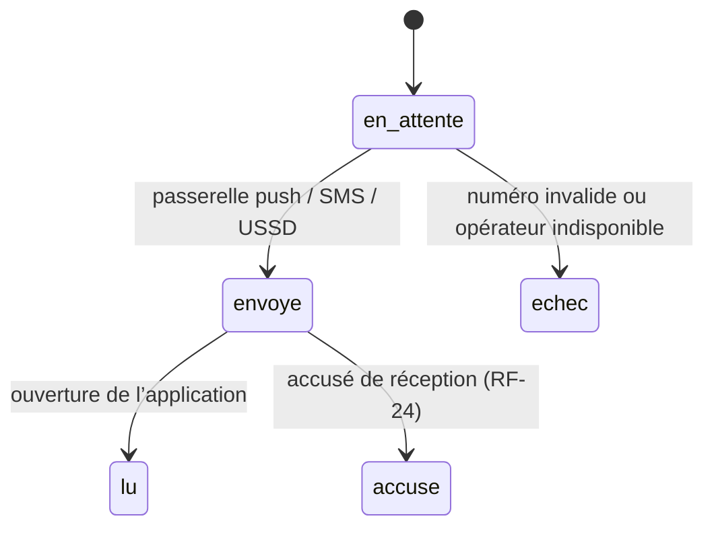

### Cycle cultural (`cycle_cultural.statut`)

État initial : `planifie`.

| De | Vers | Déclencheur |
| --- | --- | --- |
| `planifie` | `en_cours` | démarrage du travail du sol |
| `en_cours` | `termine` | récolte déclarée |
| `planifie` | `abandonne` | parcelle non exploitée |
| `en_cours` | `abandonne` | sécheresse, cyclone, ravageurs |

### Étape planifiée (`etape_planifiee.statut`)

État initial : `prevue`.

| De | Vers | Déclencheur |
| --- | --- | --- |
| `prevue` | `en_cours` | date prévue atteinte |
| `en_cours` | `realisee` | saisie de la date réelle |
| `prevue` | `sautee` | étape non nécessaire |

### Décalage (`decalage.statut`)

État initial : `propose`.

| De | Vers | Déclencheur |
| --- | --- | --- |
| `propose` | `valide` | accord de l’exploitant ou de l’agent (RG-05) |
| `propose` | `refuse` | refus explicite |

### Réservation (`reservation.statut`)

État initial : `demandee`.

| De | Vers | Déclencheur |
| --- | --- | --- |
| `demandee` | `confirmee` | accord du propriétaire |
| `demandee` | `refusee` | indisponibilité |
| `confirmee` | `annulee` | annulation du demandeur |
| `confirmee` | `terminee` | retour du matériel |

### Demande de crédit (`demande_credit.statut`)

État initial : `soumise`.

| De | Vers | Déclencheur |
| --- | --- | --- |
| `soumise` | `etude` | dossier complet |
| `etude` | `accordee` | décision favorable de l’IMF |
| `etude` | `refusee` | garantie insuffisante |
| `accordee` | `decaissee` | mise à disposition des fonds |
| `decaissee` | `remboursee` | remboursement de campagne |

### Sinistre (`sinistre.statut`)

État initial : `signale`.

| De | Vers | Déclencheur |
| --- | --- | --- |
| `signale` | `transmis` | notification au BNGRC |
| `transmis` | `en_traitement` | évaluation de l’agent |
| `en_traitement` | `cloture` | dossier clos |

### Signalement d’ouvrage (`signalement_infra.statut`)

État initial : `nouveau`.

| De | Vers | Déclencheur |
| --- | --- | --- |
| `nouveau` | `transmis` | transmission au gestionnaire |
| `transmis` | `en_reparation` | travaux engagés |
| `en_reparation` | `repare` | réception des travaux |

### Alerte (`alerte.statut`)

État initial : `brouillon`.

| De | Vers | Déclencheur |
| --- | --- | --- |
| `brouillon` | `emise` | validation et diffusion (RG-04) |
| `emise` | `cloturee` | fin de validité |

### Notification (`notification.statut`)

État initial : `en_attente`.

| De | Vers | Déclencheur |
| --- | --- | --- |
| `en_attente` | `envoye` | passerelle push / SMS / USSD |
| `en_attente` | `echec` | numéro invalide ou opérateur indisponible |
| `envoye` | `lu` | ouverture de l’application |
| `envoye` | `accuse` | accusé de réception (RF-24) |

---

## 8. Règles de déclenchement et contraintes temporelles

| Règle | Description | Mise en œuvre |
| --- | --- | --- |
| Déclenchement par échéance | Les rappels d'étapes sont émis le jour de `date_prevue` à 06:00 (heure de Madagascar) | tâche `O13`, index `idx_etape_planifiee_date_prevue` |
| Priorité d'alerte | Une alerte `cyclone` / niveau `urgence` interrompt la file des rappels et passe en tête | `alerte.priorite`, file prioritaire `O18` |
| Réessai de diffusion | Un envoi SMS en échec est retenté 3 fois (1 min, 5 min, 30 min), puis marqué `echec` | `notification.statut`, `O18` |
| Idempotence hors ligne | Une action rejouée avec le même identifiant d'appareil ne crée pas de doublon | `appareil.identifiant_appareil` + `synchronisation`, `O39` |
| Clôture de campagne | À la date de fin, les cycles non terminés passent en `abandonne` et les agrégats sont recalculés | `O33`, `E28` |
| Conservation | Journaux purgés après 12 mois, sauvegarde quotidienne conservée 30 jours | `O40` |

---

## 9. Scénarios déroulés

### 9.1 Alerte cyclonique (§ 3.12 du cahier des charges)

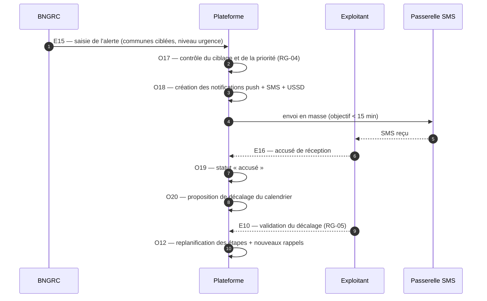

### 9.2 Location de matériel

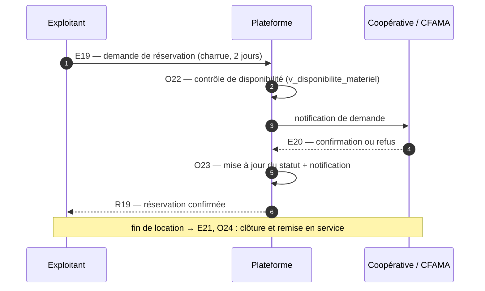

### 9.3 Stockage collectif et crédit de campagne

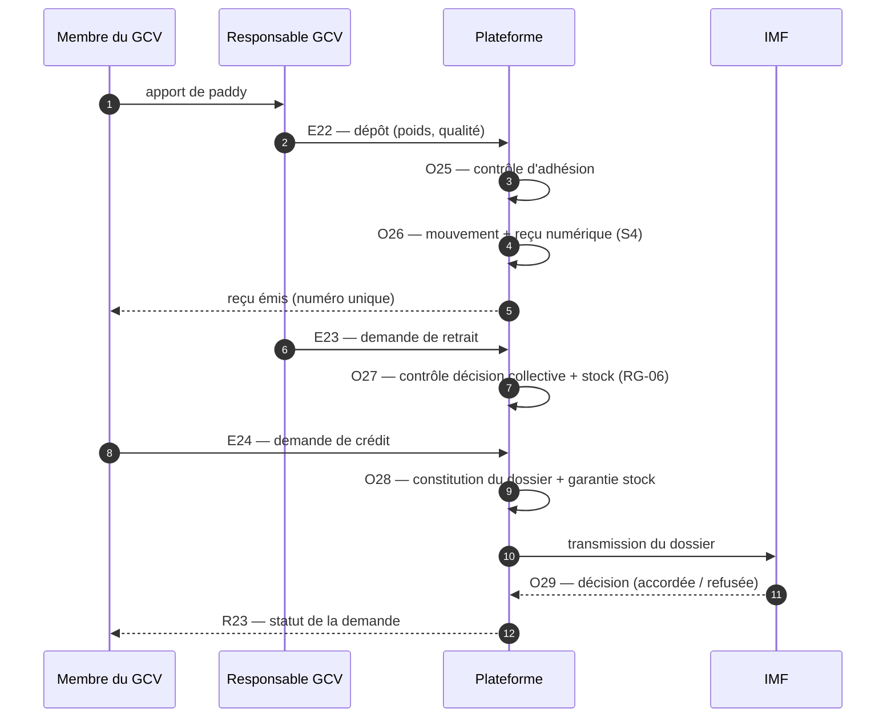

### 9.4 Déclaration de sinistre hors ligne

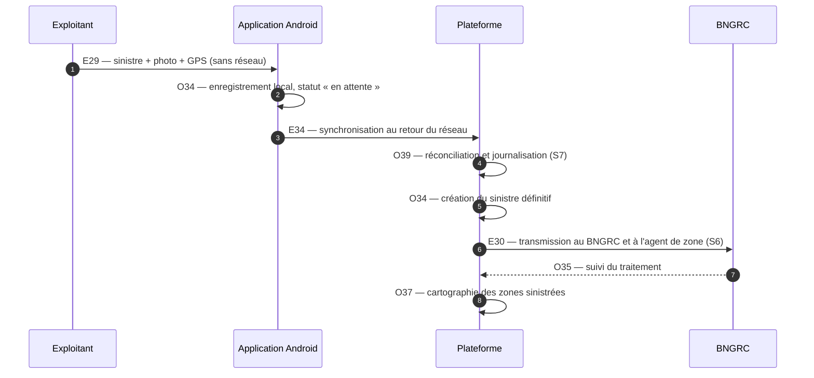

---

## 10. Traçabilité des exigences

| Exigence | Événement(s) | Opération(s) | Résultat |
| --- | --- | --- | --- |
| RF-01 — inscription par SMS | E01, E04 | O01, O02, O05 | R01, R03 |
| RF-04 — inscription assistée | E02 | O03 | R01 |
| RF-09 à RF-13 — calendrier | E08–E11 | O09–O13 | R07–R10 |
| RF-17 — formation et quiz | E13 | O15 | R12 |
| RF-19 — recommandation | E14 | O16 | R13 |
| RF-20 à RF-24 — alertes | E15–E17 | O17–O20 | R14–R16 |
| RF-25 — déficit de pluie | E18 | O21 | R17 |
| RF-26 à RF-29 — matériel | E19–E21 | O22–O24 | R18–R20 |
| RF-31 à RF-33 — GCV et crédit | E22–E24 | O25–O29 | R21–R23 |
| RF-34 à RF-36 — prix et coûts | E25 | O30 | R24 |
| RF-37 — rendement | E26 | O31 | R25 |
| RF-38 à RF-41 — pilotage | E27, E28 | O32, O33 | R26, R27 |
| RF-42 à RF-45 — sinistres et ouvrages | E29–E32 | O34–O37 | R28–R31 |
| RF-46 à RF-50 — hors ligne et administration | E33–E36 | O38–O41 | R32–R35 |

---

## 11. Points ouverts

- La fréquence exacte des tâches planifiées (rappels, agrégats, sauvegardes) dépend de
  l'infrastructure retenue ; les SLA du cahier des charges (§ 4) servent de plafond.
- L'ordre de rejeu des écritures hors ligne (E34) doit être arbitré avec les coopératives :
  dernier écrivain gagnant ou fusion champ par champ.
- Les alertes issues du service météorologique supposent une convention d'interface (API
  ou fichier) encore à signer (§ 5 du cahier des charges).
