# MLD — Modèle Logique de Données

**Projet :** RizConnect Madagascar · version 1.0
**SGBD cible :** PostgreSQL 16 + PostGIS (géométries de parcelles)
**Résultat :** 49 tables, 349 colonnes, 79 clés étrangères
**Documents liés :** [MCD](MCD.md) · [MCT](MCT.md) · [`sql/schema.sql`](sql/schema.sql)

---

## 1. Objet du document

Le MLD traduit le [MCD](MCD.md) en schéma relationnel exécutable : tables, colonnes, types,
clés primaires, clés étrangères et contraintes d'intégrité. Il reste indépendant du produit
mais dépend du **modèle relationnel** : il précise les types de données et les règles
d'intégrité que le SGBD fera respecter.

Le script complet, prêt à exécuter, est fourni dans [`sql/schema.sql`](sql/schema.sql) ;
il est généré depuis le même modèle que celui qui produit les diagrammes, ce qui garantit
la cohérence entre le document et le code.

---

## 2. Conventions de nommage et de typage

| Convention | Règle appliquée | Exemple |
| --- | --- | --- |
| Tables | `snake_case`, au singulier | `mouvement_stock` |
| Colonnes | `snake_case` | `date_recherche` → `date_releve` |
| Clé primaire | `id` de type `uuid` (`gen_random_uuid()`), sauf `journal_audit.id` en `bigserial` | `utilisateur.id` |
| Clé étrangère | `<entité_référencée>_id`, ou nom métier si plusieurs liens vers la même table | `proprietaire_id`, `declarant_id`, `instructeur_id` |
| Clé candidate | contrainte `UNIQUE` (`UK`) | `utilisateur.telephone` |
| Booléens | `boolean`, préfixe `est_` ou `actif` | `actif`, `correcte` |
| Dates | `date` pour un jour, `timestamptz` pour un instant | `date_recolte`, `date_mouvement` |
| Montants / poids | `numeric(p,s)` en ariary ou en kilogrammes, jamais en flottant | `montant_demande_mga`, `quantite_kg` |
| Énumérations | `varchar` + contrainte `CHECK … IN (…)` | `statut IN ('signale','transmis',…)` |
| Géographie | `numeric(9,6)` pour le point, `geometry(MultiPolygon,4326)` pour le contour | `parcelle.geometrie` |
| Suppression | `ON DELETE CASCADE` pour les entités faibles, `RESTRICT` par défaut | `photo_sinistre` |

**Pourquoi des UUID ?** Le mode hors ligne (RF-46) impose de créer des enregistrements sur
le téléphone avant tout contact avec le serveur : un identifiant généré localement évite
les collisions à la synchronisation. Un `bigserial` central ne le permettrait pas.

---

## 3. Règles de passage MCD → MLD

| Cas du MCD | Règle appliquée | Exemple |
| --- | --- | --- |
| Entité | Une table ; identifiant → `PRIMARY KEY` | `ZONE` → `zone(id)` |
| Association `1,1` – `0,n` / `1,n` | Clé étrangère **obligatoire** dans la table du côté « N » | `parcelle.exploitation_id NOT NULL` |
| Association `0,1` – `0,n` / `1,n` | Clé étrangère **facultative** (`NULL`) dans la table du côté « N » | `alerte.emetteur_id NULL` |
| Association `1,1` – `1,1` | Une seule table, ou clé étrangère `UNIQUE` | `recu.mouvement_id UNIQUE` (1 reçu par mouvement) |
| Association-entité (`UTILISATEUR_ROLE`) | Table propre avec deux clés étrangères + attributs portés | `utilisateur_role(utilisateur_id, role_id, …)` |
| Association réflexive (`ZONE.CONTIENT`) | Clé étrangère vers la même table | `zone.parent_id → zone.id` |
| Association `n,n` | Table de jonction (aucune dans ce modèle : les cas sont déjà des entités) | `ciblage_alerte`, `ciblage_message` |
| Association porteuse de plusieurs occurrences | Entité faible, `ON DELETE CASCADE` | `photo_sinistre`, `media` |

### 3.1 Tableau de correspondance complet

| Association | Cardinalités | Règle de passage | Résultat |
| --- | --- | --- | --- |
| A01 CONTIENT | 0,n / 0,1 | FKnullable côté « N » (0,1) | `zone.parent_id` → `zone.id` |
| A02 SIÈGE_DANS | 0,n / 0,1 | FKnullable côté « N » (0,1) | `organisation.zone_id` → `zone.id` |
| A03 RÉSIDE | 0,n / 1,1 | FKnullable côté « N » (0,1) | `utilisateur.zone_id` → `zone.id` |
| A04 TRAVAILLE_POUR | 0,n / 0,1 | FKnullable côté « N » (0,1) | `utilisateur.organisation_id` → `organisation.id` |
| A05 POSSÈDE | 0,n / 1,1 | FK obligatoire côté « N » (1,1) | `utilisateur_role.utilisateur_id` → `utilisateur.id` |
| A06 EST_TITULAIRE_DE | 0,n / 1,1 | FK obligatoire côté « N » (1,1) | `utilisateur_role.role_id` → `role.code` |
| A07 UTILISE | 0,n / 1,1 | FK obligatoire côté « N » (1,1) | `appareil.utilisateur_id` → `utilisateur.id` |
| A08 GÉNÈRE | 0,n / 0,1 | FKnullable côté « N » (0,1) | `journal_audit.utilisateur_id` → `utilisateur.id` |
| A09 MODIFIE | 0,n / 0,1 | FKnullable côté « N » (0,1) | `parametre.modifie_par_id` → `utilisateur.id` |
| A10 DISPOSE_DE | 0,n / 1,1 | FK obligatoire côté « N » (1,1) | `seuil_alerte.zone_id` → `zone.id` |
| A11 GÈRE | 0,n / 0,1 | FKnullable côté « N » (0,1) | `gcv.organisation_id` → `organisation.id` |
| A12 RESPONSABLE_DE | 0,n / 1,1 | FK obligatoire côté « N » (1,1) | `gcv.responsable_id` → `utilisateur.id` |
| A13 ABRITE | 0,n / 1,1 | FK obligatoire côté « N » (1,1) | `gcv.zone_id` → `zone.id` |
| A14 DÉTIENT | 0,n / 1,1 | FK obligatoire côté « N » (1,1) | `exploitation.proprietaire_id` → `utilisateur.id` |
| A15 SITUE | 0,n / 1,1 | FK obligatoire côté « N » (1,1) | `exploitation.zone_id` → `zone.id` |
| A16 COMPORTE | 0,n / 1,1 | FK obligatoire côté « N » (1,1) | `parcelle.exploitation_id` → `exploitation.id` |
| A17 CONCERNE | 0,n / 0,1 | FKnullable côté « N » (0,1) | `campagne.zone_id` → `zone.id` |
| A18 ORGANISE | 0,n / 1,1 | FK obligatoire côté « N » (1,1) | `cycle_cultural.campagne_id` → `campagne.id` |
| A19 SUPPORTE | 0,n / 1,1 | FK obligatoire côté « N » (1,1) | `cycle_cultural.parcelle_id` → `parcelle.id` |
| A20 CARACTÉRISE | 0,n / 1,1 | FK obligatoire côté « N » (1,1) | `cycle_cultural.variete_id` → `variete.id` |
| A21 PLANIFIE | 0,n / 1,1 | FK obligatoire côté « N » (1,1) | `etape_planifiee.cycle_id` → `cycle_cultural.id` |
| A22 INSTANCIE | 0,n / 1,1 | FK obligatoire côté « N » (1,1) | `etape_planifiee.etape_code` → `etape_culturelle.code` |
| A23 FAIT_L_OBJET_DE | 0,n / 1,1 | FK obligatoire côté « N » (1,1) | `decalage.etape_planifiee_id` → `etape_planifiee.id` |
| A24 VALIDE | 0,n / 0,1 | FKnullable côté « N » (0,1) | `decalage.valide_par_id` → `utilisateur.id` |
| A25 PRODUIT | 0,1 / 1,1 | FK obligatoire côté « N » (1,1) | `recolte.cycle_id` → `cycle_cultural.id` |
| A26 DÉCLARE | 0,n / 1,1 | FK obligatoire côté « N » (1,1) | `recolte.declare_par_id` → `utilisateur.id` |
| A27 DÉCLARE | 0,n / 1,1 | FK obligatoire côté « N » (1,1) | `possession_materiel.exploitation_id` → `exploitation.id` |
| A28 CONCERNE | 0,n / 1,1 | FK obligatoire côté « N » (1,1) | `possession_materiel.type_materiel_id` → `type_materiel.id` |
| A29 DOCUMENTE | 0,n / 1,1 | FK obligatoire côté « N » (1,1) | `fiche_technique.etape_code` → `etape_culturelle.code` |
| A30 ILLUSTRE | 0,n / 1,1 | FK obligatoire côté « N » (1,1) | `media.fiche_id` → `fiche_technique.id` |
| A31 ACCOMPAGNE | 0,1 / 0,n | FKnullable côté « N » (0,1) | `formation.fiche_id` → `fiche_technique.id` |
| A32 ÉVALUE | 0,n / 1,1 | FK obligatoire côté « N » (1,1) | `question.formation_id` → `formation.id` |
| A33 PROPOSE | 0,n / 1,1 | FK obligatoire côté « N » (1,1) | `choix_reponse.question_id` → `question.id` |
| A34 SUIT | 0,n / 1,1 | FK obligatoire côté « N » (1,1) | `inscription_formation.utilisateur_id` → `utilisateur.id` |
| A35 ACCUEILLE | 0,n / 1,1 | FK obligatoire côté « N » (1,1) | `inscription_formation.formation_id` → `formation.id` |
| A36 RÉDIGE | 0,n / 0,1 | FKnullable côté « N » (0,1) | `fiche_technique.auteur_id` → `utilisateur.id` |
| A37 ÉMET | 0,n / 0,1 | FKnullable côté « N » (0,1) | `alerte.emetteur_id` → `utilisateur.id` |
| A38 VISE | 0,n / 1,1 | FK obligatoire côté « N » (1,1) | `ciblage_alerte.alerte_id` → `alerte.id` |
| A39 EST_CIBLEE | 0,n / 1,1 | FK obligatoire côté « N » (1,1) | `ciblage_alerte.zone_id` → `zone.id` |
| A40 DÉCLENCHE | 0,n / 0,1 | FKnullable côté « N » (0,1) | `notification.alerte_id` → `alerte.id` |
| A41 REÇOIT | 0,n / 1,1 | FK obligatoire côté « N » (1,1) | `notification.utilisateur_id` → `utilisateur.id` |
| A42 RAPPELLE | 0,n / 0,1 | FKnullable côté « N » (0,1) | `notification.etape_planifiee_id` → `etape_planifiee.id` |
| A43 MESURE | 0,n / 1,1 | FK obligatoire côté « N » (1,1) | `donnee_pluviometrique.zone_id` → `zone.id` |
| A44 PUBLIE | 0,n / 0,1 | FKnullable côté « N » (0,1) | `message_sensibilisation.auteur_id` → `utilisateur.id` |
| A45 VISE | 0,n / 1,1 | FK obligatoire côté « N » (1,1) | `ciblage_message.message_id` → `message_sensibilisation.id` |
| A46 EST_DESTINATAIRE | 0,n / 1,1 | FK obligatoire côté « N » (1,1) | `ciblage_message.zone_id` → `zone.id` |
| A47 PUBLIE | 0,n / 1,1 | FK obligatoire côté « N » (1,1) | `prix_marche.zone_id` → `zone.id` |
| A48 COTE | 0,n / 1,1 | FK obligatoire côté « N » (1,1) | `prix_marche.variete_id` → `variete.id` |
| A49 SITUE | 0,n / 1,1 | FK obligatoire côté « N » (1,1) | `prix_marche.campagne_id` → `campagne.id` |
| A50 TYPOLOGIE | 0,n / 1,1 | FK obligatoire côté « N » (1,1) | `equipement.type_materiel_id` → `type_materiel.id` |
| A51 PROPOSE | 0,n / 0,1 | FKnullable côté « N » (0,1) | `equipement.proprietaire_org_id` → `organisation.id` |
| A52 LOCALISE | 0,n / 1,1 | FK obligatoire côté « N » (1,1) | `equipement.zone_id` → `zone.id` |
| A53 EST_RÉSERVÉ | 0,n / 1,1 | FK obligatoire côté « N » (1,1) | `reservation.equipement_id` → `equipement.id` |
| A54 DEMANDE | 0,n / 1,1 | FK obligatoire côté « N » (1,1) | `reservation.demandeur_id` → `utilisateur.id` |
| A55 SUBIT | 0,n / 1,1 | FK obligatoire côté « N » (1,1) | `maintenance.equipement_id` → `equipement.id` |
| A56 ADHÈRE | 0,n / 1,1 | FK obligatoire côté « N » (1,1) | `membre_gcv.exploitation_id` → `exploitation.id` |
| A57 COMPTE | 0,n / 1,1 | FK obligatoire côté « N » (1,1) | `membre_gcv.gcv_id` → `gcv.id` |
| A58 EFFECTUE | 0,n / 1,1 | FK obligatoire côté « N » (1,1) | `mouvement_stock.membre_id` → `membre_gcv.id` |
| A59 JUSTIFIE | 0,1 / 1,1 | FK obligatoire côté « N » (1,1) | `recu.mouvement_id` → `mouvement_stock.id` |
| A60 ENREGISTRE | 0,n / 1,1 | FK obligatoire côté « N » (1,1) | `mouvement_stock.enregistre_par_id` → `utilisateur.id` |
| A61 AUTORISE | 0,n / 0,1 | FKnullable côté « N » (0,1) | `mouvement_stock.decision_id` → `decision_collective.id` |
| A62 TIENT | 0,n / 1,1 | FK obligatoire côté « N » (1,1) | `decision_collective.gcv_id` → `gcv.id` |
| A63 SECRÈTE | 0,n / 1,1 | FK obligatoire côté « N » (1,1) | `decision_collective.secretaire_id` → `utilisateur.id` |
| A64 SOLLICITE | 0,n / 1,1 | FK obligatoire côté « N » (1,1) | `demande_credit.exploitation_id` → `exploitation.id` |
| A65 INSTRUIT | 0,n / 1,1 | FK obligatoire côté « N » (1,1) | `demande_credit.imf_organisation_id` → `organisation.id` |
| A66 FINANCE | 0,n / 1,1 | FK obligatoire côté « N » (1,1) | `demande_credit.campagne_id` → `campagne.id` |
| A67 SUIT | 0,n / 0,1 | FKnullable côté « N » (0,1) | `demande_credit.instructeur_id` → `utilisateur.id` |
| A68 EST_GARANTIE_PAR | 0,n / 1,1 | FK obligatoire côté « N » (1,1) | `garantie_stock.demande_credit_id` → `demande_credit.id` |
| A69 NANTIT | 0,n / 1,1 | FK obligatoire côté « N » (1,1) | `garantie_stock.gcv_id` → `gcv.id` |
| A70 SUBIT | 0,n / 1,1 | FK obligatoire côté « N » (1,1) | `sinistre.parcelle_id` → `parcelle.id` |
| A71 PROVOQUE | 0,n / 0,1 | FKnullable côté « N » (0,1) | `sinistre.alerte_id` → `alerte.id` |
| A72 SIGNALE | 0,n / 1,1 | FK obligatoire côté « N » (1,1) | `sinistre.declarant_id` → `utilisateur.id` |
| A73 CONTIENT | 0,n / 1,1 | FK obligatoire côté « N » (1,1) | `photo_sinistre.sinistre_id` → `sinistre.id` |
| A74 SITUE | 0,n / 1,1 | FK obligatoire côté « N » (1,1) | `infrastructure.zone_id` → `zone.id` |
| A75 FAIT_L_OBJET_DE | 0,n / 1,1 | FK obligatoire côté « N » (1,1) | `signalement_infra.infrastructure_id` → `infrastructure.id` |
| A76 ÉMET | 0,n / 1,1 | FK obligatoire côté « N » (1,1) | `signalement_infra.auteur_id` → `utilisateur.id` |
| A77 RÉDIGE | 0,n / 1,1 | FK obligatoire côté « N » (1,1) | `rapport_visite.agent_id` → `utilisateur.id` |
| A78 CONCERNE | 0,n / 1,1 | FK obligatoire côté « N » (1,1) | `rapport_visite.exploitation_id` → `exploitation.id` |
| A79 DÉCLENCHE | 0,n / 1,1 | FK obligatoire côté « N » (1,1) | `synchronisation.appareil_id` → `appareil.id` |


---

## 4. Diagramme logique


*Image : `docs/images/mld.png` (6209 × 3441 px). Source Graphviz : `docs/sources/mld.dot`.
La patte de corbeau est placée côté table qui porte la clé étrangère.*

### 4.1 Représentation Mermaid

```mermaid
erDiagram
  %% zone — Zone administrative
  ZONE {
    uuid id PK
    varchar code UK
    varchar nom
    varchar type_zone
    integer population
    boolean actif
    uuid parent_id FK
  }
  %% organisation — Organisation partenaire
  ORGANISATION {
    uuid id PK
    varchar nom
    varchar type_organisation
    varchar telephone
    varchar email
    boolean actif
    uuid zone_id FK
  }
  %% utilisateur — Utilisateur
  UTILISATEUR {
    uuid id PK
    varchar telephone UK
    varchar email UK
    varchar nom
    varchar prenom
    text mot_de_passe_hash
    varchar langue
    varchar statut
    timestamptz consentement_le
    timestamptz date_inscription
    uuid zone_id FK
    uuid organisation_id FK
  }
  %% role — Rôle
  ROLE {
    varchar code PK
    varchar libelle
    text description
  }
  %% utilisateur_role — Affectation de rôle
  UTILISATEUR_ROLE {
    uuid id PK
    timestamptz date_attribution
    boolean actif
    uuid utilisateur_id FK
    varchar role_id FK
  }
  %% appareil — Appareil
  APPAREIL {
    uuid id PK
    varchar identifiant_appareil UK
    varchar plateforme
    varchar version_app
    timestamptz derniere_sync
    uuid utilisateur_id FK
  }
  %% parametre — Paramètre
  PARAMETRE {
    varchar cle PK
    text valeur
    varchar type_valeur
    varchar libelle
    timestamptz modifie_le
    uuid modifie_par_id FK
  }
  %% seuil_alerte — Seuil d'alerte
  SEUIL_ALERTE {
    uuid id PK
    varchar type_alerte
    numeric cumul_10j_mm
    numeric cumul_20j_mm
    varchar niveau
    boolean actif
    uuid zone_id FK
  }
  %% journal_audit — Journal d'audit
  JOURNAL_AUDIT {
    bigserial id PK
    varchar action
    varchar entite
    uuid entite_id
    jsonb details
    inet adresse_ip
    timestamptz date_action
    uuid utilisateur_id FK
  }
  %% synchronisation — Synchronisation
  SYNCHRONISATION {
    uuid id PK
    timestamptz debut_le
    timestamptz fin_le
    integer nb_enregistrements
    varchar statut
    uuid appareil_id FK
  }
  %% exploitation — Exploitation
  EXPLOITATION {
    uuid id PK
    varchar code UK
    varchar nom
    varchar telephone
    numeric superficie_totale_ha
    varchar statut
    uuid proprietaire_id FK
    uuid zone_id FK
  }
  %% parcelle — Parcelle
  PARCELLE {
    uuid id PK
    varchar code
    numeric superficie_ha
    varchar type_riziculture
    numeric latitude
    numeric longitude
    geometry geometrie
    varchar statut
    uuid exploitation_id FK
  }
  %% variete — Variété de riz
  VARIETE {
    uuid id PK
    varchar nom UK
    integer cycle_jours
    numeric rendement_potentiel_t_ha
    text description
    boolean actif
  }
  %% campagne — Campagne rizicole
  CAMPAGNE {
    uuid id PK
    varchar libelle UK
    date date_debut
    date date_fin
    varchar saison
    varchar statut
    uuid zone_id FK
  }
  %% cycle_cultural — Cycle cultural
  CYCLE_CULTURAL {
    uuid id PK
    date date_debut
    date date_fin_prevue
    varchar statut
    uuid campagne_id FK
    uuid parcelle_id FK
    uuid variete_id FK
  }
  %% etape_culturelle — Étape culturelle
  ETAPE_CULTURELLE {
    varchar code PK
    varchar libelle
    integer ordre
    integer delai_min_jours
    integer delai_max_jours
    text description
  }
  %% etape_planifiee — Étape planifiée
  ETAPE_PLANIFIEE {
    uuid id PK
    date date_prevue
    date date_reelle
    varchar statut
    uuid cycle_id FK
    varchar etape_code FK
  }
  %% decalage — Décalage de calendrier
  DECALAGE {
    uuid id PK
    date date_proposee
    varchar motif
    varchar source
    varchar statut
    timestamptz date_validation
    uuid etape_planifiee_id FK
    uuid valide_par_id FK
  }
  %% recolte — Récolte
  RECOLTE {
    uuid id PK
    date date_recolte
    numeric quantite_paddy_kg
    numeric rendement_t_ha
    varchar qualite
    uuid cycle_id FK
    uuid declare_par_id FK
  }
  %% possession_materiel — Matériel possédé
  POSSESSION_MATERIEL {
    uuid id PK
    integer quantite
    integer annee_acquisition
    uuid exploitation_id FK
    uuid type_materiel_id FK
  }
  %% fiche_technique — Fiche technique
  FICHE_TECHNIQUE {
    uuid id PK
    varchar titre_mg
    varchar titre_fr
    text resume_mg
    text resume_fr
    varchar outil_traditionnel
    varchar outil_moderne
    varchar statut
    timestamptz date_publication
    varchar etape_code FK
    uuid auteur_id FK
  }
  %% media — Média
  MEDIA {
    uuid id PK
    varchar type_media
    text url
    varchar legende
    varchar langue
    integer duree_s
    uuid fiche_id FK
  }
  %% formation — Module de formation
  FORMATION {
    uuid id PK
    varchar titre
    text description
    integer duree_min
    varchar niveau
    varchar statut
    uuid fiche_id FK
  }
  %% question — Question de quiz
  QUESTION {
    uuid id PK
    text enonce
    integer ordre
    integer points
    uuid formation_id FK
  }
  %% choix_reponse — Choix de réponse
  CHOIX_REPONSE {
    uuid id PK
    varchar libelle
    boolean correcte
    integer ordre
    uuid question_id FK
  }
  %% inscription_formation — Inscription à une formation
  INSCRIPTION_FORMATION {
    uuid id PK
    timestamptz date_inscription
    integer progression_pct
    integer score
    varchar statut
    uuid utilisateur_id FK
    uuid formation_id FK
  }
  %% alerte — Alerte
  ALERTE {
    uuid id PK
    varchar type_alerte
    varchar niveau
    varchar titre
    text message_mg
    text message_fr
    text consignes_mg
    text consignes_fr
    integer priorite
    timestamptz date_emission
    timestamptz date_fin
    varchar statut
    uuid emetteur_id FK
  }
  %% ciblage_alerte — Ciblage d'alerte
  CIBLAGE_ALERTE {
    uuid id PK
    uuid alerte_id FK
    uuid zone_id FK
  }
  %% notification — Notification
  NOTIFICATION {
    uuid id PK
    varchar canal
    varchar titre
    text message
    varchar statut
    timestamptz date_envoi
    timestamptz date_lecture
    uuid alerte_id FK
    uuid utilisateur_id FK
    uuid etape_planifiee_id FK
  }
  %% donnee_pluviometrique — Donnée pluviométrique
  DONNEE_PLUVIOMETRIQUE {
    uuid id PK
    date date_mesure
    numeric pluie_mm
    varchar source
    uuid zone_id FK
  }
  %% message_sensibilisation — Message de sensibilisation
  MESSAGE_SENSIBILISATION {
    uuid id PK
    varchar titre
    text contenu_mg
    text contenu_fr
    date date_debut
    date date_fin
    varchar statut
    uuid auteur_id FK
  }
  %% ciblage_message — Ciblage de message
  CIBLAGE_MESSAGE {
    uuid id PK
    uuid message_id FK
    uuid zone_id FK
  }
  %% type_materiel — Type de matériel
  TYPE_MATERIEL {
    uuid id PK
    varchar code UK
    varchar libelle
    varchar categorie
    text description
  }
  %% equipement — Équipement
  EQUIPEMENT {
    uuid id PK
    varchar libelle
    varchar mode
    numeric tarif_journalier_mga
    varchar etat
    integer quantite
    uuid type_materiel_id FK
    uuid proprietaire_org_id FK
    uuid zone_id FK
  }
  %% reservation — Réservation
  RESERVATION {
    uuid id PK
    date date_debut
    date date_fin
    varchar statut
    timestamptz date_demande
    timestamptz date_reponse
    varchar motif_refus
    uuid equipement_id FK
    uuid demandeur_id FK
  }
  %% maintenance — Maintenance
  MAINTENANCE {
    uuid id PK
    date date_intervention
    varchar type_maintenance
    numeric cout_mga
    text description
    varchar statut
    uuid equipement_id FK
  }
  %% gcv — Grenier communautaire (GCV)
  GCV {
    uuid id PK
    varchar nom
    numeric capacite_t
    text reglement
    date date_ouverture
    varchar statut
    uuid organisation_id FK
    uuid responsable_id FK
    uuid zone_id FK
  }
  %% membre_gcv — Membre de GCV
  MEMBRE_GCV {
    uuid id PK
    varchar role_membre
    date date_adhesion
    varchar statut
    uuid exploitation_id FK
    uuid gcv_id FK
  }
  %% decision_collective — Décision collective
  DECISION_COLLECTIVE {
    uuid id PK
    varchar objet
    date date_decision
    integer quorum_pct
    text proces_verbal
    uuid gcv_id FK
    uuid secretaire_id FK
  }
  %% mouvement_stock — Mouvement de stock
  MOUVEMENT_STOCK {
    uuid id PK
    varchar type_mouvement
    numeric quantite_kg
    varchar qualite
    timestamptz date_mouvement
    uuid membre_id FK
    uuid enregistre_par_id FK
    uuid decision_id FK
  }
  %% recu — Reçu numérique
  RECU {
    uuid id PK
    varchar numero UK
    timestamptz date_emission
    text url_pdf
    uuid mouvement_id FK
  }
  %% demande_credit — Demande de crédit
  DEMANDE_CREDIT {
    uuid id PK
    numeric montant_demande_mga
    numeric montant_accorde_mga
    varchar objet
    varchar statut
    date date_demande
    date date_decision
    uuid exploitation_id FK
    uuid imf_organisation_id FK
    uuid campagne_id FK
    uuid instructeur_id FK
  }
  %% garantie_stock — Garantie en stock
  GARANTIE_STOCK {
    uuid id PK
    numeric quantite_kg
    numeric valeur_mga
    uuid demande_credit_id FK
    uuid gcv_id FK
  }
  %% prix_marche — Prix du marché
  PRIX_MARCHE {
    uuid id PK
    date date_releve
    numeric prix_kg_mga
    varchar marche
    varchar source
    uuid zone_id FK
    uuid variete_id FK
    uuid campagne_id FK
  }
  %% sinistre — Sinistre
  SINISTRE {
    uuid id PK
    varchar type_sinistre
    date date_survenance
    numeric superficie_touchee_ha
    text description
    numeric latitude
    numeric longitude
    varchar statut
    timestamptz date_transmission
    uuid parcelle_id FK
    uuid alerte_id FK
    uuid declarant_id FK
  }
  %% photo_sinistre — Photo de sinistre
  PHOTO_SINISTRE {
    uuid id PK
    text url
    timestamptz date_prise
    uuid sinistre_id FK
  }
  %% infrastructure — Ouvrage hydraulique
  INFRASTRUCTURE {
    uuid id PK
    varchar nom
    varchar type_infrastructure
    numeric longueur_m
    varchar etat
    numeric latitude
    numeric longitude
    uuid zone_id FK
  }
  %% signalement_infra — Signalement d’ouvrage
  SIGNALEMENT_INFRA {
    uuid id PK
    text description
    varchar gravite
    varchar statut
    timestamptz date_signalement
    timestamptz date_traitement
    text url_photo
    uuid infrastructure_id FK
    uuid auteur_id FK
  }
  %% rapport_visite — Rapport de visite
  RAPPORT_VISITE {
    uuid id PK
    date date_visite
    integer duree_min
    text conseils
    integer nb_exploitants
    uuid agent_id FK
    uuid exploitation_id FK
  }
  ZONE o{--o| ZONE : "parent_id"
  ORGANISATION o{--o| ZONE : "zone_id"
  UTILISATEUR o{--|| ZONE : "zone_id"
  UTILISATEUR o{--o| ORGANISATION : "organisation_id"
  UTILISATEUR o{--|| UTILISATEUR_ROLE : "utilisateur_id"
  ROLE o{--|| UTILISATEUR_ROLE : "role_id"
  UTILISATEUR o{--|| APPAREIL : "utilisateur_id"
  UTILISATEUR o{--o| JOURNAL_AUDIT : "utilisateur_id"
  UTILISATEUR o{--o| PARAMETRE : "modifie_par_id"
  ZONE o{--|| SEUIL_ALERTE : "zone_id"
  ORGANISATION o{--o| GCV : "organisation_id"
  UTILISATEUR o{--|| GCV : "responsable_id"
  ZONE o{--|| GCV : "zone_id"
  UTILISATEUR o{--|| EXPLOITATION : "proprietaire_id"
  ZONE o{--|| EXPLOITATION : "zone_id"
  EXPLOITATION o{--|| PARCELLE : "exploitation_id"
  ZONE o{--o| CAMPAGNE : "zone_id"
  CAMPAGNE o{--|| CYCLE_CULTURAL : "campagne_id"
  PARCELLE o{--|| CYCLE_CULTURAL : "parcelle_id"
  VARIETE o{--|| CYCLE_CULTURAL : "variete_id"
  CYCLE_CULTURAL o{--|| ETAPE_PLANIFIEE : "cycle_id"
  ETAPE_CULTURELLE o{--|| ETAPE_PLANIFIEE : "etape_code"
  ETAPE_PLANIFIEE o{--|| DECALAGE : "etape_planifiee_id"
  UTILISATEUR o{--o| DECALAGE : "valide_par_id"
  CYCLE_CULTURAL o|--|| RECOLTE : "cycle_id"
  UTILISATEUR o{--|| RECOLTE : "declare_par_id"
  EXPLOITATION o{--|| POSSESSION_MATERIEL : "exploitation_id"
  TYPE_MATERIEL o{--|| POSSESSION_MATERIEL : "type_materiel_id"
  ETAPE_CULTURELLE o{--|| FICHE_TECHNIQUE : "etape_code"
  FICHE_TECHNIQUE o{--|| MEDIA : "fiche_id"
  FICHE_TECHNIQUE o|--o{ FORMATION : "fiche_id"
  FORMATION o{--|| QUESTION : "formation_id"
  QUESTION o{--|| CHOIX_REPONSE : "question_id"
  UTILISATEUR o{--|| INSCRIPTION_FORMATION : "utilisateur_id"
  FORMATION o{--|| INSCRIPTION_FORMATION : "formation_id"
  UTILISATEUR o{--o| FICHE_TECHNIQUE : "auteur_id"
  UTILISATEUR o{--o| ALERTE : "emetteur_id"
  ALERTE o{--|| CIBLAGE_ALERTE : "alerte_id"
  ZONE o{--|| CIBLAGE_ALERTE : "zone_id"
  ALERTE o{--o| NOTIFICATION : "alerte_id"
  UTILISATEUR o{--|| NOTIFICATION : "utilisateur_id"
  ETAPE_PLANIFIEE o{--o| NOTIFICATION : "etape_planifiee_id"
  ZONE o{--|| DONNEE_PLUVIOMETRIQUE : "zone_id"
  UTILISATEUR o{--o| MESSAGE_SENSIBILISATION : "auteur_id"
  MESSAGE_SENSIBILISATION o{--|| CIBLAGE_MESSAGE : "message_id"
  ZONE o{--|| CIBLAGE_MESSAGE : "zone_id"
  ZONE o{--|| PRIX_MARCHE : "zone_id"
  VARIETE o{--|| PRIX_MARCHE : "variete_id"
  CAMPAGNE o{--|| PRIX_MARCHE : "campagne_id"
  TYPE_MATERIEL o{--|| EQUIPEMENT : "type_materiel_id"
  ORGANISATION o{--o| EQUIPEMENT : "proprietaire_org_id"
  ZONE o{--|| EQUIPEMENT : "zone_id"
  EQUIPEMENT o{--|| RESERVATION : "equipement_id"
  UTILISATEUR o{--|| RESERVATION : "demandeur_id"
  EQUIPEMENT o{--|| MAINTENANCE : "equipement_id"
  EXPLOITATION o{--|| MEMBRE_GCV : "exploitation_id"
  GCV o{--|| MEMBRE_GCV : "gcv_id"
  MEMBRE_GCV o{--|| MOUVEMENT_STOCK : "membre_id"
  MOUVEMENT_STOCK o|--|| RECU : "mouvement_id"
  UTILISATEUR o{--|| MOUVEMENT_STOCK : "enregistre_par_id"
  DECISION_COLLECTIVE o{--o| MOUVEMENT_STOCK : "decision_id"
  GCV o{--|| DECISION_COLLECTIVE : "gcv_id"
  UTILISATEUR o{--|| DECISION_COLLECTIVE : "secretaire_id"
  EXPLOITATION o{--|| DEMANDE_CREDIT : "exploitation_id"
  ORGANISATION o{--|| DEMANDE_CREDIT : "imf_organisation_id"
  CAMPAGNE o{--|| DEMANDE_CREDIT : "campagne_id"
  UTILISATEUR o{--o| DEMANDE_CREDIT : "instructeur_id"
  DEMANDE_CREDIT o{--|| GARANTIE_STOCK : "demande_credit_id"
  GCV o{--|| GARANTIE_STOCK : "gcv_id"
  PARCELLE o{--|| SINISTRE : "parcelle_id"
  ALERTE o{--o| SINISTRE : "alerte_id"
  UTILISATEUR o{--|| SINISTRE : "declarant_id"
  SINISTRE o{--|| PHOTO_SINISTRE : "sinistre_id"
  ZONE o{--|| INFRASTRUCTURE : "zone_id"
  INFRASTRUCTURE o{--|| SIGNALEMENT_INFRA : "infrastructure_id"
  UTILISATEUR o{--|| SIGNALEMENT_INFRA : "auteur_id"
  UTILISATEUR o{--|| RAPPORT_VISITE : "agent_id"
  EXPLOITATION o{--|| RAPPORT_VISITE : "exploitation_id"
  APPAREIL o{--|| SYNCHRONISATION : "appareil_id"
```



---

## 5. Liste des tables

### D1 — Comptes, référentiel et administration

| Table | Colonnes | Clé primaire | Clés étrangères | Description |
| --- | --: | --- | --- | --- |
| [`zone`](#zone) | 7 | `id` | `parent_id` → zone.id | Zone administrative |
| [`organisation`](#organisation) | 7 | `id` | `zone_id` → zone.id | Organisation partenaire |
| [`utilisateur`](#utilisateur) | 12 | `id` | `zone_id` → zone.id<br/>`organisation_id` → organisation.id | Utilisateur |
| [`role`](#role) | 3 | `code` | — | Rôle |
| [`utilisateur_role`](#utilisateur_role) | 5 | `id` | `utilisateur_id` → utilisateur.id<br/>`role_id` → role.code | Affectation de rôle |
| [`appareil`](#appareil) | 6 | `id` | `utilisateur_id` → utilisateur.id | Appareil |
| [`parametre`](#parametre) | 6 | `cle` | `modifie_par_id` → utilisateur.id | Paramètre |
| [`seuil_alerte`](#seuil_alerte) | 7 | `id` | `zone_id` → zone.id | Seuil d'alerte |
| [`journal_audit`](#journal_audit) | 8 | `id` | `utilisateur_id` → utilisateur.id | Journal d'audit |
| [`synchronisation`](#synchronisation) | 6 | `id` | `appareil_id` → appareil.id | Synchronisation |

### D2 — Exploitations, parcelles et calendrier cultural

| Table | Colonnes | Clé primaire | Clés étrangères | Description |
| --- | --: | --- | --- | --- |
| [`exploitation`](#exploitation) | 8 | `id` | `proprietaire_id` → utilisateur.id<br/>`zone_id` → zone.id | Exploitation |
| [`parcelle`](#parcelle) | 9 | `id` | `exploitation_id` → exploitation.id | Parcelle |
| [`variete`](#variete) | 6 | `id` | — | Variété de riz |
| [`campagne`](#campagne) | 7 | `id` | `zone_id` → zone.id | Campagne rizicole |
| [`cycle_cultural`](#cycle_cultural) | 7 | `id` | `campagne_id` → campagne.id<br/>`parcelle_id` → parcelle.id<br/>`variete_id` → variete.id | Cycle cultural |
| [`etape_culturelle`](#etape_culturelle) | 6 | `code` | — | Étape culturelle |
| [`etape_planifiee`](#etape_planifiee) | 6 | `id` | `cycle_id` → cycle_cultural.id<br/>`etape_code` → etape_culturelle.code | Étape planifiée |
| [`decalage`](#decalage) | 8 | `id` | `etape_planifiee_id` → etape_planifiee.id<br/>`valide_par_id` → utilisateur.id | Décalage de calendrier |
| [`recolte`](#recolte) | 7 | `id` | `cycle_id` → cycle_cultural.id<br/>`declare_par_id` → utilisateur.id | Récolte |
| [`possession_materiel`](#possession_materiel) | 5 | `id` | `exploitation_id` → exploitation.id<br/>`type_materiel_id` → type_materiel.id | Matériel possédé |

### D3 — Bibliothèque technique et formation

| Table | Colonnes | Clé primaire | Clés étrangères | Description |
| --- | --: | --- | --- | --- |
| [`fiche_technique`](#fiche_technique) | 11 | `id` | `etape_code` → etape_culturelle.code<br/>`auteur_id` → utilisateur.id | Fiche technique |
| [`media`](#media) | 7 | `id` | `fiche_id` → fiche_technique.id | Média |
| [`formation`](#formation) | 7 | `id` | `fiche_id` → fiche_technique.id | Module de formation |
| [`question`](#question) | 5 | `id` | `formation_id` → formation.id | Question de quiz |
| [`choix_reponse`](#choix_reponse) | 5 | `id` | `question_id` → question.id | Choix de réponse |
| [`inscription_formation`](#inscription_formation) | 7 | `id` | `utilisateur_id` → utilisateur.id<br/>`formation_id` → formation.id | Inscription à une formation |

### D4 — Alertes, météo et sensibilisation

| Table | Colonnes | Clé primaire | Clés étrangères | Description |
| --- | --: | --- | --- | --- |
| [`alerte`](#alerte) | 13 | `id` | `emetteur_id` → utilisateur.id | Alerte |
| [`ciblage_alerte`](#ciblage_alerte) | 3 | `id` | `alerte_id` → alerte.id<br/>`zone_id` → zone.id | Ciblage d'alerte |
| [`notification`](#notification) | 10 | `id` | `alerte_id` → alerte.id<br/>`utilisateur_id` → utilisateur.id<br/>`etape_planifiee_id` → etape_planifiee.id | Notification |
| [`donnee_pluviometrique`](#donnee_pluviometrique) | 5 | `id` | `zone_id` → zone.id | Donnée pluviométrique |
| [`message_sensibilisation`](#message_sensibilisation) | 8 | `id` | `auteur_id` → utilisateur.id | Message de sensibilisation |
| [`ciblage_message`](#ciblage_message) | 3 | `id` | `message_id` → message_sensibilisation.id<br/>`zone_id` → zone.id | Ciblage de message |

### D5 — Matériel agricole

| Table | Colonnes | Clé primaire | Clés étrangères | Description |
| --- | --: | --- | --- | --- |
| [`type_materiel`](#type_materiel) | 5 | `id` | — | Type de matériel |
| [`equipement`](#equipement) | 9 | `id` | `type_materiel_id` → type_materiel.id<br/>`proprietaire_org_id` → organisation.id<br/>`zone_id` → zone.id | Équipement |
| [`reservation`](#reservation) | 9 | `id` | `equipement_id` → equipement.id<br/>`demandeur_id` → utilisateur.id | Réservation |
| [`maintenance`](#maintenance) | 7 | `id` | `equipement_id` → equipement.id | Maintenance |

### D6 — GCV, stocks, crédit et prix

| Table | Colonnes | Clé primaire | Clés étrangères | Description |
| --- | --: | --- | --- | --- |
| [`gcv`](#gcv) | 9 | `id` | `organisation_id` → organisation.id<br/>`responsable_id` → utilisateur.id<br/>`zone_id` → zone.id | Grenier communautaire (GCV) |
| [`membre_gcv`](#membre_gcv) | 6 | `id` | `exploitation_id` → exploitation.id<br/>`gcv_id` → gcv.id | Membre de GCV |
| [`decision_collective`](#decision_collective) | 7 | `id` | `gcv_id` → gcv.id<br/>`secretaire_id` → utilisateur.id | Décision collective |
| [`mouvement_stock`](#mouvement_stock) | 8 | `id` | `membre_id` → membre_gcv.id<br/>`enregistre_par_id` → utilisateur.id<br/>`decision_id` → decision_collective.id | Mouvement de stock |
| [`recu`](#recu) | 5 | `id` | `mouvement_id` → mouvement_stock.id | Reçu numérique |
| [`demande_credit`](#demande_credit) | 11 | `id` | `exploitation_id` → exploitation.id<br/>`imf_organisation_id` → organisation.id<br/>`campagne_id` → campagne.id<br/>`instructeur_id` → utilisateur.id | Demande de crédit |
| [`garantie_stock`](#garantie_stock) | 5 | `id` | `demande_credit_id` → demande_credit.id<br/>`gcv_id` → gcv.id | Garantie en stock |
| [`prix_marche`](#prix_marche) | 8 | `id` | `zone_id` → zone.id<br/>`variete_id` → variete.id<br/>`campagne_id` → campagne.id | Prix du marché |

### D7 — Suivi de production, sinistres et infrastructures

| Table | Colonnes | Clé primaire | Clés étrangères | Description |
| --- | --: | --- | --- | --- |
| [`sinistre`](#sinistre) | 12 | `id` | `parcelle_id` → parcelle.id<br/>`alerte_id` → alerte.id<br/>`declarant_id` → utilisateur.id | Sinistre |
| [`photo_sinistre`](#photo_sinistre) | 4 | `id` | `sinistre_id` → sinistre.id | Photo de sinistre |
| [`infrastructure`](#infrastructure) | 8 | `id` | `zone_id` → zone.id | Ouvrage hydraulique |
| [`signalement_infra`](#signalement_infra) | 9 | `id` | `infrastructure_id` → infrastructure.id<br/>`auteur_id` → utilisateur.id | Signalement d’ouvrage |
| [`rapport_visite`](#rapport_visite) | 7 | `id` | `agent_id` → utilisateur.id<br/>`exploitation_id` → exploitation.id | Rapport de visite |


---

## 6. Détail des tables

Chaque table est décrite avec ses colonnes, ses types et ses contraintes. Les colonnes
`PK`, `FK` et `UK` sont celles du script [`sql/schema.sql`](sql/schema.sql).

#### zone

Découpage région → district → commune → Fokontany (RF-03). Relation réflexive pour la hiérarchie.

| Colonne | Type | Clé | Description | NULL |
| --- | --- | :--: | --- | :--: |
| `id` | `uuid` | PK | Identifiant technique | non |
| `code` | `varchar(24)` | UK | Code officiel (ex. MG-ANA-01) | non |
| `nom` | `varchar(120)` | — | Nom de la zone | non |
| `type_zone` | `varchar(16)` | — | Niveau hiérarchique | non |
| `population` | `integer` | — | Population estimée | oui |
| `actif` | `boolean` | — | Zone ouverte au pilote | non |
| `parent_id` | `uuid` | FK | CONTIENT → ZONE | oui |

Clé primaire : `id`. Clés candidates : `code`. Contraintes de domaine : `CHECK (type_zone IN ('region', 'district', 'commune', 'fokontany'))`.

#### organisation

Coopérative, IMF, ONG, CFAMA, MAEP, BNGRC ou service météo (RF-02, RF-26, RF-33).

| Colonne | Type | Clé | Description | NULL |
| --- | --- | :--: | --- | :--: |
| `id` | `uuid` | PK | Identifiant technique | non |
| `nom` | `varchar(160)` | — | Raison sociale | non |
| `type_organisation` | `varchar(24)` | — | Nature de l'organisation | non |
| `telephone` | `varchar(20)` | — | Contact | non |
| `email` | `varchar(160)` | — | Contact électronique | non |
| `actif` | `boolean` | — | Organisation active | non |
| `zone_id` | `uuid` | FK | SIÈGE_DANS → ZONE | oui |

Clé primaire : `id`. Contraintes de domaine : `CHECK (type_organisation IN ('cooperative', 'imf', 'ong', 'cfama', 'maep', 'bngrc', 'service_meteo'))`.

#### utilisateur

Compte identifié par son téléphone (RF-01), rattaché à une zone et éventuellement à une organisation.

| Colonne | Type | Clé | Description | NULL |
| --- | --- | :--: | --- | :--: |
| `id` | `uuid` | PK | Identifiant technique | non |
| `telephone` | `varchar(20)` | UK | Numéro unique, identifiant de connexion | non |
| `email` | `varchar(160)` | UK | Optionnel, agents et institutions | oui |
| `nom` | `varchar(80)` | — | Nom | non |
| `prenom` | `varchar(80)` | — | Prénom | non |
| `mot_de_passe_hash` | `text` | — | Hash Argon2 ; nul si authentification par code SMS | oui |
| `langue` | `varchar(2)` | — | Langue de l’interface | non |
| `statut` | `varchar(16)` | — | État du compte | non |
| `consentement_le` | `timestamptz` | — | Consentement données personnelles | oui |
| `date_inscription` | `timestamptz` | — | Date de création du compte | non |
| `zone_id` | `uuid` | FK | RÉSIDE → ZONE | oui |
| `organisation_id` | `uuid` | FK | TRAVAILLE_POUR → ORGANISATION | oui |

Clé primaire : `id`. Clés candidates : `telephone`, `email`. Contraintes de domaine : `CHECK (langue IN ('mg', 'fr'))` ; `CHECK (statut IN ('invite', 'actif', 'suspendu', 'archive'))`.

#### role

Référentiel des rôles : exploitant, agent, coopérative, IMF, MAEP, BNGRC, administrateur (RF-02).

| Colonne | Type | Clé | Description | NULL |
| --- | --- | :--: | --- | :--: |
| `code` | `varchar(24)` | PK | Code du rôle | non |
| `libelle` | `varchar(80)` | — | Libellé affiché | non |
| `description` | `text` | — | Droits associés | non |

Clé primaire : `code`.

#### utilisateur_role

Association-entité : un utilisateur peut cumuler des rôles, avec un périmètre géographique (RG-07).

| Colonne | Type | Clé | Description | NULL |
| --- | --- | :--: | --- | :--: |
| `id` | `uuid` | PK | Identifiant technique | non |
| `date_attribution` | `timestamptz` | — | Date d'effet | non |
| `actif` | `boolean` | — | Rôle en cours | non |
| `utilisateur_id` | `uuid` | FK | POSSÈDE → UTILISATEUR | non |
| `role_id` | `varchar(24)` | FK | EST_TITULAIRE_DE → ROLE | non |

Clé primaire : `id`.

#### appareil

Terminal Android ou navigateur utilisé pour la synchronisation hors ligne (RF-46).

| Colonne | Type | Clé | Description | NULL |
| --- | --- | :--: | --- | :--: |
| `id` | `uuid` | PK | Identifiant technique | non |
| `identifiant_appareil` | `varchar(120)` | UK | Identifiant matériel/logiciel | non |
| `plateforme` | `varchar(16)` | — | Système | non |
| `version_app` | `varchar(20)` | — | Version du client | non |
| `derniere_sync` | `timestamptz` | — | Dernière synchronisation réussie | non |
| `utilisateur_id` | `uuid` | FK | UTILISE → UTILISATEUR | non |

Clé primaire : `id`. Clés candidates : `identifiant_appareil`. Contraintes de domaine : `CHECK (plateforme IN ('android', 'web', 'ussd'))`.

#### parametre

Paramétrage des régions, saisons, variétés et seuils (RF-50), modifiable par un administrateur.

| Colonne | Type | Clé | Description | NULL |
| --- | --- | :--: | --- | :--: |
| `cle` | `varchar(60)` | PK | Clé du paramètre | non |
| `valeur` | `text` | — | Valeur sérialisée | non |
| `type_valeur` | `varchar(16)` | — | Type de la valeur | non |
| `libelle` | `varchar(160)` | — | Description fonctionnelle | non |
| `modifie_le` | `timestamptz` | — | Dernière modification | non |
| `modifie_par_id` | `uuid` | FK | MODIFIE → UTILISATEUR | oui |

Clé primaire : `cle`. Contraintes de domaine : `CHECK (type_valeur IN ('entier', 'decimal', 'booleen', 'texte', 'json'))`.

#### seuil_alerte

Seuils pluviométriques par zone utilisés pour qualifier la sécheresse (RF-25, RF-50).

| Colonne | Type | Clé | Description | NULL |
| --- | --- | :--: | --- | :--: |
| `id` | `uuid` | PK | Identifiant technique | non |
| `type_alerte` | `varchar(24)` | — | Phénomène surveillé | non |
| `cumul_10j_mm` | `numeric(6,1)` | — | Cumul de pluie minimal sur 10 jours | non |
| `cumul_20j_mm` | `numeric(6,1)` | — | Cumul de pluie minimal sur 20 jours | non |
| `niveau` | `varchar(16)` | — | Niveau déclenché | non |
| `actif` | `boolean` | — | Seuil actif | non |
| `zone_id` | `uuid` | FK | DISPOSE_DE → ZONE | non |

Clé primaire : `id`. Contraintes de domaine : `CHECK (type_alerte IN ('secheresse', 'fortes_pluies', 'cyclone'))` ; `CHECK (niveau IN ('info', 'vigilance', 'alerte', 'urgence'))`.

#### journal_audit

Traçabilité des actions, des synchronisations et des accès (RF-49).

| Colonne | Type | Clé | Description | NULL |
| --- | --- | :--: | --- | :--: |
| `id` | `bigserial` | PK | Identifiant séquentiel | non |
| `action` | `varchar(32)` | — | Type d’action (creation, modification, suppression, connexion…) | non |
| `entite` | `varchar(48)` | — | Table concernée | non |
| `entite_id` | `uuid` | — | Enregistrement concerné | oui |
| `details` | `jsonb` | — | Avant/après, contexte | non |
| `adresse_ip` | `inet` | — | Origine de la requête | oui |
| `date_action` | `timestamptz` | — | Horodatage | non |
| `utilisateur_id` | `uuid` | FK | GÉNÈRE → UTILISATEUR | oui |

Clé primaire : `id`.

#### synchronisation

Journal des remontées hors ligne (RF-46) : volume, durée, conflits éventuels.

| Colonne | Type | Clé | Description | NULL |
| --- | --- | :--: | --- | :--: |
| `id` | `uuid` | PK | Identifiant technique | non |
| `debut_le` | `timestamptz` | — | Début de la synchronisation | non |
| `fin_le` | `timestamptz` | — | Fin de la synchronisation | oui |
| `nb_enregistrements` | `integer` | — | Nombre d’enregistrements échangés | non |
| `statut` | `varchar(16)` | — | Résultat | non |
| `appareil_id` | `uuid` | FK | DÉCLENCHE → APPAREIL | non |

Clé primaire : `id`. Contraintes de domaine : `CHECK (statut IN ('reussie', 'partielle', 'echec'))`.

#### exploitation

Unité de production d'un exploitant dans un Fokontany (RF-05).

| Colonne | Type | Clé | Description | NULL |
| --- | --- | :--: | --- | :--: |
| `id` | `uuid` | PK | Identifiant technique | non |
| `code` | `varchar(24)` | UK | Code lisible (ex. EXP-2026-0142) | non |
| `nom` | `varchar(160)` | — | Nom de l’exploitation | non |
| `telephone` | `varchar(20)` | — | Téléphone de contact | oui |
| `superficie_totale_ha` | `numeric(8,2)` | — | Somme des parcelles (dénormalisée pour le pilotage) | oui |
| `statut` | `varchar(16)` | — | État | non |
| `proprietaire_id` | `uuid` | FK | DÉTIENT → UTILISATEUR | non |
| `zone_id` | `uuid` | FK | SITUE → ZONE | non |

Clé primaire : `id`. Clés candidates : `code`. Contraintes de domaine : `CHECK (statut IN ('active', 'suspendue', 'archivee'))`. `superficie_totale_ha` est dénormalisée (recalculée par trigger ou batch).

#### parcelle

Rizière localisée et géométrisée (RF-05, RF-08), support du calendrier et des sinistres.

| Colonne | Type | Clé | Description | NULL |
| --- | --- | :--: | --- | :--: |
| `id` | `uuid` | PK | Identifiant technique | non |
| `code` | `varchar(24)` | — | Code interne à l’exploitation | non |
| `superficie_ha` | `numeric(6,2)` | — | Superficie en hectares | non |
| `type_riziculture` | `varchar(16)` | — | Mode de culture | non |
| `latitude` | `numeric(9,6)` | — | Latitude du centroïde | oui |
| `longitude` | `numeric(9,6)` | — | Longitude du centroïde | oui |
| `geometrie` | `geometry(MultiPolygon,4326)` | — | Contour saisi sur la carte (PostGIS) | oui |
| `statut` | `varchar(16)` | — | État | non |
| `exploitation_id` | `uuid` | FK | COMPORTE → EXPLOITATION | non |

Clé primaire : `id`. Contraintes de domaine : `CHECK (type_riziculture IN ('irriguee', 'pluviale', 'brulis'))` ; `CHECK (statut IN ('active', 'jachere', 'abandonnee'))`.

#### variete

Référentiel des variétés (RF-07, RF-50) : durée de cycle et potentiel de rendement.

| Colonne | Type | Clé | Description | NULL |
| --- | --- | :--: | --- | :--: |
| `id` | `uuid` | PK | Identifiant technique | non |
| `nom` | `varchar(120)` | UK | Nom de la variété | non |
| `cycle_jours` | `integer` | — | Durée moyenne du cycle | non |
| `rendement_potentiel_t_ha` | `numeric(4,2)` | — | Potentiel de rendement | oui |
| `description` | `text` | — | Caractéristiques | oui |
| `actif` | `boolean` | — | Variété proposée | non |

Clé primaire : `id`. Clés candidates : `nom`.

#### campagne

Période de production (grande saison / contre-saison) servant de référentiel temporel (RF-07, RF-37).

| Colonne | Type | Clé | Description | NULL |
| --- | --- | :--: | --- | :--: |
| `id` | `uuid` | PK | Identifiant technique | non |
| `libelle` | `varchar(40)` | UK | Libellé (ex. 2026-2027) | non |
| `date_debut` | `date` | — | Début de campagne | non |
| `date_fin` | `date` | — | Fin de campagne | non |
| `saison` | `varchar(16)` | — | Saison | non |
| `statut` | `varchar(16)` | — | État | non |
| `zone_id` | `uuid` | FK | CONCERNE → ZONE | oui |

Clé primaire : `id`. Clés candidates : `libelle`. Contraintes de domaine : `CHECK (saison IN ('grande_saison', 'contre_saison'))` ; `CHECK (statut IN ('preparee', 'en_cours', 'cloturee'))`.

#### cycle_cultural

Culture d'une variété sur une parcelle pendant une campagne : point d'entrée du calendrier (RG-01).

| Colonne | Type | Clé | Description | NULL |
| --- | --- | :--: | --- | :--: |
| `id` | `uuid` | PK | Identifiant technique | non |
| `date_debut` | `date` | — | Date de démarrage (travail du sol) | non |
| `date_fin_prevue` | `date` | — | Fin prévue (battage) | oui |
| `statut` | `varchar(16)` | — | Avancement | non |
| `campagne_id` | `uuid` | FK | ORGANISE → CAMPAGNE | non |
| `parcelle_id` | `uuid` | FK | SUPPORTE → PARCELLE | non |
| `variete_id` | `uuid` | FK | CARACTÉRISE → VARIETE | non |

Clé primaire : `id`. Contraintes de domaine : `CHECK (statut IN ('planifie', 'en_cours', 'termine', 'abandonne'))`.

#### etape_culturelle

Référentiel des étapes : travail du sol, semis, repiquage, sarclage, moisson, battage (RF-09, RF-14).

| Colonne | Type | Clé | Description | NULL |
| --- | --- | :--: | --- | :--: |
| `code` | `varchar(24)` | PK | Code de l’étape | non |
| `libelle` | `varchar(80)` | — | Libellé bilingue de référence | non |
| `ordre` | `integer` | — | Ordre chronologique | non |
| `delai_min_jours` | `integer` | — | Délai minimal depuis l’étape précédente | oui |
| `delai_max_jours` | `integer` | — | Délai maximal depuis l’étape précédente | oui |
| `description` | `text` | — | Contenu de la fiche type | oui |

Clé primaire : `code`.

#### etape_planifiee

Occurrence datée d'une étape pour un cycle (RF-09, RF-12), base des rappels.

| Colonne | Type | Clé | Description | NULL |
| --- | --- | :--: | --- | :--: |
| `id` | `uuid` | PK | Identifiant technique | non |
| `date_prevue` | `date` | — | Date planifiée | non |
| `date_reelle` | `date` | — | Date de réalisation constatée | oui |
| `statut` | `varchar(16)` | — | Avancement | non |
| `cycle_id` | `uuid` | FK | PLANIFIE → CYCLE_CULTURAL | non |
| `etape_code` | `varchar(24)` | FK | INSTANCIE → ETAPE_CULTURELLE | non |

Clé primaire : `id`. Contraintes de domaine : `CHECK (statut IN ('prevue', 'en_cours', 'realisee', 'sautee'))`.

#### decalage

Proposition de report d'une étape, jamais appliquée sans validation (RF-11, RG-05).

| Colonne | Type | Clé | Description | NULL |
| --- | --- | :--: | --- | :--: |
| `id` | `uuid` | PK | Identifiant technique | non |
| `date_proposee` | `date` | — | Nouvelle date proposée | non |
| `motif` | `varchar(160)` | — | Retard des pluies, sécheresse, alerte cyclone… | non |
| `source` | `varchar(24)` | — | Origine de la proposition | non |
| `statut` | `varchar(16)` | — | Décision | non |
| `date_validation` | `timestamptz` | — | Horodatage de la décision | oui |
| `etape_planifiee_id` | `uuid` | FK | FAIT_L_OBJET_DE → ETAPE_PLANIFIEE | non |
| `valide_par_id` | `uuid` | FK | VALIDE → UTILISATEUR | oui |

Clé primaire : `id`. Contraintes de domaine : `CHECK (source IN ('meteo', 'alerte', 'exploitant', 'agent'))` ; `CHECK (statut IN ('propose', 'valide', 'refuse'))`.

#### recolte

Déclaration de récolte d'un cycle et rendement calculé en t/ha (RF-07, RF-37).

| Colonne | Type | Clé | Description | NULL |
| --- | --- | :--: | --- | :--: |
| `id` | `uuid` | PK | Identifiant technique | non |
| `date_recolte` | `date` | — | Date de moisson/battage | non |
| `quantite_paddy_kg` | `numeric(10,2)` | — | Production de paddy déclarée | non |
| `rendement_t_ha` | `numeric(5,2)` | — | Rendement calculé : quantité / superficie | oui |
| `qualite` | `varchar(16)` | — | Qualité estimée | oui |
| `cycle_id` | `uuid` | FK | PRODUIT → CYCLE_CULTURAL | non |
| `declare_par_id` | `uuid` | FK | DÉCLARE → UTILISATEUR | non |

Clé primaire : `id`. Contraintes de domaine : `CHECK (qualite IN ('bonne', 'moyenne', 'faible'))`. `rendement_t_ha` est calculé à l’enregistrement (`quantite_paddy_kg / 1000 / superficie_ha`).

#### possession_materiel

Matériel déclaré par une exploitation (RF-06), utilisé pour personnaliser les conseils (RF-19, RF-39).

| Colonne | Type | Clé | Description | NULL |
| --- | --- | :--: | --- | :--: |
| `id` | `uuid` | PK | Identifiant technique | non |
| `quantite` | `integer` | — | Nombre d’unités | non |
| `annee_acquisition` | `integer` | — | Année d’acquisition | non |
| `exploitation_id` | `uuid` | FK | DÉCLARE → EXPLOITATION | non |
| `type_materiel_id` | `uuid` | FK | CONCERNE → TYPE_MATERIEL | non |

Clé primaire : `id`.

#### fiche_technique

Fiche pratique par étape : technique, outil traditionnel et outil moderne équivalent (RF-14, RF-16, RF-47).

| Colonne | Type | Clé | Description | NULL |
| --- | --- | :--: | --- | :--: |
| `id` | `uuid` | PK | Identifiant technique | non |
| `titre_mg` | `varchar(160)` | — | Titre en malagasy | non |
| `titre_fr` | `varchar(160)` | — | Titre en français | non |
| `resume_mg` | `text` | — | Contenu court en malagasy | non |
| `resume_fr` | `text` | — | Contenu court en français | non |
| `outil_traditionnel` | `varchar(160)` | — | Ex. angady, faucille | non |
| `outil_moderne` | `varchar(160)` | — | Ex. motoculteur, batteuse | non |
| `statut` | `varchar(16)` | — | Cycle de publication | non |
| `date_publication` | `timestamptz` | — | Date de mise en ligne | oui |
| `etape_code` | `varchar(24)` | FK | DOCUMENTE → ETAPE_CULTURELLE | non |
| `auteur_id` | `uuid` | FK | RÉDIGE → UTILISATEUR | oui |

Clé primaire : `id`. Contraintes de domaine : `CHECK (statut IN ('brouillon', 'publie', 'archive'))`.

#### media

Illustration, vidéo courte ou lecture audio d'une fiche, par langue (RF-15).

| Colonne | Type | Clé | Description | NULL |
| --- | --- | :--: | --- | :--: |
| `id` | `uuid` | PK | Identifiant technique | non |
| `type_media` | `varchar(12)` | — | Format | non |
| `url` | `text` | — | Adresse du fichier | non |
| `legende` | `varchar(160)` | — | Légende | oui |
| `langue` | `varchar(2)` | — | Langue | non |
| `duree_s` | `integer` | — | Durée pour les vidéos et audios | oui |
| `fiche_id` | `uuid` | FK | ILLUSTRE → FICHE_TECHNIQUE | non |

Clé primaire : `id`. Contraintes de domaine : `CHECK (type_media IN ('image', 'video', 'audio'))` ; `CHECK (langue IN ('mg', 'fr'))`.

#### formation

Formation courte avec quiz et suivi de progression (RF-17).

| Colonne | Type | Clé | Description | NULL |
| --- | --- | :--: | --- | :--: |
| `id` | `uuid` | PK | Identifiant technique | non |
| `titre` | `varchar(160)` | — | Titre du module | non |
| `description` | `text` | — | Objectifs pédagogiques | non |
| `duree_min` | `integer` | — | Durée estimée | oui |
| `niveau` | `varchar(16)` | — | Niveau | non |
| `statut` | `varchar(16)` | — | Publication | non |
| `fiche_id` | `uuid` | FK | ACCOMPAGNE → FICHE_TECHNIQUE | oui |

Clé primaire : `id`. Contraintes de domaine : `CHECK (niveau IN ('debutant', 'intermediaire', 'avance'))` ; `CHECK (statut IN ('brouillon', 'publie', 'archive'))`.

#### question

Question d'évaluation rattachée à un module de formation (RF-17).

| Colonne | Type | Clé | Description | NULL |
| --- | --- | :--: | --- | :--: |
| `id` | `uuid` | PK | Identifiant technique | non |
| `enonce` | `text` | — | Énoncé bilingue | non |
| `ordre` | `integer` | — | Ordre dans le quiz | non |
| `points` | `integer` | — | Barème | non |
| `formation_id` | `uuid` | FK | ÉVALUE → FORMATION | non |

Clé primaire : `id`.

#### choix_reponse

Proposition de réponse, une seule correcte par question (RF-17).

| Colonne | Type | Clé | Description | NULL |
| --- | --- | :--: | --- | :--: |
| `id` | `uuid` | PK | Identifiant technique | non |
| `libelle` | `varchar(240)` | — | Texte du choix | non |
| `correcte` | `boolean` | — | Bonne réponse | non |
| `ordre` | `integer` | — | Ordre d’affichage | non |
| `question_id` | `uuid` | FK | PROPOSE → QUESTION | non |

Clé primaire : `id`.

#### inscription_formation

Suivi individuel : progression et score (RF-17).

| Colonne | Type | Clé | Description | NULL |
| --- | --- | :--: | --- | :--: |
| `id` | `uuid` | PK | Identifiant technique | non |
| `date_inscription` | `timestamptz` | — | Date d’inscription | non |
| `progression_pct` | `integer` | — | Progression de 0 à 100 | non |
| `score` | `integer` | — | Score du quiz | non |
| `statut` | `varchar(16)` | — | État | non |
| `utilisateur_id` | `uuid` | FK | SUIT → UTILISATEUR | non |
| `formation_id` | `uuid` | FK | ACCUEILLE → FORMATION | non |

Clé primaire : `id`. Contraintes de domaine : `CHECK (statut IN ('inscrit', 'en_cours', 'termine', 'abandonne'))`.

#### alerte

Alerte climatique ou sanitaire émise par le BNGRC ou la météo, prioritaire sur tout autre message (RF-20 à RF-23, RG-04).

| Colonne | Type | Clé | Description | NULL |
| --- | --- | :--: | --- | :--: |
| `id` | `uuid` | PK | Identifiant technique | non |
| `type_alerte` | `varchar(24)` | — | Phénomène | non |
| `niveau` | `varchar(16)` | — | Gravité | non |
| `titre` | `varchar(160)` | — | Titre bilingue | non |
| `message_mg` | `text` | — | Message en malagasy | non |
| `message_fr` | `text` | — | Message en français | non |
| `consignes_mg` | `text` | — | Consignes de protection (RF-22) | oui |
| `consignes_fr` | `text` | — | Consignes de protection (RF-22) | oui |
| `priorite` | `integer` | — | Priorité de diffusion (RG-04) | non |
| `date_emission` | `timestamptz` | — | Début de validité | non |
| `date_fin` | `timestamptz` | — | Fin de validité | oui |
| `statut` | `varchar(16)` | — | État | non |
| `emetteur_id` | `uuid` | FK | ÉMET → UTILISATEUR | oui |

Clé primaire : `id`. Contraintes de domaine : `CHECK (type_alerte IN ('cyclone', 'fortes_pluies', 'secheresse', 'ravageurs', 'prix'))` ; `CHECK (niveau IN ('info', 'vigilance', 'alerte', 'urgence'))` ; `CHECK (statut IN ('brouillon', 'emise', 'cloturee'))`.

#### ciblage_alerte

Zones couvertes par une alerte (RF-23) ; une alerte peut viser plusieurs communes.

| Colonne | Type | Clé | Description | NULL |
| --- | --- | :--: | --- | :--: |
| `id` | `uuid` | PK | Identifiant technique | non |
| `alerte_id` | `uuid` | FK | VISE → ALERTE | non |
| `zone_id` | `uuid` | FK | EST_CIBLEE → ZONE | non |

Clé primaire : `id`.

#### notification

Message envoyé à un utilisateur par push, SMS ou USSD, avec accusé de réception (RF-12, RF-21, RF-24).

| Colonne | Type | Clé | Description | NULL |
| --- | --- | :--: | --- | :--: |
| `id` | `uuid` | PK | Identifiant technique | non |
| `canal` | `varchar(8)` | — | Canal de diffusion | non |
| `titre` | `varchar(160)` | — | Titre | non |
| `message` | `text` | — | Contenu envoyé | non |
| `statut` | `varchar(16)` | — | État de diffusion | non |
| `date_envoi` | `timestamptz` | — | Date d’envoi | oui |
| `date_lecture` | `timestamptz` | — | Date de lecture / d’accusé | oui |
| `alerte_id` | `uuid` | FK | DÉCLENCHE → ALERTE | oui |
| `utilisateur_id` | `uuid` | FK | REÇOIT → UTILISATEUR | non |
| `etape_planifiee_id` | `uuid` | FK | RAPPELLE → ETAPE_PLANIFIEE | oui |

Clé primaire : `id`. Contraintes de domaine : `CHECK (canal IN ('push', 'sms', 'ussd'))` ; `CHECK (statut IN ('en_attente', 'envoye', 'echec', 'lu', 'accuse'))`. `message` conserve une copie du texte envoyé (instantané historique).

#### donnee_pluviometrique

Relevé journalier par zone, base du calcul du déficit de pluie (RF-25).

| Colonne | Type | Clé | Description | NULL |
| --- | --- | :--: | --- | :--: |
| `id` | `uuid` | PK | Identifiant technique | non |
| `date_mesure` | `date` | — | Jour du relevé | non |
| `pluie_mm` | `numeric(6,1)` | — | Hauteur de pluie | non |
| `source` | `varchar(60)` | — | Station ou fournisseur | non |
| `zone_id` | `uuid` | FK | MESURE → ZONE | non |

Clé primaire : `id`.

#### message_sensibilisation

Message de sensibilisation ciblé par commune ou Fokontany (RF-18).

| Colonne | Type | Clé | Description | NULL |
| --- | --- | :--: | --- | :--: |
| `id` | `uuid` | PK | Identifiant technique | non |
| `titre` | `varchar(160)` | — | Titre | non |
| `contenu_mg` | `text` | — | Contenu en malagasy | non |
| `contenu_fr` | `text` | — | Contenu en français | non |
| `date_debut` | `date` | — | Début de diffusion | non |
| `date_fin` | `date` | — | Fin de diffusion | non |
| `statut` | `varchar(16)` | — | État | non |
| `auteur_id` | `uuid` | FK | PUBLIE → UTILISATEUR | oui |

Clé primaire : `id`. Contraintes de domaine : `CHECK (statut IN ('brouillon', 'actif', 'clos'))`.

#### ciblage_message

Zones destinataires d'un message de sensibilisation (RF-18).

| Colonne | Type | Clé | Description | NULL |
| --- | --- | :--: | --- | :--: |
| `id` | `uuid` | PK | Identifiant technique | non |
| `message_id` | `uuid` | FK | VISE → MESSAGE_SENSIBILISATION | non |
| `zone_id` | `uuid` | FK | EST_DESTINATAIRE → ZONE | non |

Clé primaire : `id`.

#### type_materiel

Référentiel des équipements : angady, charrue, herse, motoculteur, sarcleuse, faucille, batteuse (RF-06, RF-16, RF-26).

| Colonne | Type | Clé | Description | NULL |
| --- | --- | :--: | --- | :--: |
| `id` | `uuid` | PK | Identifiant technique | non |
| `code` | `varchar(32)` | UK | Code du type | non |
| `libelle` | `varchar(120)` | — | Libellé | non |
| `categorie` | `varchar(24)` | — | Étape concernée | non |
| `description` | `text` | — | Usage et coût indicatif | non |

Clé primaire : `id`. Clés candidates : `code`. Contraintes de domaine : `CHECK (categorie IN ('travail_sol', 'semis', 'repiquage', 'sarclage', 'moisson', 'battage', 'transport'))`.

#### equipement

Matériel réel mis à disposition par le CFAMA, une coopérative, une ONG ou un Fokontany (RF-26 à RF-29).

| Colonne | Type | Clé | Description | NULL |
| --- | --- | :--: | --- | :--: |
| `id` | `uuid` | PK | Identifiant technique | non |
| `libelle` | `varchar(160)` | — | Désignation | non |
| `mode` | `varchar(16)` | — | Modalité de mise à disposition | non |
| `tarif_journalier_mga` | `numeric(10,0)` | — | Tarif indicatif par jour | oui |
| `etat` | `varchar(16)` | — | Disponibilité | non |
| `quantite` | `integer` | — | Nombre d’unités identiques | non |
| `type_materiel_id` | `uuid` | FK | TYPOLOGIE → TYPE_MATERIEL | non |
| `proprietaire_org_id` | `uuid` | FK | PROPOSE → ORGANISATION | oui |
| `zone_id` | `uuid` | FK | LOCALISE → ZONE | non |

Clé primaire : `id`. Contraintes de domaine : `CHECK (mode IN ('location', 'pret', 'collectif'))` ; `CHECK (etat IN ('disponible', 'reserve', 'maintenance', 'hors_service'))`.

#### reservation

Demande de location ou de prêt sur une période, confirmée par le propriétaire (RF-27, RF-28).

| Colonne | Type | Clé | Description | NULL |
| --- | --- | :--: | --- | :--: |
| `id` | `uuid` | PK | Identifiant technique | non |
| `date_debut` | `date` | — | Début de la période | non |
| `date_fin` | `date` | — | Fin de la période | non |
| `statut` | `varchar(16)` | — | État | non |
| `date_demande` | `timestamptz` | — | Date de la demande | non |
| `date_reponse` | `timestamptz` | — | Date de la réponse | oui |
| `motif_refus` | `varchar(240)` | — | Motif éventuel | oui |
| `equipement_id` | `uuid` | FK | EST_RÉSERVÉ → EQUIPEMENT | non |
| `demandeur_id` | `uuid` | FK | DEMANDE → UTILISATEUR | non |

Clé primaire : `id`. Contraintes de domaine : `CHECK (statut IN ('demandee', 'confirmee', 'refusee', 'annulee', 'terminee'))`.

#### maintenance

Suivi de l'état et des interventions sur le matériel (RF-29).

| Colonne | Type | Clé | Description | NULL |
| --- | --- | :--: | --- | :--: |
| `id` | `uuid` | PK | Identifiant technique | non |
| `date_intervention` | `date` | — | Date prévue ou réalisée | non |
| `type_maintenance` | `varchar(16)` | — | Nature | non |
| `cout_mga` | `numeric(10,0)` | — | Coût de l’intervention | oui |
| `description` | `text` | — | Travaux réalisés | oui |
| `statut` | `varchar(16)` | — | État | non |
| `equipement_id` | `uuid` | FK | SUBIT → EQUIPEMENT | non |

Clé primaire : `id`. Contraintes de domaine : `CHECK (type_maintenance IN ('preventive', 'corrective'))` ; `CHECK (statut IN ('planifiee', 'en_cours', 'terminee'))`.

#### gcv

Grenier Commun Villageois : membres, dépôts, retraits et valeur du stock (RF-31).

| Colonne | Type | Clé | Description | NULL |
| --- | --- | :--: | --- | :--: |
| `id` | `uuid` | PK | Identifiant technique | non |
| `nom` | `varchar(160)` | — | Nom du grenier | non |
| `capacite_t` | `numeric(8,2)` | — | Capacité de stockage (tonnes) | oui |
| `reglement` | `text` | — | Règles de fonctionnement et de décision collective | non |
| `date_ouverture` | `date` | — | Date d’ouverture | oui |
| `statut` | `varchar(16)` | — | État | non |
| `organisation_id` | `uuid` | FK | GÈRE → ORGANISATION | oui |
| `responsable_id` | `uuid` | FK | RESPONSABLE_DE → UTILISATEUR | non |
| `zone_id` | `uuid` | FK | ABRITE → ZONE | non |

Clé primaire : `id`. Contraintes de domaine : `CHECK (statut IN ('ouvert', 'suspendu', 'ferme'))`.

#### membre_gcv

Adhésion d'une exploitation à un grenier, avec rôle interne (RF-31).

| Colonne | Type | Clé | Description | NULL |
| --- | --- | :--: | --- | :--: |
| `id` | `uuid` | PK | Identifiant technique | non |
| `role_membre` | `varchar(24)` | — | Fonction dans le grenier | non |
| `date_adhesion` | `date` | — | Date d’adhésion | non |
| `statut` | `varchar(16)` | — | État | non |
| `exploitation_id` | `uuid` | FK | ADHÈRE → EXPLOITATION | non |
| `gcv_id` | `uuid` | FK | COMPTE → GCV | non |

Clé primaire : `id`. Contraintes de domaine : `CHECK (role_membre IN ('membre', 'tresorier', 'president'))` ; `CHECK (statut IN ('actif', 'sorti'))`.

#### decision_collective

Décision de l'assemblée du grenier autorisant un retrait ou une mise en garantie (RG-06).

| Colonne | Type | Clé | Description | NULL |
| --- | --- | :--: | --- | :--: |
| `id` | `uuid` | PK | Identifiant technique | non |
| `objet` | `varchar(160)` | — | Objet de la décision | non |
| `date_decision` | `date` | — | Date de l’assemblée | non |
| `quorum_pct` | `integer` | — | Quorum atteint | oui |
| `proces_verbal` | `text` | — | Compte rendu | oui |
| `gcv_id` | `uuid` | FK | TIENT → GCV | non |
| `secretaire_id` | `uuid` | FK | SECRÈTE → UTILISATEUR | non |

Clé primaire : `id`.

#### mouvement_stock

Dépôt ou retrait de paddy, avec reçu numérique et décision collective éventuelle (RF-31, RF-32, RG-06).

| Colonne | Type | Clé | Description | NULL |
| --- | --- | :--: | --- | :--: |
| `id` | `uuid` | PK | Identifiant technique | non |
| `type_mouvement` | `varchar(8)` | — | Sens du mouvement | non |
| `quantite_kg` | `numeric(10,2)` | — | Poids de paddy | non |
| `qualite` | `varchar(16)` | — | Qualité constatée | oui |
| `date_mouvement` | `timestamptz` | — | Horodatage | non |
| `membre_id` | `uuid` | FK | EFFECTUE → MEMBRE_GCV | non |
| `enregistre_par_id` | `uuid` | FK | ENREGISTRE → UTILISATEUR | non |
| `decision_id` | `uuid` | FK | AUTORISE → DECISION_COLLECTIVE | oui |

Clé primaire : `id`. Contraintes de domaine : `CHECK (type_mouvement IN ('depot', 'retrait'))` ; `CHECK (qualite IN ('bonne', 'moyenne', 'faible'))`.

#### recu

Reçu remis pour chaque dépôt ou retrait (RF-32), numéro unique et PDF archivable.

| Colonne | Type | Clé | Description | NULL |
| --- | --- | :--: | --- | :--: |
| `id` | `uuid` | PK | Identifiant technique | non |
| `numero` | `varchar(24)` | UK | Numéro de reçu | non |
| `date_emission` | `timestamptz` | — | Date d’émission | non |
| `url_pdf` | `text` | — | Document généré | oui |
| `mouvement_id` | `uuid` | FK | JUSTIFIE → MOUVEMENT_STOCK | non |

Clé primaire : `id`. Clés candidates : `numero`.

#### demande_credit

Dossier de crédit de campagne déposé auprès d'une IMF, avec le stock comme garantie (RF-33).

| Colonne | Type | Clé | Description | NULL |
| --- | --- | :--: | --- | :--: |
| `id` | `uuid` | PK | Identifiant technique | non |
| `montant_demande_mga` | `numeric(12,0)` | — | Montant sollicité | non |
| `montant_accorde_mga` | `numeric(12,0)` | — | Montant accordé | oui |
| `objet` | `varchar(160)` | — | Semences, main-d’œuvre, location… | oui |
| `statut` | `varchar(16)` | — | Avancement | non |
| `date_demande` | `date` | — | Date de dépôt | non |
| `date_decision` | `date` | — | Date de décision | oui |
| `exploitation_id` | `uuid` | FK | SOLLICITE → EXPLOITATION | non |
| `imf_organisation_id` | `uuid` | FK | INSTRUIT → ORGANISATION | non |
| `campagne_id` | `uuid` | FK | FINANCE → CAMPAGNE | non |
| `instructeur_id` | `uuid` | FK | SUIT → UTILISATEUR | oui |

Clé primaire : `id`. Contraintes de domaine : `CHECK (statut IN ('soumise', 'etude', 'accordee', 'refusee', 'decaissee', 'remboursee'))`.

#### garantie_stock

Stock de paddy affecté en garantie d'un crédit (RF-33), valorisé au prix du marché.

| Colonne | Type | Clé | Description | NULL |
| --- | --- | :--: | --- | :--: |
| `id` | `uuid` | PK | Identifiant technique | non |
| `quantite_kg` | `numeric(10,2)` | — | Quantité nantie | non |
| `valeur_mga` | `numeric(12,0)` | — | Valorisation retenue | non |
| `demande_credit_id` | `uuid` | FK | EST_GARANTIE_PAR → DEMANDE_CREDIT | non |
| `gcv_id` | `uuid` | FK | NANTIT → GCV | non |

Clé primaire : `id`.

#### prix_marche

Relevé de prix du riz par marché et par variété (RF-34, RF-35).

| Colonne | Type | Clé | Description | NULL |
| --- | --- | :--: | --- | :--: |
| `id` | `uuid` | PK | Identifiant technique | non |
| `date_releve` | `date` | — | Date du relevé | non |
| `prix_kg_mga` | `numeric(8,0)` | — | Prix au kilo | non |
| `marche` | `varchar(120)` | — | Marché ou lieu de vente | non |
| `source` | `varchar(60)` | — | Source du relevé | non |
| `zone_id` | `uuid` | FK | PUBLIE → ZONE | non |
| `variete_id` | `uuid` | FK | COTE → VARIETE | non |
| `campagne_id` | `uuid` | FK | SITUE → CAMPAGNE | non |

Clé primaire : `id`.

#### sinistre

Déclaration d'inondation, cyclone, sécheresse ou ravageurs avec photo et position (RF-42, RF-43).

| Colonne | Type | Clé | Description | NULL |
| --- | --- | :--: | --- | :--: |
| `id` | `uuid` | PK | Identifiant technique | non |
| `type_sinistre` | `varchar(16)` | — | Nature | non |
| `date_survenance` | `date` | — | Date du phénomène | non |
| `superficie_touchee_ha` | `numeric(6,2)` | — | Superficie impactée | non |
| `description` | `text` | — | Description des dégâts | oui |
| `latitude` | `numeric(9,6)` | — | Position GPS | oui |
| `longitude` | `numeric(9,6)` | — | Position GPS | oui |
| `statut` | `varchar(16)` | — | Traitement | non |
| `date_transmission` | `timestamptz` | — | Transmission au BNGRC | non |
| `parcelle_id` | `uuid` | FK | SUBIT → PARCELLE | non |
| `alerte_id` | `uuid` | FK | PROVOQUE → ALERTE | oui |
| `declarant_id` | `uuid` | FK | SIGNALE → UTILISATEUR | non |

Clé primaire : `id`. Contraintes de domaine : `CHECK (type_sinistre IN ('inondation', 'cyclone', 'secheresse', 'ravageurs'))` ; `CHECK (statut IN ('signale', 'transmis', 'en_traitement', 'cloture'))`.

#### photo_sinistre

Preuve photographique d'un sinistre (RF-42), collectée même hors ligne puis synchronisée.

| Colonne | Type | Clé | Description | NULL |
| --- | --- | :--: | --- | :--: |
| `id` | `uuid` | PK | Identifiant technique | non |
| `url` | `text` | — | Fichier stocké | non |
| `date_prise` | `timestamptz` | — | Date de prise de vue | non |
| `sinistre_id` | `uuid` | FK | CONTIENT → SINISTRE | non |

Clé primaire : `id`.

#### infrastructure

Digue, barrage ou canal d'irrigation à entretenir (RF-44, RF-45).

| Colonne | Type | Clé | Description | NULL |
| --- | --- | :--: | --- | :--: |
| `id` | `uuid` | PK | Identifiant technique | non |
| `nom` | `varchar(160)` | — | Nom de l’ouvrage | non |
| `type_infrastructure` | `varchar(16)` | — | Type | non |
| `longueur_m` | `numeric(8,1)` | — | Linéaire | oui |
| `etat` | `varchar(16)` | — | État constaté | non |
| `latitude` | `numeric(9,6)` | — | Position GPS | oui |
| `longitude` | `numeric(9,6)` | — | Position GPS | oui |
| `zone_id` | `uuid` | FK | SITUE → ZONE | non |

Clé primaire : `id`. Contraintes de domaine : `CHECK (type_infrastructure IN ('digue', 'barrage', 'canal'))` ; `CHECK (etat IN ('bon', 'degrade', 'hors_service'))`.

#### signalement_infra

Signalement d'une infrastructure à réparer, suivi jusqu'à la réparation (RF-44).

| Colonne | Type | Clé | Description | NULL |
| --- | --- | :--: | --- | :--: |
| `id` | `uuid` | PK | Identifiant technique | non |
| `description` | `text` | — | Désordre constaté | non |
| `gravite` | `varchar(16)` | — | Gravité | non |
| `statut` | `varchar(16)` | — | Traitement | non |
| `date_signalement` | `timestamptz` | — | Date du signalement | non |
| `date_traitement` | `timestamptz` | — | Date de clôture | oui |
| `url_photo` | `text` | — | Photo jointe | oui |
| `infrastructure_id` | `uuid` | FK | FAIT_L_OBJET_DE → INFRASTRUCTURE | non |
| `auteur_id` | `uuid` | FK | ÉMET → UTILISATEUR | non |

Clé primaire : `id`. Contraintes de domaine : `CHECK (gravite IN ('faible', 'moyenne', 'forte'))` ; `CHECK (statut IN ('nouveau', 'transmis', 'en_reparation', 'repare'))`.

#### rapport_visite

Compte rendu de la visite d'un agent de terrain : exploitants rencontrés, conseils donnés (RF-41).

| Colonne | Type | Clé | Description | NULL |
| --- | --- | :--: | --- | :--: |
| `id` | `uuid` | PK | Identifiant technique | non |
| `date_visite` | `date` | — | Date de la visite | non |
| `duree_min` | `integer` | — | Durée | oui |
| `conseils` | `text` | — | Conseils et observations | non |
| `nb_exploitants` | `integer` | — | Nombre d’exploitants rencontrés | oui |
| `agent_id` | `uuid` | FK | RÉDIGE → UTILISATEUR | non |
| `exploitation_id` | `uuid` | FK | CONCERNE → EXPLOITATION | non |

Clé primaire : `id`.


---

## 7. Contraintes d'intégrité

### 7.1 Contraintes structurelles

| Type | Nombre | Portée |
| --- | --: | --- |
| Clés primaires | 49 | une par table |
| Clés étrangères | 79 | toutes les associations du MCD |
| Clés candidates (`UNIQUE`) | 12 | téléphone, e-mail, codes, numéro de reçu |
| Contraintes de domaine (`CHECK`) | 34 | énumérations `statut`, `type_*`, `niveau` |

### 7.2 Contraintes métier non déclaratives

Certaines règles du cahier des charges ne peuvent pas s'exprimer par une simple contrainte
de colonne ; elles sont implémentées par des triggers ou par le code applicatif.

| Règle | Contrainte | Mise en œuvre |
| --- | --- | --- |
| RG-02 / RG-03 | Sarclage à 8–10 jours, repiquage à 15–20 cm | Génération des `etape_planifiee` (opération O10) avec les délais de `etape_culturelle` |
| RG-04 | Une alerte cyclone est prioritaire et couvre toute la zone | `alerte.priorite` + diffusion à toutes les exploitations des zones de `ciblage_alerte` |
| RG-05 | Pas de décalage sans validation | `decalage.statut='valide'` ⇒ `valide_par_id IS NOT NULL` (trigger `trg_decalage_validation`) |
| RG-06 | Retrait soumis à décision collective | `CHECK (type_mouvement <> 'retrait' OR decision_id IS NOT NULL)` |
| RG-07 | Cloisonnement par zone | Politiques `ROW LEVEL SECURITY` sur `exploitation`, `parcelle`, `sinistre`, `notification` |
| RF-37 | Rendement cohérent avec la superficie | Trigger `trg_recolte_rendement` : `rendement_t_ha = quantite_paddy_kg / 1000 / parcelle.superficie_ha` |
| RF-31 | Stock jamais négatif | Contrôle applicatif sur `v_stock_gcv` avant insertion d'un retrait (trigger différé) |
| RF-50 | Un seul seuil actif par zone et par type | Index unique partiel `WHERE actif` sur `seuil_alerte (zone_id, type_alerte)` |

### 7.3 Exemples de contraintes déclaratives générées

```sql
-- RG-06 : un retrait de stock exige une décision collective
CONSTRAINT ck_mouvement_stock_decision
  CHECK (type_mouvement <> 'retrait' OR decision_id IS NOT NULL)

-- Un seul reçu par mouvement (relation 1,1 du MCD, association A59)
CONSTRAINT uk_recu_mouvement UNIQUE (mouvement_id)

-- Un utilisateur ne peut avoir qu'un seul rôle actif identique
CONSTRAINT uk_utilisateur_role UNIQUE (utilisateur_id, role_id)
```

---

## 8. Vues et calculs dérivés

Cinq objets de calcul évitent de stocker des données redondantes. Ils couvrent les
exigences de pilotage (RF-25, RF-31, RF-37, RF-38, RF-39).

### v_stock_gcv

Stock de paddy par grenier, membre et qualité : Σ dépôts − Σ retraits (RF-31, RF-32).

```sql
CREATE VIEW v_stock_gcv AS
SELECT  m.gcv_id,
        s.membre_id,
        s.qualite,
        SUM(CASE WHEN s.type_mouvement = 'depot' THEN s.quantite_kg ELSE -s.quantite_kg END) AS stock_kg,
        SUM(CASE WHEN s.type_mouvement = 'depot' THEN s.quantite_kg ELSE -s.quantite_kg END) * 1000 AS stock_valeur_mga
FROM    mouvement_stock s
JOIN    membre_gcv m ON m.id = s.membre_id
GROUP BY m.gcv_id, s.membre_id, s.qualite;
```

### v_indicateur_pluie

Cumuls de pluie à 10 et 20 jours et déficit par rapport au seuil de la zone (RF-25).

```sql
CREATE VIEW v_indicateur_pluie AS
SELECT  p.zone_id,
        CURRENT_DATE                                   AS date_calcul,
        SUM(p.pluie_mm) FILTER (WHERE p.date_mesure > CURRENT_DATE - 10) AS cumul_10j_mm,
        SUM(p.pluie_mm) FILTER (WHERE p.date_mesure > CURRENT_DATE - 20) AS cumul_20j_mm,
        s.cumul_10j_mm                                 AS seuil_10j_mm,
        s.cumul_20j_mm                                 AS seuil_20j_mm,
        ROUND(100 * (1 - COALESCE(SUM(p.pluie_mm) FILTER (WHERE p.date_mesure > CURRENT_DATE - 20), 0)
            / NULLIF(s.cumul_20j_mm, 0)), 1)           AS deficit_20j_pct
FROM    zone z
LEFT JOIN donnee_pluviometrique p ON p.zone_id = z.id
LEFT JOIN seuil_alerte s ON s.zone_id = z.id AND s.type_alerte = 'secheresse' AND s.actif
GROUP BY p.zone_id, z.id, s.cumul_10j_mm, s.cumul_20j_mm;
```

### v_rendement_parcelle

Rendement en t/ha par parcelle et campagne, comparable au matériel déclaré (RF-37, RF-39).

```sql
CREATE VIEW v_rendement_parcelle AS
SELECT  pa.id            AS parcelle_id,
        pa.exploitation_id,
        cy.campagne_id,
        cy.variete_id,
        pa.superficie_ha,
        r.quantite_paddy_kg,
        ROUND(r.quantite_paddy_kg / 1000 / NULLIF(pa.superficie_ha, 0), 2) AS rendement_t_ha
FROM    parcelle pa
JOIN    cycle_cultural cy ON cy.parcelle_id = pa.id
LEFT JOIN recolte r ON r.cycle_id = cy.id;
```

### v_disponibilite_materiel

Équipements réellement disponibles à une date donnée, réservations confirmées déduites (RF-26, RF-27).

```sql
CREATE VIEW v_disponibilite_materiel AS
SELECT  e.id,
        e.libelle,
        e.zone_id,
        e.quantite - COALESCE((
          SELECT COUNT(*) FROM reservation r
          WHERE r.equipement_id = e.id
            AND r.statut IN ('demandee', 'confirmee')
            AND CURRENT_DATE BETWEEN r.date_debut AND r.date_fin
        ), 0) AS quantite_disponible
FROM    equipement e
WHERE   e.etat = 'disponible';
```

### v_tableau_bord_zone

Indicateurs agrégés par région/district pour le MAEP et le BNGRC (RF-38, RF-40, RG-07).

```sql
CREATE MATERIALIZED VIEW v_tableau_bord_zone AS
SELECT  z.id AS zone_id, z.code, z.nom, z.type_zone, c.id AS campagne_id,
        COUNT(DISTINCT pa.id)                 AS nb_parcelles,
        SUM(pa.superficie_ha)                 AS superficie_ha,
        SUM(r.quantite_paddy_kg) / 1000       AS production_t,
        ROUND(AVG(rp.rendement_t_ha), 2)      AS rendement_moyen_t_ha,
        COUNT(DISTINCT si.id)                 AS nb_sinistres
FROM    zone z
LEFT JOIN exploitation e ON e.zone_id = z.id
LEFT JOIN parcelle pa ON pa.exploitation_id = e.id
LEFT JOIN cycle_cultural cy ON cy.parcelle_id = pa.id
LEFT JOIN campagne c ON c.id = cy.campagne_id
LEFT JOIN recolte r ON r.cycle_id = cy.id
LEFT JOIN v_rendement_parcelle rp ON rp.parcelle_id = pa.id
LEFT JOIN sinistre si ON si.parcelle_id = pa.id
GROUP BY z.id, z.code, z.nom, z.type_zone, c.id;
```


---

## 9. Index et performances

Les index couvrent les trois usages critiques : la synchronisation mobile (lecture par
utilisateur et par zone), la diffusion d'alerte (envoi massif par zone) et les tableaux
de bord (agrégats par campagne).

| Index | Table(s) | Justification |
| --- | --- | --- |
| `idx_<table>_<fk>` | toutes les tables portant une FK | jointures et intégrité référentielle (79 index) |
| `idx_etape_planifiee_date_prevue` | `etape_planifiee` | sélection des rappels du jour (RF-12) |
| `idx_notification_statut` | `notification` | rejeu des envois en échec (RF-21, RF-24) |
| `idx_alerte_zone_dates` | `alerte`, `ciblage_alerte` | diffusion prioritaire sous 15 min (RG-04) |
| `idx_mouvement_stock_gcv_date` | `mouvement_stock` | calcul du stock et des reçus (RF-31) |
| `idx_parcelle_geometrie` (GiST) | `parcelle` | cartographie des zones sinistrées (RF-45) |
| `idx_sinistre_statut` | `sinistre` | suivi du traitement par le BNGRC (RF-43) |
| `idx_donnee_pluviometrique_zone_date` | `donnee_pluviometrique` | cumuls à 10 et 20 jours (RF-25) |

Liste générée des index de clés étrangères :
`idx_zone_parent_id`, `idx_organisation_zone_id`, `idx_utilisateur_zone_id`, `idx_utilisateur_organisation_id`, `idx_utilisateur_role_utilisateur_id`, `idx_utilisateur_role_role_id`, `idx_appareil_utilisateur_id`, `idx_parametre_modifie_par_id`, `idx_seuil_alerte_zone_id`, `idx_journal_audit_utilisateur_id`, `idx_synchronisation_appareil_id`, `idx_exploitation_proprietaire_id`, `idx_exploitation_zone_id`, `idx_parcelle_exploitation_id`, `idx_campagne_zone_id`, `idx_cycle_cultural_campagne_id`, `idx_cycle_cultural_parcelle_id`, `idx_cycle_cultural_variete_id`, `idx_etape_planifiee_cycle_id`, `idx_etape_planifiee_etape_code`, `idx_decalage_etape_planifiee_id`, `idx_decalage_valide_par_id`, `idx_recolte_cycle_id`, `idx_recolte_declare_par_id`, `idx_possession_materiel_exploitation_id`, `idx_possession_materiel_type_materiel_id`, `idx_fiche_technique_etape_code`, `idx_fiche_technique_auteur_id`, `idx_media_fiche_id`, `idx_formation_fiche_id`, `idx_question_formation_id`, `idx_choix_reponse_question_id`, `idx_inscription_formation_utilisateur_id`, `idx_inscription_formation_formation_id`, `idx_alerte_emetteur_id`, `idx_ciblage_alerte_alerte_id`, `idx_ciblage_alerte_zone_id`, `idx_notification_alerte_id`, `idx_notification_utilisateur_id`, `idx_notification_etape_planifiee_id`, `idx_donnee_pluviometrique_zone_id`, `idx_message_sensibilisation_auteur_id`, `idx_ciblage_message_message_id`, `idx_ciblage_message_zone_id`, `idx_equipement_type_materiel_id`, `idx_equipement_proprietaire_org_id`, `idx_equipement_zone_id`, `idx_reservation_equipement_id`, `idx_reservation_demandeur_id`, `idx_maintenance_equipement_id`, `idx_gcv_organisation_id`, `idx_gcv_responsable_id`, `idx_gcv_zone_id`, `idx_membre_gcv_exploitation_id`, `idx_membre_gcv_gcv_id`, `idx_decision_collective_gcv_id`, `idx_decision_collective_secretaire_id`, `idx_mouvement_stock_membre_id`, `idx_mouvement_stock_enregistre_par_id`, `idx_mouvement_stock_decision_id`, `idx_recu_mouvement_id`, `idx_demande_credit_exploitation_id`, `idx_demande_credit_imf_organisation_id`, `idx_demande_credit_campagne_id`, `idx_demande_credit_instructeur_id`, `idx_garantie_stock_demande_credit_id`, `idx_garantie_stock_gcv_id`, `idx_prix_marche_zone_id`, `idx_prix_marche_variete_id`, `idx_prix_marche_campagne_id`, `idx_sinistre_parcelle_id`, `idx_sinistre_alerte_id`, `idx_sinistre_declarant_id`, `idx_photo_sinistre_sinistre_id`, `idx_infrastructure_zone_id`, `idx_signalement_infra_infrastructure_id`, `idx_signalement_infra_auteur_id`, `idx_rapport_visite_agent_id`, `idx_rapport_visite_exploitation_id`

---

## 10. Normalisation

Le schéma est en **troisième forme normale (3FN)** :

- **1FN** — aucune colonne multivaluée. Les listes (photos d'un sinistre, zones ciblées
  par une alerte, choix d'une question) sont des tables filles.
- **2FN** — les attributs ne dépendent que de la clé primaire complète. Les tables de
  jonction (`utilisateur_role`, `ciblage_alerte`) portent leurs propres attributs, pas
  des attributs de leurs parents.
- **3FN** — aucun attribut ne dépend d'un autre attribut non clé : `rendement_t_ha` est
  calculé par trigger à partir des données sources, `superficie_totale_ha` est un cache
  recalculé, le stock du GCV est une vue.

**Dénormalisations assumées et documentées :**

| Élément | Pourquoi | Garde-fou |
| --- | --- | --- |
| `exploitation.superficie_totale_ha` | évite un `SUM` sur toutes les parcelles dans les tableaux de bord | recalcul par trigger après insertion/modification de parcelle |
| `recolte.rendement_t_ha` | valeur historique figée au moment de la déclaration | trigger de calcul, jamais saisi |
| `notification.message` | conserver le texte réellement envoyé (SMS facturé) | instantané, non mis à jour |
| `v_tableau_bord_zone` (matérialisée) | agrégats régionaux coûteux (100 000 utilisateurs) | rafraîchissement nocturne après clôture de campagne |

---

## 11. Volumétrie et dimensionnement

| Table | Lignes / an | Taille estimée / an | Stratégie |
| --- | --: | --: | --- |
| `notification` | 5–10 M | ~2 Go | partitionnement mensuel, purge à 24 mois |
| `etape_planifiee` | 1,4 M | ~150 Mo | index sur `date_prevue`, archivage par campagne |
| `mouvement_stock` | 300 000 | ~60 Mo | conservation 10 ans (valeur patrimoniale du GCV) |
| `journal_audit` | 2–3 M | ~1 Go | partitionnement mensuel, purge à 12 mois |
| `donnee_pluviometrique` | 150 000 | ~15 Mo | conservation 20 ans (séries climatiques) |
| `photo_sinistre` | 50 000 | objets S3 ~5 Go | URL en base, fichiers hors base |

---

## 12. Script de création

Le DDL complet (tables, contraintes, commentaires, index, vues) est disponible ici :

- [`sql/schema.sql`](sql/schema.sql) — script généré, exécutable tel quel ;
- [`sql/README.md`](sql/README.md) — ordre d'exécution et prérequis.

---

## 13. Correspondance avec le MCD

| MCD | MLD | Observation |
| --- | --- | --- |
| 49 entités | 49 tables | aucune table supplémentaire : les associations n,n sont déjà des entités |
| 79 associations | 79 clés étrangères | aucune table de jonction créée par transformation |
| Entités faibles | `ON DELETE CASCADE` | `media`, `photo_sinistre`, `choix_reponse`, `recu`, `ciblage_*` |
| Attributs calculés du MCD | Colonnes calculées + vues | `rendement_t_ha`, `stock_kg`, `deficit_20j_pct` |
