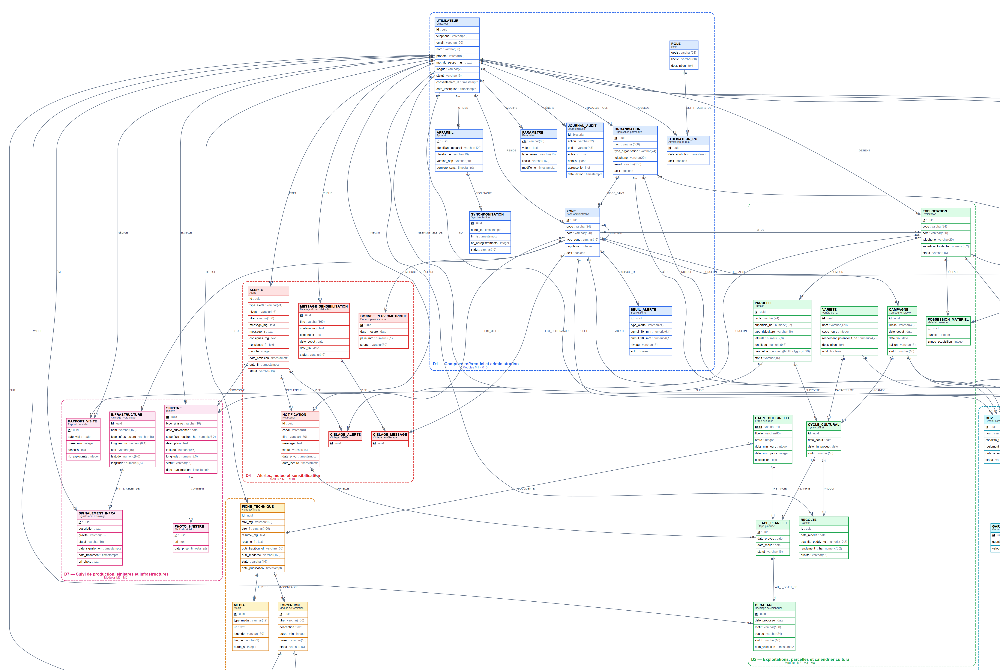
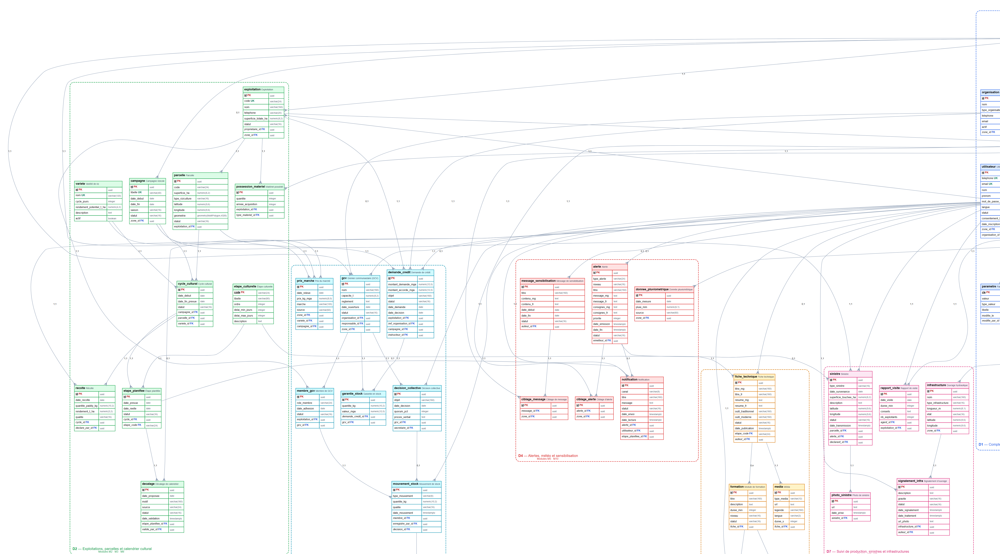

# Modélisation Merise — RizConnect Madagascar

Dossier de conception des données de la plateforme RizConnect, établi à partir du cahier
des charges [`hh.sh`](../hh.sh) (modules M1 à M10, règles RG-01 à RG-07).

| Document | Contenu | Diagramme |
| --- | --- | --- |
| [MCD.md](MCD.md) | Modèle conceptuel : 49 entités, 79 associations, dictionnaire des données | `images/mcd.svg` / `.png` |
| [MLD.md](MLD.md) | Modèle logique : 49 tables, 349 colonnes, contraintes, 99 index, vues | `images/mld.svg` / `.png` |
| [MCT.md](MCT.md) | Modèle conceptuel des traitements : 36 événements, 41 opérations, 9 cycles de vie | `images/mct.svg`, `images/mct-etats.svg` |
| [sql/schema.sql](sql/schema.sql) | DDL PostgreSQL 16 + PostGIS, index de performance et paramètres de stockage, généré depuis le modèle | — |

## Aperçu

### MCD



### MLD



### MCT


## Arborescence

```
docs/
├── README.md            ce fichier
├── MCD.md               modèle conceptuel de données
├── MLD.md               modèle logique de données
├── MCT.md               modèle conceptuel des traitements
├── images/              diagrammes exportés (SVG vectoriel + PNG)
│   ├── mcd.svg / mcd.png                  vue globale
│   ├── mcd-D1…D7.svg / .png               vues détaillées par domaine
│   ├── mld.svg / mld.png
│   ├── mct.svg / mct.png
│   ├── mct-1.svg / mct-2.svg              M1–M5 et M6–M10
│   └── mct-etats.svg / mct-etats.png      cycles de vie
├── sources/             sources Graphviz (.dot) et Mermaid (.mmd)
├── sql/                 script de création de la base
└── tools/               générateur (modèle unique → diagrammes + documents)
    ├── model.mjs        entités, associations, MCT, vues, index et paramètres de stockage
    ├── render.mjs       rendu DOT / Mermaid / SQL
    ├── build.mjs        génération des images et des documents
    └── templates/       gabarits Markdown
```

## Régénérer les diagrammes et les documents

Le modèle est saisi **une seule fois** dans `tools/model.mjs` ; tout le reste en est dérivé.

```bash
cd docs/tools
npm install
npm run build
```

Prérequis :

- Node.js 20 ou plus ;
- Google Chrome (ou Microsoft Edge) installé, utilisé en mode *headless* pour convertir
  les SVG en PNG. Les SVG restent disponibles si aucun navigateur n'est présent.

La génération réécrit `docs/MCD.md`, `docs/MLD.md`, `docs/MCT.md`, `docs/README.md`,
`docs/sql/schema.sql`, `docs/sources/*` et `docs/images/*`. Les parties rédigées à la main
doivent donc être modifiées dans `tools/templates/`, jamais directement dans les documents
générés.

## Conventions

- **Merise** pour le MCD et le MCT : entités, associations, cardinalités `(min,max)`,
  événements / opérations / synchronisations / résultats.
- **PostgreSQL** pour le MLD : `uuid`, `timestamptz`, `numeric`, `geometry(MultiPolygon,4326)`,
  contraintes `CHECK` pour les énumérations.
- Identifiants en français, au singulier, en `snake_case` dans la base, en majuscules dans
  le MCD.
- Chaque entité, association et exigence porte la référence du cahier des charges
  (`RF-xx`, `RG-xx`) qui la justifie.

## Performances

Le DDL n'est pas seulement structurel : il contient 44 index secondaires
(composites, partiels, couvrants, GiST, GIN, BRIN), des paramètres `fillfactor` et
d'autovacuum pour les tables les plus sollicitées, et l'index unique qui permet le
rafraîchissement concurrent de la vue matérialisée. Les choix sont justifiés un par un au
[§ 9 du MLD](MLD.md#9-index-et-performances) ; le mode d'emploi est dans
[`sql/README.md`](sql/README.md).
