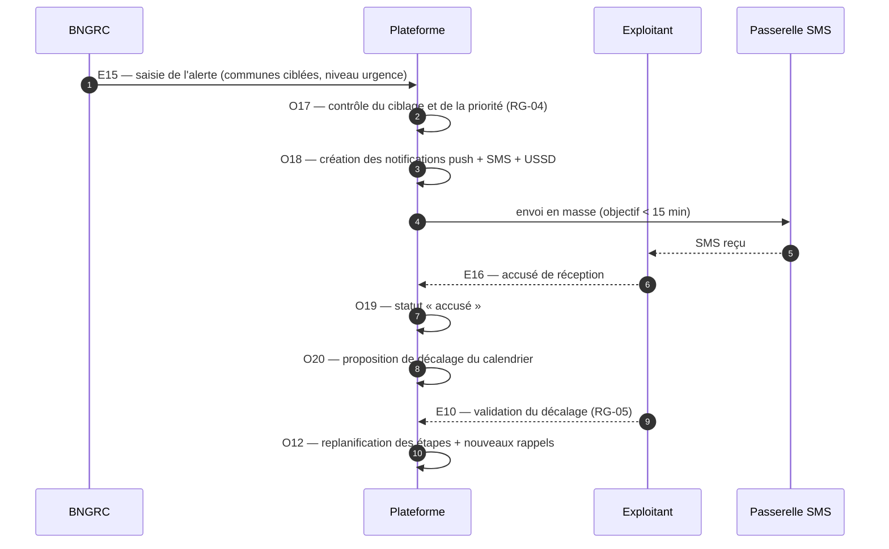
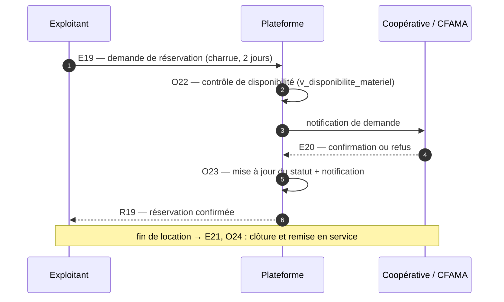
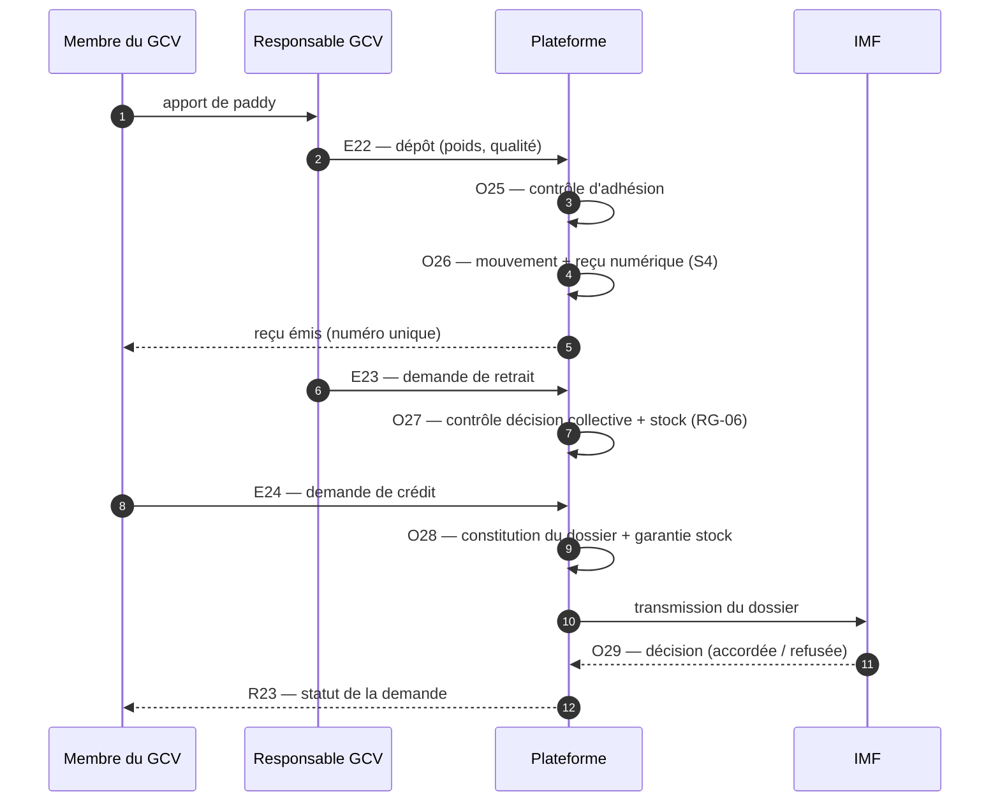
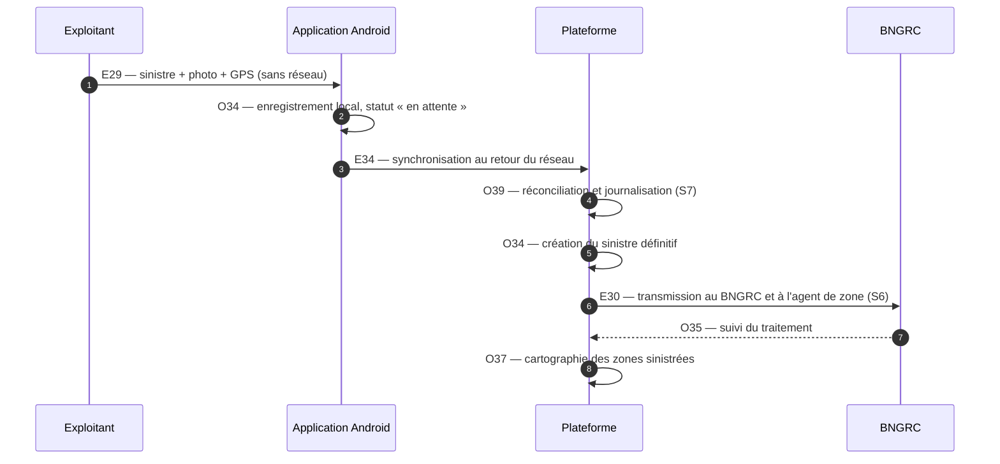

# MCT — Modèle Conceptuel de Traitements

**Projet :** RizConnect Madagascar · version 1.0
**Contenu :** {{COUNTS.EVENEMENTS}} événements, {{COUNTS.OPERATIONS}} opérations, 7 synchronisations, {{COUNTS.ETATS}} cycles de vie
**Documents liés :** [MCD](MCD.md) · [MLD](MLD.md)

---

## 1. Objet du document

Le MCD décrit les **données** ; le MCT décrit ce qui **les fait vivre**. Il répond à la
question : *quel événement, reçu par le système, déclenche quelle opération, sur quelles
entités, et avec quel résultat vérifiable ?*

Le MCT est volontairement indépendant de l'architecture : il ne dit pas si une opération
est exécutée par l'application Android, par l'API ou par une tâche planifiée. Il fixe en
revanche les **règles de synchronisation** entre opérations, qui deviendront des
transactions ou des files d'attente au moment de la conception détaillée.

---

## 2. Conventions Merise

| Symbole | Nom | Signification |
| --- | --- | --- |
| **E** | Événement | Fait observé par le système : message reçu, action d'un acteur, échéance de calendrier, retour du réseau |
| **O** | Opération | Traitement déclenché : vérification, calcul, création ou mise à jour d'entités |
| **▬** | Synchronisation | Barre qui fusionne plusieurs flux : les opérations en aval attendent que toutes les opérations en amont soient terminées |
| **R** | Résultat | État du système après traitement, exprimé en entités du MCD |
| `[…]` | Condition | Règle de déclenchement ou de branchement (ex. `[stock suffisant]`) |

Un événement peut être **externe** (saisie par un acteur, API météo), **temporel**
(tâche planifiée) ou **interne** (conséquence d'une opération précédente). Chaque
opération est atomique : elle laisse le système dans un état cohérent, même en cas
d'interruption (mode hors ligne, coupure réseau).

---

## 3. Diagramme des traitements

{{IMAGE_MCT}}

*Image : `docs/images/mct.png` ({{SIZES_MCT}}). Source Graphviz : `docs/sources/mct.dot`.
Chaque bloc correspond à un module du cahier des charges ; les flèches vont de l'événement
vers le résultat, en passant par les opérations et les barres de synchronisation.*

### 3.1 Vues par moitié du cahier des charges

Pour une lecture confortable, le même graphe est découpé en deux planches.

{{IMAGE_MCT1}}

*Modules M1 à M5 — `docs/images/mct-1.png` ({{SIZES_MCT1}}).*

{{IMAGE_MCT2}}

*Modules M6 à M10 — `docs/images/mct-2.png` ({{SIZES_MCT2}}).*

---

## 4. Événements

{{EVENEMENTS}}

### 4.1 Nature et fréquence des événements

| Type | Événements | Fréquence attendue | Contrainte de délai |
| --- | --- | --- | --- |
| Saisie utilisateur | E01, E03, E05–E07, E14, E19, E22–E24, E26, E29, E31 | continue | réponse < 3 s (exigence de performance) |
| Saisie institutionnelle | E12, E15, E25, E30 | quotidienne / à l'événement | alerte diffusée < 15 min (RG-04) |
| Temporel | E11 (rappel d'étape), E28 (clôture de campagne), E35 (sauvegarde) | tâche planifiée quotidienne | exécution entre 00:00 et 04:00 |
| Interne / système | E04, E08, E09, E10, E16–E18, E20, E21, E27, E32–E34, E36 | selon les flux | — |

---

## 5. Opérations

{{OPERATIONS}}

### 5.1 Règles de calcul portées par les opérations

| Opération | Formule / règle | Source |
| --- | --- | --- |
| O07 — superficie d'une parcelle | `aire(geometrie)` si tracé GPS, sinon saisie manuelle contrôlée (0,01–50 ha) | RF-08 |
| O10 — génération des étapes | `date_etape[n] = date_reelle[n-1] + delai_min_jours` ; sarclage 1 à J+8..J+10, sarclage 2 à J+14 minimum | RG-02, RG-03 |
| O11 — proposition de décalage | `nouvelle_date = date_prevue + retard_observe` où `retard_observe` provient de la pluie ou de l'alerte | RF-11 |
| O21 — déficit de pluie | `deficit_20j_pct = 100 × (1 − cumul_20j / seuil_20j)` | RF-25, vue `v_indicateur_pluie` |
| O22 — disponibilité matériel | `quantite − réservations confirmées sur la période` | RF-27, vue `v_disponibilite_materiel` |
| O27 — contrôle de retrait | `quantite_demandee ≤ stock_kg` **et** `decision_collective` présente | RG-06, vue `v_stock_gcv` |
| O31 — rendement | `rendement_t_ha = quantite_paddy_kg / 1000 / superficie_ha` | RF-37 |
| O33 — agrégats de campagne | `SUM(superficie_ha)`, `SUM(production_t)`, `AVG(rendement_t_ha)` par région et district | RF-38 |

---

## 6. Synchronisations

{{SYNCHROS}}

Les synchronisations S1 à S7 deviennent, dans l'implémentation, des **transactions SQL**
(S1, S2, S4, S5) ou des **files de messages idempotentes** (S3, S6, S7).

---

## 7. Cycles de vie des objets à statut

{{IMAGE_ETATS}}

*Image : `docs/images/mct-etats.png` ({{SIZES_ETATS}}). Chaque diagramme se lit de gauche
(état initial) vers la droite ; les transitions sont étiquetées par leur déclencheur.*

{{MERMAID_ETATS}}

{{ETATS_TABLES}}

---

## 8. Règles de déclenchement et contraintes temporelles

| Règle | Description | Mise en œuvre |
| --- | --- | --- |
| Déclenchement par échéance | Les rappels d'étapes sont émis le jour de `date_prevue` à 06:00 (heure de Madagascar) | tâche `O13`, index `idx_etape_planifiee_date_prevue` |
| Priorité d'alerte | Une alerte `cyclone` / niveau `urgence` interrompt la file des rappels et passe en tête | `alerte.priorite`, file prioritaire `O18` |
| Réessai de diffusion | Un envoi SMS en échec est retenté 3 fois (1 min, 5 min, 30 min), puis marqué `echec` | `notification.statut`, `O18` |
| Idempotence hors ligne | Une action rejouée avec le même identifiant d'appareil ne crée pas de doublon | `appareil.identifiant_appareil` + `synchronisation`, `O39` |
| Clôture de campagne | À la date de fin, les cycles non terminés passent en `abandonne` et les agrégats sont recalculés | `O33`, `E28` |
| Conservation | Journaux purgés après 12 mois, sauvegarde quotidienne conservée 30 jours | `O40` |

---

## 9. Scénarios déroulés

### 9.1 Alerte cyclonique (§ 3.12 du cahier des charges)

### 9.2 Location de matériel

### 9.3 Stockage collectif et crédit de campagne

### 9.4 Déclaration de sinistre hors ligne

---

## 10. Traçabilité des exigences

| Exigence | Événement(s) | Opération(s) | Résultat |
| --- | --- | --- | --- |
| RF-01 — inscription par SMS | E01, E04 | O01, O02, O05 | R01, R03 |
| RF-04 — inscription assistée | E02 | O03 | R01 |
| RF-09 à RF-13 — calendrier | E08–E11 | O09–O13 | R07–R10 |
| RF-17 — formation et quiz | E13 | O15 | R12 |
| RF-19 — recommandation | E14 | O16 | R13 |
| RF-20 à RF-24 — alertes | E15–E17 | O17–O20 | R14–R16 |
| RF-25 — déficit de pluie | E18 | O21 | R17 |
| RF-26 à RF-29 — matériel | E19–E21 | O22–O24 | R18–R20 |
| RF-31 à RF-33 — GCV et crédit | E22–E24 | O25–O29 | R21–R23 |
| RF-34 à RF-36 — prix et coûts | E25 | O30 | R24 |
| RF-37 — rendement | E26 | O31 | R25 |
| RF-38 à RF-41 — pilotage | E27, E28 | O32, O33 | R26, R27 |
| RF-42 à RF-45 — sinistres et ouvrages | E29–E32 | O34–O37 | R28–R31 |
| RF-46 à RF-50 — hors ligne et administration | E33–E36 | O38–O41 | R32–R35 |

---

## 11. Points ouverts

- La fréquence exacte des tâches planifiées (rappels, agrégats, sauvegardes) dépend de
  l'infrastructure retenue ; les SLA du cahier des charges (§ 4) servent de plafond.
- L'ordre de rejeu des écritures hors ligne (E34) doit être arbitré avec les coopératives :
  dernier écrivain gagnant ou fusion champ par champ.
- Les alertes issues du service météorologique supposent une convention d'interface (API
  ou fichier) encore à signer (§ 5 du cahier des charges).
